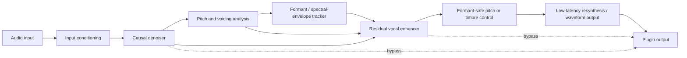

# NeuroChain: Low-Latency Formant-Preserving Neural Vocal Enhancement

## 1. Introduction

Real-time vocal enhancement sits at the intersection of two objectives that are often treated separately: improving the technical quality of a vocal signal and preserving the perceptual identity of the singer or speaker. Conventional processing can reduce noise, control dynamics, remove sibilance, shape spectral balance, and correct pitch with predictable computational cost. However, operations that modify pitch or spectral structure may also alter the vocal tract resonances—formants—that contribute strongly to vowel character, timbre, and perceived identity. Neural models offer new opportunities to estimate, separate, and resynthesize these attributes, but their benefits must be assessed against practical constraints: monitoring latency, causal operation, memory and compute requirements, plugin compatibility, and the risk that a model produces a cleaner but less authentic voice. The central premise of this report is that formant preservation should be treated as an explicit design and evaluation objective, rather than as an assumed by-product of high perceptual quality.

The report uses a source–filter perspective to organize the problem. In this view, the excitation generated by the vocal folds interacts with a time-varying vocal-tract filter whose resonances define much of the spectral envelope. Pitch correction primarily changes the excitation rate, whereas formant-preserving processing attempts to change or enhance the signal without moving—or while deliberately tracking and reconstructing—the relevant resonances. This distinction provides a common frame for comparing classic methods such as LPC, cepstral-envelope processing, PSOLA, and WORLD with neural approaches including DDSP, neural vocoders, speech-enhancement networks, voice-conversion systems, and differentiable DSP chains. It also clarifies an important boundary: the proposed system is not intended to replace every studio production tool or to perform unrestricted voice conversion. It targets low-latency enhancement for singing and speech, including live monitoring and plugin use, where intelligibility, cleanliness, pitch fidelity, and vocal identity must be balanced under a strict delay budget.

The literature review will therefore evaluate methods along several dimensions rather than ranking them by audio quality alone:

- **Signal behavior:** denoising and enhancement quality, pitch fidelity, spectral-envelope stability, and preservation of the first three formants.
- **Deployment behavior:** causal or non-causal operation, look-ahead, block and buffer requirements, model size, real-time factor, CPU/GPU dependence, and support for quantization or pruning.
- **Perceptual behavior:** intelligibility, naturalness, artifact suppression, and whether listeners identify the processed voice as the same singer or speaker.
- **Reproducibility:** dataset suitability, licensing, publicly available implementations, inference backends, and whether reported latency measurements include the complete audio path.

The remainder of the report follows this framework. It first establishes the acoustic and DSP foundations needed to define formant preservation and explain why naïve pitch shifting can compromise identity. It then compares neural methods by function and implementation properties, explicitly flagging cases in which latency or formant behavior depends on model configuration rather than on the method’s name. The subsequent sections translate the sub-10-ms live-monitoring target into architectural and deployment requirements for VST3, AU, and CLAP plugins, and define datasets, objective metrics, and listening tests for evaluating both enhancement and identity preservation. Finally, the report identifies the unresolved combination of low latency, high perceptual quality, and stable formants, and proposes NeuroChain as a modular sequence of small neural and signal-processing components. A three-month validation plan will test that proposal against classical and neural baselines through ablations, end-to-end latency measurements, and explicit success criteria.

## 2. Vocal Processing Foundations and Formant Preservation

### 2.1 The source–filter model and vocal identity

A useful starting point for NeuroChain is the **source–filter model**: voiced excitation generated by the vocal folds is shaped by the resonances of the vocal tract. In this abstraction, the excitation carries much of the periodicity, fundamental frequency \(F_0\), energy, and phonation character, while the vocal-tract transfer function determines the broad spectral envelope associated with vowels and timbre. The principal resonances of this envelope are the formants, conventionally denoted \(F_1,F_2,F_3,\ldots\). Formant locations are not merely spectral peaks; they are perceptually important cues to vowel identity and contribute to the singer-specific character that listeners often describe as vocal “color,” “ring,” or identity. Formant normalization and tracking are established analysis problems, including both intrinsic normalization within a speaker and extrinsic normalization across speakers or contexts. [1](#ref-cit-1-01 "citation")

A compact representation is

\[
x(t) \approx e(t;F_0,\text{phonation}) * h(t;F_1,F_2,F_3,\ldots),
\]

where \(e(t)\) is the excitation, \(h(t)\) is the vocal-tract impulse response, and \(*\) denotes convolution. In the frequency domain,

\[
X(\omega) \approx E(\omega)H(\omega).
\]

This factorization is an approximation rather than a strict physical decomposition: aspiration, turbulence, vocal-fold asymmetry, room acoustics, consonantal transients, and microphone coloration may not be cleanly assigned to only one component. Nevertheless, it defines the central engineering objective for formant-preserving enhancement: modify the excitation or undesired noise while avoiding unintended displacement or blurring of the spectral envelope \(H(\omega)\).

The distinction matters because ordinary vocal processing is generally **signal-oriented**, whereas formant preservation is **identity-oriented**. A conventional processor may improve intelligibility, loudness, or brightness without estimating the singer’s resonant structure. A processor intended for live enhancement must therefore treat the spectral envelope as a protected or explicitly controlled object rather than as incidental content.

### 2.2 What conventional vocal processing changes

Classic vocal chains remain important baselines because they are computationally inexpensive, predictable, and already integrated into studio and plugin workflows. Their limitations arise primarily when a processor changes pitch, dynamics, or spectral balance without modeling the source–filter relationship.

- **Equalization** applies frequency-selective gain. It can reduce low-frequency rumble, compensate for microphone coloration, improve intelligibility, or add presence. However, a broad EQ boost or cut can reinforce or suppress formant regions without knowing whether a peak is a desired vocal resonance, an unwanted room mode, or a sibilant component. EQ therefore changes the observed spectral envelope but does not, by itself, preserve or reconstruct vocal identity.
- **Compression** reduces dynamic range by applying gain that depends on signal level. It can stabilize a live vocal in a mix, but attack and release settings may reshape consonant transients, breathiness, and the relative prominence of vowel resonances. Compression is not inherently formant-destructive, but aggressive or poorly timed gain control can make the vocal timbre less natural.
- **De-essing** selectively attenuates high-frequency sibilance, usually in an identified high-frequency band or through a detector-driven gain reduction. This can improve perceived smoothness, but an overly broad or fast de-esser may remove fricative detail and alter consonant intelligibility. It should therefore be treated as a targeted suppression stage rather than a general spectral enhancement mechanism.
- **Pitch correction** modifies the estimated fundamental frequency trajectory toward a target scale or contour. In a conventional correction system, the desired operation is to alter \(F_0\) while retaining the singer’s vowel and timbral identity. The implementation challenge is that pitch and spectral-envelope information overlap in the observed waveform, especially for short analysis windows and rapidly changing sung phonemes.
- **Naïve pitch shifting** changes the frequency locations of the harmonic series and, when applied as a uniform time–frequency scaling, also moves the resonant envelope. If a spectrum is transformed approximately as \(X'(\omega)=X(\omega/\alpha)\), then both harmonic frequencies and formant peaks are displaced by the scale factor \(\alpha\). A pitch increase can consequently produce a smaller-vowel or “chipmunk-like” impression, while a pitch decrease can make the voice sound unnaturally dark or enlarged. The central problem is therefore not pitch modification itself, but the failure to decouple the excitation trajectory from the vocal-tract envelope. [2](#ref-cit-1-04 "citation")

The desired operation can be expressed conceptually as

\[
F_0(t)\rightarrow \widetilde{F}_0(t),
\qquad
H(\omega,t)\rightarrow H(\omega,t),
\]

rather than applying the same frequency transformation to both. In practice, exact invariance is neither always possible nor always desirable: singers naturally modify formants with pitch, loudness, vowel articulation, register, and vocal technique. NeuroChain should therefore target **controlled preservation**—avoiding unintended global formant displacement while allowing measured, musically plausible changes.

### 2.3 Classical formant-preservation strategies

Traditional methods address the source–filter problem by estimating a spectral envelope, manipulating pitch-synchronous excitation, or using a structured vocoder representation. Their chief advantage is interpretability: the system exposes \(F_0\), envelope, aperiodicity, or resonant-filter parameters that can be inspected and constrained.

#### LPC and spectral-envelope estimation

Linear predictive coding (LPC) models a short-time speech or singing frame as the output of an all-pole filter driven by an excitation. The prediction filter approximates the vocal-tract response, and its poles provide a compact description of resonant structure. A pitch-shifting processor can estimate the LPC envelope, alter the excitation period, and resynthesize through the original or a separately modified filter. This is attractive for NeuroChain because the representation directly separates a pitch-related component from an envelope-related component.

The main boundary condition is analysis reliability. LPC assumes that a relatively low-order filter can represent the relevant spectral structure over a short frame. Strong consonants, breathy phonation, creaky voice, vocal fry, noisy recordings, and rapidly changing vowels can violate this approximation. Pole tracking can also become unstable or produce spurious resonances when the input is noisy or under-resolved. LPC should therefore be evaluated not only by average formant error but also by failure rate on transitions and non-modal phonation.

#### Cepstral spectral envelopes

Cepstral analysis separates slowly varying spectral-envelope information from fine harmonic structure by transforming the log magnitude spectrum into the cepstral domain. Low quefrency coefficients can represent a smoothed envelope, while higher-quefrency components capture finer harmonic detail. A pitch-shifting system can estimate the envelope, transform the excitation-related component, and reapply the envelope during synthesis.

Compared with raw-bin spectral interpolation, cepstral smoothing is less likely to mistake individual harmonics for formants. Its trade-off is that the smoothing cutoff and frame length are consequential: excessive smoothing can erase narrow resonances or singer-specific detail, whereas insufficient smoothing leaves pitch-dependent structure in the envelope. As with LPC, a static envelope estimate is inadequate for fast sung articulation; the envelope must be tracked over time and interpolated without introducing modulation artifacts.

#### PSOLA and pitch-synchronous processing

Pitch-Synchronous Overlap-Add (PSOLA) manipulates waveform segments centered on estimated glottal or pitch-synchronous marks. Pitch can be changed by altering the spacing and overlap of these segments, while preserving the local waveform shape and, in favorable conditions, much of the original spectral envelope. This makes PSOLA computationally attractive for low-latency processing and useful as a classical baseline.

Its dependence on reliable pitch marks is also its principal weakness. The method can degrade on unvoiced consonants, polyphonic or noisy mixtures, breathy singing, rapid vibrato, octave errors, and transitions where the notion of a single stable period is ambiguous. The evidence retrieved for this review does not include a dedicated modern arXiv paper specifically establishing PSOLA formant preservation; accordingly, its role here should be treated as classical signal-processing background rather than as a claim supported by a modern formant-preservation benchmark. [2](#ref-cit-1-04 "citation")

#### WORLD vocoder

WORLD uses a structured decomposition of speech or singing into fundamental frequency, spectral envelope, aperiodicity, and energy. This factorization is well matched to formant-preserving pitch transformation: \(F_0\) can be modified while the spectral envelope is retained or smoothly adjusted. It also provides an interpretable reference implementation for separating periodic excitation, vocal-tract resonances, and noise-like components.

WORLD’s limitation is not conceptual separation but analysis and synthesis fidelity under difficult conditions. Singing has wide pitch excursions, expressive loudness changes, consonant transitions, and phonation modes that can challenge vocoder assumptions. Errors in \(F_0\), envelope estimation, or aperiodicity tracking may produce buzziness, transient smearing, or unstable vowels. Nevertheless, WORLD is a valuable baseline because it makes the intended control variables explicit and provides a stronger comparison than a naïve global pitch shift.

The classical methods can therefore be summarized as follows:

| Method | Primary representation | Formant-preservation mechanism | Main failure conditions | Relevance to NeuroChain |
|---|---|---|---|---|
| LPC | All-pole vocal-tract filter plus excitation | Retain or independently modify the estimated filter | Noisy, breathy, transitional, or poorly modeled frames | Interpretable envelope baseline |
| Cepstral envelope | Smoothed log-spectrum | Separate low-quefrency envelope from harmonic detail | Poor smoothing choice; rapidly changing vowels | Lightweight envelope estimator |
| PSOLA | Pitch-synchronous waveform segments | Change segment timing while retaining local waveform structure | Pitch-mark errors, unvoiced sounds, vibrato, noise | Low-compute pitch baseline |
| WORLD | \(F_0\), envelope, aperiodicity, energy | Modify \(F_0\) while retaining envelope | Analysis errors and vocoder artifacts | Structured reference and ablation baseline |
| Naïve spectral pitch shift | Uniform frequency transformation | No explicit separation | Formants move with harmonics | Negative control demonstrating identity loss |

### 2.4 Implications for a neural system

The classical review suggests that NeuroChain should not ask a single neural network to “make the voice better” without constraints. The system should instead expose, estimate, or regularize the variables that determine vocal identity:

1. **Estimate \(F_0\) and voicing confidence.** Pitch correction or excitation enhancement should be gated by confidence, particularly during consonants and weak phonation.
2. **Estimate the time-varying spectral envelope.** The envelope may be represented by LPC coefficients, cepstral coefficients, formant tracks, a differentiable filter bank, or a learned latent constrained by reconstruction.
3. **Process noise and dynamics separately from identity-sensitive structure.** Denoising, compression-like gain control, and de-essing should avoid unnecessarily modifying \(F_1\)–\(F_3\).
4. **Resynthesize with an explicit identity path.** The original or corrected envelope should be supplied to the synthesis stage rather than left for an unconstrained generator to infer.
5. **Measure both enhancement and preservation.** A system that improves noise suppression but shifts formants should not be considered successful.

Recent neural work reinforces the value of explicit or controllable spectral structure. HiFi-Glot uses differentiable resonant filters for controllable neural formant synthesis, while other work addresses formant estimation and tracking with probabilistic heat maps. [1](#ref-cit-1-01 "citation") DDSP-based singing work similarly uses a harmonic source filtered by a time-varying finite impulse response filter, an architecture that makes the source–filter relationship operational rather than purely descriptive. [3](#ref-cit-1-02 "citation") These approaches do not by themselves establish that a low-latency live processor will preserve a particular singer’s formants under all conditions; they instead motivate an architecture in which resonance control is explicit and testable.

A practical design principle follows:

\[
\mathcal{L}_{\text{total}}
=
\mathcal{L}_{\text{audio}}
+
\lambda_{\text{env}}\mathcal{L}_{\text{envelope}}
+
\lambda_{\text{form}}\mathcal{L}_{F_1:F_3}
+
\lambda_{\text{lat}}\mathcal{L}_{\text{latency}},
\]

where \(\mathcal{L}_{\text{audio}}\) measures reconstruction or enhancement quality, \(\mathcal{L}_{\text{envelope}}\) penalizes spectral-envelope distortion, \(\mathcal{L}_{F_1:F_3}\) penalizes unintended formant displacement, and \(\mathcal{L}_{\text{latency}}\) represents deployment constraints. The weights should not be assumed universal: a classical singer, pop vocalist, spoken-word performer, and heavily effected live input may require different preservation tolerances.

### 2.5 Boundary conditions and unresolved questions

Formant preservation is not equivalent to freezing three frequency values. First, formants are time-varying and coupled to articulation; preserving a singer’s identity may require preserving trajectories, bandwidths, relative amplitudes, and transitions rather than only the instantaneous locations of \(F_1\), \(F_2\), and \(F_3\). Second, pitch and formants are perceptually entangled: a pitch change that leaves the measured envelope fixed may still sound unnatural if the result is outside the singer’s normal register or vowel-production behavior. Third, the input may contain reverberation, backing instruments, microphone coloration, or multiple voices, in which case the “true” vocal envelope is not directly observable.

The evidence available for this section supports the source–filter framing, formant tracking and normalization, differentiable resonant filtering, and neural singing-vocoder directions, but it does not provide a unified modern benchmark comparing LPC, cepstral methods, PSOLA, WORLD, and neural systems under the same low-latency formant-preservation protocol. [1](#ref-cit-1-01 "citation") [3](#ref-cit-1-02 "citation") Consequently, NeuroChain should treat the classical algorithms not as obsolete alternatives but as diagnostic baselines: if a neural module cannot outperform or substantially reduce the artifacts of an explicit source–filter baseline at comparable latency, its additional complexity is not yet justified.

## 3. Neural Methods for Enhancement, Synthesis, and Voice Conversion

Neural methods for vocal processing should be distinguished by the signal representation they learn and by the degree of control retained by the processing chain. A model that generates a high-quality waveform is not automatically suitable for live enhancement: it may require future context, introduce algorithmic delay, obscure the vocal-tract envelope, or replace rather than enhance the singer’s original voice. For NeuroChain, the relevant design principle is therefore **controlled neural processing**: use learned models where they improve denoising, analysis, or perceptual reconstruction, while retaining explicit control over \(F_0\), the spectral envelope, and the processing latency.

The formant-preservation objective can be expressed through the source–filter decomposition

\[
x(t) \approx e(t;F_0,\text{voicing}) * h(t;F_1,F_2,F_3,\ldots),
\]

where \(e(t)\) is the excitation and \(h(t)\) is the vocal-tract response. A pitch transformation should primarily modify the excitation trajectory \(F_0(t)\), while preserving or deliberately transforming the envelope \(H(f,t)\). In practice, a neural model may learn this separation implicitly, but implicit separation is not sufficient evidence of formant preservation. It must be tested against formant trajectories, spectral-envelope distance, and listener judgments of identity and vowel quality.

### 3.1 Neural vocoders and DDSP-based synthesis

Neural vocoders reconstruct a waveform from an intermediate representation such as acoustic features, a latent code, or a source–filter description. Their principal advantage is perceptual quality: they can model nonlinear excitation, phase behavior, and waveform details that are difficult to reproduce with a conventional vocoder. Their principal risk for NeuroChain is that waveform generation can become a voice-replacement operation rather than a transparent enhancement operation. The retrieved literature includes neural analyzers for speech and singing, singing-specific neural vocoders, and hierarchical diffusion vocoders designed to accommodate singing’s broad pitch, loudness, and pronunciation variation [3](#ref-cit-1-02 "citation").

**DeepA** is relevant because it frames analysis itself as a learned problem. Nikonorov, Sisman, Zhang, and Li describe a deep neural analyzer for speech and singing vocoding, motivated in part by the limited generalizability of conventional signal-processing vocoders [3](#ref-cit-1-02 "citation"). This is potentially useful for a NeuroChain analysis module, particularly when LPC or hand-designed spectral representations become unreliable on expressive singing. However, the available evidence does not establish DeepA’s causal structure, model size, end-to-end delay, or suitability for sub-10-ms monitoring. It should therefore be treated as an analysis reference rather than as a deployment-ready real-time component.

The singing-specific neural-vocoder literature also includes hierarchical diffusion models and CNN-based singing synthesis. Hierarchical diffusion targets the variation in pitch, loudness, and pronunciation that makes singing more difficult than ordinary speech [3](#ref-cit-1-02 "citation"). ConSinger similarly addresses the inference cost of diffusion-based singing generation by seeking high-fidelity generation with minimal diffusion steps [3](#ref-cit-1-02 "citation"). These systems are valuable quality references, but generation speed should not be equated with live-monitoring latency: a model can reduce the number of diffusion steps while still requiring substantial context or producing a complete segment rather than a continuously causal stream. The evidence supplied here does not provide verified latency, parameter count, or formant-error measurements for either system.

DDSP offers a more controllable alternative. In the cited SawSing work, harmonic singing components are synthesized by filtering a sawtooth source with a time-varying finite-impulse-response filter [3](#ref-cit-1-02 "citation"). This structure is attractive for formant preservation because the source and the time-varying filter have distinct roles: \(F_0\) can be controlled through the source, while resonant structure can be represented by the filter. The distinction is important, but it does not guarantee that a learned filter will preserve the original singer’s formants. A model trained to synthesize plausible singing may smooth, shift, or normalize resonances unless its loss explicitly penalizes formant displacement.

A related direction is differentiable resonant filtering. HiFi-Glot uses differentiable resonant filters for controllable neural formant synthesis [1](#ref-cit-1-01 "citation"). This provides a direct architectural precedent for representing formants as controllable resonances rather than leaving the entire spectral envelope to an unconstrained generator. For NeuroChain, a practical implication is to expose \(F_1\)–\(F_3\), bandwidths, and gain as interpretable intermediate variables, even if a neural estimator supplies them. This makes it possible to constrain enhancement strength and to bypass the learned resynthesis path when confidence is low.

### 3.2 Speech-enhancement models

Speech-enhancement systems generally estimate a cleaner waveform, mask, filter, or spectral representation from a degraded input. They are closer to NeuroChain’s enhancement goal than a voice-conversion system because the desired output should retain the input speaker. Nevertheless, speech enhancement and singing enhancement are not interchangeable. Sustained vowels, vibrato, wide pitch excursions, breathiness, consonant timing, and accompaniment leakage change the statistics of the problem. The search evidence explicitly identifies a domain-mismatch gap: recent work considers adapting speech-enhancement models to singing, suggesting that singing-domain enhancement remains comparatively underexplored [4](#ref-cit-5-06 "citation").

The strongest candidate role for a speech-enhancement model is therefore a **front-end denoiser or dereverberation module**, not the final identity-preserving synthesizer. A causal or streaming enhancement model can suppress stationary noise and moderate interference before pitch and formant analysis. However, aggressive suppression can remove breath noise, consonant transients, or high-frequency singer cues that contribute to identity. This trade-off should be measured separately from waveform quality: a cleaner signal is not necessarily a more identity-preserving signal.

The retrieved enhancement evidence spans generative, audio-visual, restoration, and task-oriented approaches. HL-StarGAN combines a discriminator, classifier, metric-assessment predictor, and generator for face-masked speech [5](#ref-cit-5-02 "citation"). Audio-visual conditional-VAE enhancement uses probabilistic speech priors and can be trained without paired clean/noisy speech [5](#ref-cit-5-02 "citation"). DBP-Net addresses noise, reverberation, and bandwidth degradation through a dual-branch parallel architecture [5](#ref-cit-5-02 "citation"). These results broaden the design space, but none of the supplied evidence verifies that these systems are causal, small enough for a VST3/AU/CLAP plug-in, or evaluated for singing-formant preservation. They should therefore be considered architectural references rather than direct baselines until their implementations are profiled.

A useful deployment distinction is between three output types:

| Enhancement output | Typical control | Formant-preservation implication | NeuroChain role |
|---|---|---|---|
| Time–frequency mask | Attenuates selected regions of a spectrogram | Can preserve formants if masks do not suppress resonant bands, but may create musical noise or vowel coloration | Conservative denoising baseline |
| Complex spectral filter | Estimates magnitude and phase modification | More expressive, but can shift resonance peaks or introduce phase artifacts | Candidate low-latency enhancer |
| Waveform generator | Directly synthesizes the cleaned waveform | Potentially highest quality, but identity and formant retention must be explicitly verified | Optional high-quality path, not the initial safety path |

The available evidence does not supply verified latency or parameter counts for particular enhancement systems. Consequently, claims that a named model is “real time” should be treated as implementation-dependent. Causality depends on the receptive field, look-ahead, overlap-add design, and whether the published model was trained and evaluated with future context. A compact model can still violate the live-monitoring budget if it requires a long analysis window or repeated iterative inference.

### 3.3 Voice conversion and singing-voice synthesis

Voice-conversion systems are designed to alter speaker identity or vocal characteristics while retaining linguistic or musical content. The NU Voice Conversion System is identified in the retrieved evidence as a voice-conversion reference [6](#ref-cit-5-03 "citation"). Singing-voice synthesis systems by Nakamura et al. use CNNs conditioned on musical-score and acoustic-feature sequences, while a related system emphasizes fast, high-quality generation [6](#ref-cit-5-03 "citation"). ConSinger targets efficient, high-fidelity singing generation with minimal diffusion steps [6](#ref-cit-5-03 "citation").

These systems are relevant to NeuroChain as upper-bound quality and identity-transformation references, but they are not equivalent to transparent vocal enhancement. In a conversion system, changing timbre may be the intended behavior; in NeuroChain, changing timbre is generally an error unless explicitly requested. A converted output can sound natural while nevertheless moving the singer’s formants toward the training distribution or target voice. Therefore, speaker-similarity scores or perceptual naturalness alone cannot establish preservation of the input singer’s formants.

For the same reason, RVC and so-vits-svc should be evaluated as **conversion baselines**, not assumed to be enhancement baselines. The supplied evidence does not provide verified measurements for their latency, model size, causal operation, or formant preservation. Any real-time claim for such systems is implementation-dependent and must be tested under the exact inference configuration, including chunk size, overlap, device, precision, and any pitch extractor used. The central research question is not whether conversion can produce a plausible singing voice, but whether a system can retain the original singer’s spectral envelope while improving noise, pitch, or intelligibility.

### 3.4 Differentiable DSP chains

Differentiable DSP combines trainable components with explicit signal-processing operations. This approach is particularly suitable for NeuroChain because it permits the model to learn difficult control decisions while preserving interpretable operations such as filtering, pitch-synchronous synthesis, dynamics processing, and resonant filtering. Steinmetz, Bryan, and Reiss use a neural network to infer audio-effect controls from an input and a style-reference recording, after which differentiable signal processing renders the target style [7](#ref-cit-1-03 "citation"). The cited work supports a general control-inference pattern: the neural component predicts parameters, while the DSP component remains responsible for the final signal transformation.

This separation offers three benefits. First, controls such as gain, filter coefficients, and resonance locations can be bounded to prevent unstable or implausible behavior. Second, the DSP path can provide a deterministic fallback when the neural estimate is uncertain. Third, module-level latency can be measured independently instead of treating a monolithic waveform network as an opaque block. The limitation is equally important: differentiability does not imply causality, low latency, or formant preservation. A differentiable graph may still contain noncausal analysis, large look-ahead, iterative optimization, or a learned control objective that rewards perceptual similarity at the expense of identity. The retrieved evidence explicitly cautions that differentiable-DSP research does not itself guarantee causal execution or vocal-formant preservation [6](#ref-cit-5-03 "citation") [8](#ref-cit-5-05 "citation").

### 3.5 Comparative assessment for NeuroChain

The following table summarizes what can be concluded from the retrieved evidence. “Unknown” is intentional: no latency, parameter-count, or causality number should be fabricated where the evidence does not report one.

| Method family / example | Primary role | Latency and model-size status in retrieved evidence | Causal or non-causal status | Formant-preservation behavior |
|---|---|---|---|---|
| DeepA | Learned analysis for speech and singing vocoding | Not reported in the supplied evidence | Not established | Potentially useful for separating analysis variables, but no supplied formant-preservation result |
| CNN singing synthesis | Score/acoustic-feature-conditioned singing generation | Fast generation is a stated goal for one CNN system, but no verified plug-in latency or model size is supplied [6](#ref-cit-5-03 "citation") | Not established | Generates expressive singing; preservation of a live singer’s original \(F_1\)–\(F_3\) is not established |
| Hierarchical diffusion singing vocoder | High-quality singing waveform generation | Diffusion inference is generally a concern; supplied evidence gives no deployment measurement [3](#ref-cit-1-02 "citation") | Not established | Models singing variation, but no direct formant-retention result is supplied |
| ConSinger | Efficient high-fidelity singing generation | Minimal diffusion steps are an explicit goal, not a verified sub-10-ms result [3](#ref-cit-1-02 "citation") | Not established | Fidelity is targeted; preservation of an input singer’s formants is not established |
| DDSP / SawSing | Structured harmonic singing synthesis | Potentially efficient because synthesis uses a source and time-varying FIR filter, but no measured latency or model size is supplied [3](#ref-cit-1-02 "citation") | The cited evidence does not establish the complete inference schedule | Explicit source/filter structure is favorable to formant control, but learned-filter retention must be measured |
| HiFi-Glot-style differentiable resonant filters | Controllable formant synthesis | No deployment measurement supplied | Not established | Directly represents resonant formants and is therefore promising for controllability [1](#ref-cit-1-01 "citation") |
| Speech-enhancement networks | Noise, reverberation, or bandwidth restoration | Model-specific latency and size are not supplied | Depends on receptive field and implementation | May preserve formants when conservative, but enhancement losses do not guarantee singer-identity retention |
| Voice conversion, including NU VC and comparable systems | Timbre or speaker transformation | No verified latency or model size supplied for this section [6](#ref-cit-5-03 "citation") | Not established | Naturalness or target-speaker similarity does not establish preservation of the source singer’s formants |
| Differentiable DSP chain | Neural control of explicit DSP | Can be made modular, but differentiability alone provides no latency guarantee [6](#ref-cit-5-03 "citation") [8](#ref-cit-5-05 "citation") | Must be designed explicitly | Best suited to constrained formant-preserving processing, provided the loss and controls enforce it |

The table exposes the principal methodological gap: most families have evidence for either synthesis quality, analysis flexibility, or enhancement capability, but not for all three requirements simultaneously. In particular, the supplied evidence does not establish that any listed neural vocoder or conversion system simultaneously provides sub-10-ms end-to-end monitoring latency, causal operation, preservation of the input singer’s \(F_1\)–\(F_3\), and perceptually convincing enhancement.

### 3.6 Recommended role assignment in NeuroChain

NeuroChain should initially avoid a monolithic neural vocoder and instead assign neural methods to bounded functions:

1. **Neural denoising:** use a small enhancement model as a conservative front end. Its output should be residual or filtered enhancement rather than an unconstrained replacement waveform.
2. **Pitch and formant analysis:** estimate \(F_0\), voicing, and \(F_1\)–\(F_3\), with confidence values. Formant tracking is a distinct technical problem; probabilistic heat-map estimation has been proposed for formant estimation and tracking [1](#ref-cit-1-01 "citation").
3. **Structured enhancement:** predict gains, filter coefficients, or resonant-filter controls rather than directly rewriting the entire voice.
4. **Optional resynthesis:** use a DDSP- or resonant-filter-based path only when the analysis confidence is high and the added latency is acceptable.
5. **Fallback DSP:** bypass the neural resynthesis path during unvoiced consonants, rapid vowel transitions, low-confidence frames, or computational overload.

This architecture treats formant preservation as an explicit invariant rather than an emergent side effect. A suitable training objective would combine enhancement and identity terms, for example

\[
\mathcal{L}
=
\lambda_{\mathrm{audio}}\mathcal{L}_{\mathrm{audio}}
+
\lambda_{\mathrm{env}}\,D_{\mathrm{env}}(H_{\mathrm{out}},H_{\mathrm{ref}})
+
\lambda_{\mathrm{form}}\sum_{k=1}^{3}
\left\lVert F_{k,\mathrm{out}}-F_{k,\mathrm{ref}}\right\rVert_1
+
\lambda_{\mathrm{lat}}\mathcal{L}_{\mathrm{latency}},
\]

where \(D_{\mathrm{env}}\) measures spectral-envelope deviation and the reference envelope is taken from the clean or minimally processed input. The latency term should not be treated as a differentiable proxy alone: hard profiling on the target CPU and plug-in host remains necessary.

The unresolved questions are therefore empirical. It remains unclear whether a small causal enhancement model can suppress live-performance noise without attenuating singer-specific resonances; whether a learned formant tracker remains stable under vibrato and rapid vowel transitions; whether DDSP-style resynthesis improves quality enough to justify its additional delay; and whether neural conversion models can be constrained to preserve the source envelope rather than merely producing a plausible target voice. These questions motivate the baselines and ablations in the subsequent research plan, with every real-time and formant-preservation claim requiring measurement under the same host block size, hardware, precision, and audio material.

## 4. Real-Time Constraints, Plugin Deployment, and Reproducibility

NeuroChain should treat “real time” as an end-to-end systems property rather than as a property of the neural network alone. The target for live monitoring is a round-trip latency below 10 ms, but the model’s inference time is only one component of that budget: input and output buffers, audio-interface and converter delay, host scheduling, plugin processing, model look-ahead, and the complete monitoring path all contribute. Practical latency guidance identifies buffer size, interface/converter delay, plugin delay, CPU load, and look-ahead as separate contributors; at 48 kHz, a 128-sample buffer already represents approximately 2.67 ms for one buffer before the remainder of the round trip is counted. [9](#ref-cit-2-04 "citation") Consequently, a model that runs in less than 1 ms can still fail the live-use requirement if it is embedded in a host configured with large buffers or if its processing path introduces substantial look-ahead.

### 4.1 Latency target and budget

At a sampling rate \(f_s\), the duration of an audio block containing \(B\) samples is

\[
T_{\mathrm{block}}=\frac{B}{f_s}.
\]

Thus, at 48 kHz, a 128-sample block is approximately 2.67 ms and a 64-sample block is approximately 1.33 ms. These are block durations, not complete end-to-end latency values. [9](#ref-cit-2-04 "citation") A useful engineering decomposition is

\[
T_{\mathrm{RT}} =
T_{\mathrm{in}}+
T_{\mathrm{ADC}}+
T_{\mathrm{host}}+
T_{\mathrm{plugin}}+
T_{\mathrm{lookahead}}+
T_{\mathrm{DAC}}+
T_{\mathrm{out}},
\]

where \(T_{\mathrm{plugin}}\) includes feature extraction, neural inference, post-processing, and resynthesis. The project should report both the measured round-trip value \(T_{\mathrm{RT}}\) and each measurable component, rather than reporting only neural inference time.

A first implementation should therefore reserve a strict processing budget inside the broader 10-ms target. For example, a 64- or 128-sample host block can provide the scheduling granularity, while the neural module operates on smaller internal hops if necessary. The exact allocation must be measured on the target machine and interface; the retrieved evidence does not provide reliable, directly comparable end-to-end latency benchmarks for neural audio systems. [10](#ref-cit-2-03 "citation") The proposed budget below is consequently a design target, not an established benchmark:

| Processing component | Proposed design target | Constraint and rationale |
|---|---:|---|
| Input/output and host buffering | Minimize through 64–128 sample operation at 48 kHz | 64 samples correspond to 1.33 ms and 128 samples to 2.67 ms per block, but neither equals round-trip latency. [9](#ref-cit-2-04 "citation") |
| Feature extraction and pitch/formant analysis | Approximately 0.5–1.5 ms of compute, with bounded state | Use streaming state and avoid recomputing overlapping history. |
| Denoising/enhancement inference | Approximately 1–2 ms of compute | Prefer compact causal models; benchmark worst-case, not only mean time. |
| Neural or DSP resynthesis | Approximately 1–2 ms of compute | Avoid future-dependent synthesis in the live path. |
| Safety margin | At least several milliseconds of the total target | Accommodates host scheduling, CPU contention, and transient load. |
| Total round trip | \(<10\) ms target | Must be measured through the complete interface–host–plugin–interface path. |

The table is intentionally conservative about numerical allocations: only the block-duration values are directly established by the evidence, while the per-module compute targets are proposed engineering limits requiring validation. A system that uses a 20–40 ms analysis window is not automatically noncausal if it processes only samples available up to the current time, but it will have different transient behavior from a short-window system. [9](#ref-cit-2-04 "citation") The design must therefore distinguish *causality* from *latency*: a long causal stateful window can avoid future samples while still producing sluggish onset response or delaying reliable pitch and formant estimates.

### 4.2 Causal and streaming architecture

Causal streaming operation is essential for live vocal enhancement because future samples cannot be used without adding look-ahead. [9](#ref-cit-2-04 "citation") NeuroChain should maintain state across blocks for the STFT, feature normalization, recurrent layers, pitch tracking, formant tracking, and resynthesis filters. The processing graph should accept arbitrary host block sizes while maintaining a fixed internal hop, because VST3, AU, and CLAP hosts may not deliver audio in the same block configuration. Any adapter between host blocks and internal hops must use preallocated ring buffers and deterministic state transitions rather than allocating memory on the audio thread.

A suitable live path is:

The model should not use centered STFT frames, bidirectional recurrent layers, noncausal convolutions, or a vocoder requiring future context on the strict monitoring path. A bidirectional or diffusion-based model may be evaluated as an offline or deliberately delayed reference, but it should not be presented as satisfying the sub-10-ms live requirement unless its complete look-ahead and round-trip delay are explicitly included. Neural vocoders can also introduce artifacts that are sufficiently systematic to support detection of synthesized speech, illustrating that waveform-generation quality and causal deployability are separate concerns. [11](#ref-cit-2-01 "citation")

The practical consequence is a two-path design. The **live path** should contain only bounded-causality modules: lightweight denoising, pitch/formant tracking, modest spectral-envelope correction, and a low-cost resynthesizer. A **quality path** may use larger context or noncausal processing for recording, offline rendering, or a monitoring mode with user-selected latency. This separation prevents a high-quality but delayed model from silently violating the live-monitoring contract.

### 4.3 CPU, GPU, and worst-case execution

CPU inference is the default target for a plugin because it avoids GPU wake-up, device-transfer, driver, and synchronization overheads that can be unpredictable at small audio blocks. GPU execution may be useful for offline rendering or unusually large models, but it should not be assumed to improve live latency merely because the GPU has higher peak throughput. The relevant measure is worst-case deadline compliance: every processing block must finish before the host requests the next block.

The audio thread should therefore avoid dynamic allocation, blocking locks, filesystem access, network access, and lazy model initialization. Model loading, graph construction, memory mapping, and backend selection should occur during plugin construction or an explicit preparation phase. The runtime should expose a bounded failure mode—such as bypass or a stable DSP fallback—if inference exceeds its deadline. Mean CPU utilization is insufficient evidence of real-time safety; the evaluation should record maximum processing time, deadline misses, underruns, and behavior under concurrent host activity.

Quantization and pruning are appropriate deployment tools, but they involve trade-offs. Lower-precision weights can reduce memory traffic and improve CPU throughput, while pruning can reduce arithmetic cost if the target backend exploits the resulting sparsity. Neither technique guarantees lower end-to-end latency: unsupported operators, dequantization overhead, irregular sparse kernels, or a backend fallback can erase the expected gain. Each compressed model should therefore be compared against its full-precision version using the same machine, block size, thread count, and audio workload. Quality checks must include formant error and spectral-envelope distance, because a small speed improvement is not a successful optimization if it changes singer identity or vowel structure.

### 4.4 Plugin deployment strategy

The audio-plugin ABI should be separated from the neural-inference implementation. A practical architecture is a native C++ DSP core wrapped by VST3, AU, and CLAP entry points, with model weights either embedded into the binary or loaded from a versioned model package. ONNX Runtime is a plausible portable backend because it targets CPU, NVIDIA CUDA, and edge/mobile platforms, but the retrieved evidence does not establish a direct ONNX-Runtime-to-VST3 deployment workflow or confirm the runtime’s license. Those details must be checked against the exact runtime release and dependency notices shipped with the product. [12](#ref-cit-3-06 "citation")

RTNeural is a stronger candidate when predictable CPU execution is more important than broad model compatibility. It is an open-source library designed for real-time neural inference and audio processing, supports models originating in PyTorch or TensorFlow, and provides examples of integration into real-time audio plugins. Its repository uses the BSD 3-Clause license. [13](#ref-cit-3-02 "citation") A compact NeuroChain module can therefore be trained in a general machine-learning framework, exported to a supported RTNeural representation, and executed without the graph-management and backend complexity of a general-purpose runtime. Unsupported layers or larger architectures would require extending RTNeural or moving to ONNX Runtime or libtorch, followed by explicit tests for thread safety, allocation behavior, binary size, and deadline compliance. [13](#ref-cit-3-02 "citation")

The deployment options have different risk profiles:

| Backend path | Main advantage | Main risk or unresolved issue | Appropriate NeuroChain use |
|---|---|---|---|
| RTNeural | Designed for real-time audio inference; BSD 3-Clause; plugin integration examples | Limited supported-layer/model scope may constrain architecture | Default for small recurrent or feed-forward enhancement modules. [13](#ref-cit-3-02 "citation") |
| ONNX Runtime | Portable backend targeting CPU, CUDA, and edge/mobile platforms | Exact plugin workflow, binary footprint, runtime licensing, and real-time allocation behavior require verification | Candidate for broader model compatibility and comparative benchmarking. [12](#ref-cit-3-06 "citation") |
| libtorch | Flexible PyTorch-oriented deployment path | Greater dependency and binary complexity; real-time behavior must be validated | Research prototype or offline/less constrained mode unless a minimal build is demonstrated. |
| Generated native weights/kernels | Maximum control over memory and execution | Higher engineering cost and less portability | Final optimized path for a fixed, very small architecture. |

VST3, AU, and CLAP should share the same DSP core and parameter semantics, with only the format-specific wrapper differing. The wrappers should expose bypass, wet/dry mix, enhancement amount, pitch/formant controls, and a reported latency value where the host format supports latency reporting. Any internal delay introduced by look-ahead must be reported accurately; otherwise, the host may align tracks incorrectly or create comb-filtering when the processed and unprocessed signals are mixed.

Licensing is part of deployment reproducibility, not a post hoc legal detail. JUCE’s official distribution information states that JUCE is dual licensed under the JUCE license and AGPLv3, and that distributors of closed-source binaries containing JUCE must maintain a license for at least the duration of distribution. [14](#ref-cit-3-01 "citation") The retrieved evidence did not provide a direct official Steinberg VST3 SDK license page; an OBS discussion reports a GPL-compatible VST3 SDK release, but that is not a substitute for checking the precise SDK license used by NeuroChain. [15](#ref-cit-3-03 "citation") The project should maintain a machine-readable software bill of materials containing the plugin framework, inference runtime, compiler/runtime libraries, model files, training code, and licenses. ONNX Runtime’s exact license should likewise be verified from the release actually redistributed, because the retrieved source established its portability but not its license. [14](#ref-cit-3-01 "citation")

### 4.5 Reproducibility and real-time validation protocol

A reproducible release should freeze more than neural weights. It should record the sample rate, internal hop, analysis-window length, model version, feature normalization statistics, quantization scheme, compiler and optimization flags, backend version, CPU model, operating system, plugin format, host, buffer size, thread configuration, and interface/converter path. The same item should be included in every latency table so that a reported 1-ms inference result cannot be mistaken for a 1-ms monitoring result.

The minimum validation sequence is:

1. **Offline numerical validation:** compare the deployed model against the training implementation on identical input files, including waveform error, spectral-envelope error, pitch output, and F1–F3 estimates.
2. **Streaming equivalence test:** process the same file once as a continuous stream and once in randomized host block sizes; verify that state handling does not change the output beyond a predefined tolerance.
3. **Deadline test:** measure minimum, median, 95th/99th-percentile, and maximum processing time under the intended host and concurrent CPU load.
4. **Round-trip test:** measure interface input-to-output latency with the complete plugin path, separately reporting buffer, converter, host, plugin, and look-ahead contributions where measurable.
5. **Failure test:** force CPU contention, bypass changes, preset changes, sample-rate changes, and plugin removal/reinstantiation; confirm that the audio thread does not allocate, block, crash, or emit unstable output.
6. **Cross-format test:** compare VST3, AU, and CLAP behavior using the same model package and parameter values.

The central unresolved question is how much quality can be retained under a genuinely causal budget. The retrieved literature does not supply directly comparable end-to-end neural-audio latency benchmarks. [10](#ref-cit-2-03 "citation") Therefore, NeuroChain should not claim real-time performance from architecture labels such as “streaming,” “causal,” or “CPU capable” alone. It should claim compliance only after measuring the complete plugin and interface path, reporting worst-case deadline behavior, and demonstrating that compression or causal restriction has not materially increased formant error or degraded vocal identity.

## 5. Datasets and Evaluation Methodology

A credible evaluation of NeuroChain must treat vocal enhancement as a multi-objective problem rather than reducing performance to denoising quality. The system is successful only if it improves noise and interference while retaining intelligibility, pitch and prosody, singer identity, and the formant structure that conveys vowel quality and vocal timbre. Accordingly, the evaluation should report separate outcomes for **signal quality, intelligibility, separation, pitch fidelity, formant preservation, identity preservation, computational cost, and end-to-end latency**. A single aggregate score would conceal important failure modes—for example, a model could increase SI-SDR while shifting F1–F3, or improve perceived brightness while changing the singer’s identity. Existing speech-evaluation work likewise supports combining automatic measures with human-in-the-loop assessment rather than relying on one learned or proxy metric [16](#ref-cit-4-01 "citation").

### 5.1 Dataset strategy and evidence status

The dataset plan should distinguish three roles: **training**, **development/ablation**, and **held-out evaluation**. Training material should expose the model to variation in speakers, microphones, rooms, phonetic content, pitch range, vocal registers, and noise conditions. Development data should support rapid architectural decisions without repeatedly consuming the final test set. The held-out test set should contain both matched and out-of-domain conditions, including singers and recordings not represented during training.

The evidence retrieved for this section confirms the relevance of singing-voice benchmarks and identifies several singing-synthesis and separation resources, but it does **not** establish the licensing terms, speaker counts, sample rates, recording conditions, or redistribution permissions for every dataset requested below. Those fields must therefore be verified from each dataset’s official repository or accompanying paper before data are downloaded or redistributed. In particular, “available for research” must not be interpreted as permission to include the raw recordings in a commercial plugin or public training release.

| Dataset | Proposed role in NeuroChain | Evidence-supported relevance | License / deployment status |
|---|---|---|---|
| **VCTK** | Clean multi-speaker speech for denoising, enhancement, formant tracking, speaker-identity tests, and speech-side ablations | Appropriate as a controlled speech corpus in the proposed evaluation design | **Uncertain from retrieved evidence.** Verify the current corpus license, attribution requirements, redistribution restrictions, and whether commercial model training is permitted. |
| **NUS-48E** | Singing-voice development and test material, particularly for pitch, vowel/formant, and enhancement experiments | Relevant to singing evaluation in the proposed plan | **Uncertain from retrieved evidence.** Confirm recording metadata, permitted uses, and whether processed audio or model weights trained on it may be redistributed. |
| **VocalSet** | Singing technique, vocal-register, articulation, and singer-identity evaluation; useful for testing whether enhancement alters expressive vocal characteristics | Relevant to controlled singing analysis | **Uncertain from retrieved evidence.** Confirm license scope, performer consent terms, and commercial-use conditions. |
| **OpenSinger** | Singing synthesis/enhancement training or cross-dataset generalization, subject to verified metadata and licensing | Relevant to singing-voice modeling | **Uncertain from retrieved evidence.** Verify the exact release and license rather than assuming that the project name identifies a single legally uniform corpus. |
| **M4Singer** | Singing-voice modeling and held-out evaluation of pitch, timbre, and formant behavior | Relevant to singing synthesis and voice modeling | **Uncertain from retrieved evidence.** Confirm whether use is limited to academic research and whether derived models can be distributed. |
| **DAPS** | Speech recording-condition and microphone/room robustness tests; useful for assessing enhancement under controlled acoustic variation | Appropriate for speech enhancement and recording-domain evaluation | **Uncertain from retrieved evidence.** Verify the official license and any restrictions on redistribution or commercial use. |
| **MedleyVox** | Optional multi-singer separation benchmark and stress test for vocal interference | It was introduced specifically as an evaluation dataset for multiple-singing-voice separation, addressing the lack of benchmark data; it also provides separation baselines [17](#ref-cit-4-02 "citation") | Verify dataset-specific terms before use; the retrieved evidence does not establish its license. |

The requested corpus list should not be treated as interchangeable. Speech corpora such as VCTK and DAPS can support intelligibility and enhancement experiments, but they do not by themselves establish performance on sustained singing vowels, vibrato, melisma, breathiness, or register transitions. Conversely, singing corpora may be unsuitable for ordinary speech metrics if lyric alignment, phonetic coverage, or clean reference quality is inadequate. A robust test protocol should therefore report results separately for speech and singing, and should avoid pooling them into one unqualified mean.

For each dataset, the experiment log should record:

- corpus version, download source, and checksum;
- speaker and singer identifiers and the speaker-disjoint split;
- language, phonetic coverage, vocal register, pitch range, and recording conditions;
- sample rate, bit depth, channel configuration, and any resampling;
- clean/noisy pairing procedure and synthetic-noise recipe;
- license text, attribution obligations, commercial-use status, and redistribution restrictions;
- whether derived features, enhanced examples, checkpoints, and final model weights may legally be released.

The license column is deliberately marked uncertain because the retrieved evidence does not provide authoritative terms for the six requested datasets. This is a research risk, not a minor administrative detail: a model may be technically reproducible while its training audio cannot lawfully be redistributed.

### 5.2 Objective evaluation dimensions

#### Signal quality and intelligibility

For paired clean/noisy experiments, report **PESQ or POLQA**, where the required licensing permits their use, together with **STOI or ESTOI** for intelligibility and **SI-SDR** for source-estimation quality. These should be computed both before and after enhancement, using identical reference alignment and loudness normalization. The evaluation should additionally report ASR word or phoneme error rate for speech, because perceptual quality and intelligibility are not equivalent. Combining automatic metrics with human judgments is preferable to treating any one metric as a complete perceptual model [16](#ref-cit-4-01 "citation").

For speech, define the relative improvement of a metric \(M\) over the noisy input as

\[
\Delta M = M(\hat{x},x_{\mathrm{clean}})-M(y,x_{\mathrm{clean}}),
\]

where \(y\) is the degraded input, \(\hat{x}\) is the NeuroChain output, and \(x_{\mathrm{clean}}\) is the reference. The direction of improvement must be stated for each measure: higher is generally desirable for STOI and SI-SDR, whereas error rates should decrease. Results should include confidence intervals across utterances and speakers, not only a global average, because a system that benefits clean speech but fails on certain accents, registers, or noise types is not robust.

For singing, ordinary ASR word-error rate may be misleading: lyrics, elongated vowels, vibrato, melisma, and expressive pronunciation can confound recognition. The safer protocol is to use lyric alignment or phoneme recognition where reliable annotations exist, supplemented by manually verified intelligibility judgments. This limitation is especially important when comparing singing and speech results; a lower singing ASR score does not necessarily indicate worse vocal enhancement.

#### Separation and interference rejection

When the input contains accompaniment, competing vocals, or multiple singers, report source-separation performance using **SI-SDR** against isolated references where those references exist. MedleyVox is particularly relevant to this condition because it was designed as an evaluation dataset for multiple-singing-voice separation [17](#ref-cit-4-02 "citation"). If isolated stems are unavailable, use controlled mixtures generated from licensed sources and report the mixture recipe.

Separation should be evaluated jointly with identity and formant measures. A model that removes interference by attenuating the target singer may obtain an apparently favorable residual-noise score while damaging the target. Therefore, every separation experiment should include target-vocal loudness change, pitch dropout rate, formant error, and subjective identity ratings.

#### Formant preservation and spectral-envelope fidelity

Formant preservation is a primary endpoint, not a qualitative afterthought. Extract \(F_1\), \(F_2\), and \(F_3\) from the clean reference and processed signal using the same tracker, then manually inspect a validation subset containing sustained vowels, consonant-vowel transitions, vibrato, and high-pitched singing. For each formant \(k\in\{1,2,3\}\), report the mean absolute frequency error

\[
E_{F_k}=\frac{1}{T}\sum_{t=1}^{T}\left|\hat{F}_k(t)-F_k(t)\right|,
\]

along with relative error,

\[
E^{\mathrm{rel}}_{F_k}
=\frac{1}{T}\sum_{t=1}^{T}
\frac{|\hat{F}_k(t)-F_k(t)|}{F_k(t)}.
\]

Also report trajectory correlation, voiced-frame coverage, formant bandwidth error, and amplitude error where the tracker is reliable. A useful supplementary measure is spectral-envelope distance over a vowel region:

\[
D_{\mathrm{env}}
=\frac{1}{T}\sum_{t=1}^{T}
\left\| \log \hat{S}_{\mathrm{env}}(t,f)
-\log S_{\mathrm{env}}(t,f)\right\|_2,
\]

with the frequency range and smoothing procedure fixed in advance. This distinguishes a pitch-preserving system that nevertheless changes resonance structure from one that retains both fundamental frequency and vocal-tract envelope.

Formant tracking is uncertain at very high pitches, during breathy or creaky phonation, and in noisy frames. The protocol should therefore report a tracker-confidence mask and separate “all frames” from “reliably tracked frames.” Manual correction of a small validation subset is recommended; otherwise, an apparent formant improvement may reflect tracker failure rather than genuine preservation.

#### Pitch and prosody fidelity

Pitch fidelity should be measured independently from formants. Use a common \(F_0\) tracker and report:

- gross pitch error on voiced frames;
- octave-error rate;
- voiced/unvoiced decision error;
- median absolute \(F_0\) error in cents;
- vibrato-rate and vibrato-depth deviation;
- pitch-contour correlation;
- note-onset and note-duration deviation where aligned musical annotations exist.

For voiced frames, pitch error in cents can be expressed as

\[
E_{F_0}^{\mathrm{cent}}
=\frac{1200}{T}\sum_{t=1}^{T}
\left|\log_2\left(\frac{\hat{F}_0(t)}{F_0(t)}\right)\right|.
\]

This should be evaluated separately for speech, sustained singing, rapid ornamentation, and pitch-correction stress tests. A model can preserve average pitch while smearing vibrato or introducing short octave errors, so the contour-level measures are necessary.

#### Speaker identity and timbre preservation

Identity should be assessed using both objective embeddings and controlled listening. If a speaker-embedding model is used, report cosine similarity between reference and processed utterances, but treat it as a relative diagnostic rather than a definitive identity measure. The processed signal should also be compared against impostor or other-singer samples to determine whether enhancement merely increases generic embedding similarity.

The central subjective question is not simply “Does this sound better?” but “Does this still sound like the same singer?” Identity tests should therefore use randomized A/B or three-way comparisons in which listeners hear:

1. the clean or reference vocal;
2. the degraded input;
3. the NeuroChain output;

and answer whether the output retains the same singer, vowel character, register, and expressive style. A fourth condition can be included for a competing enhancement baseline. Results should be stratified by expert status, because trained singers, engineers, and general listeners may detect timbral changes differently.

### 5.3 Real-time and computational measures

Real-time feasibility must be measured on the actual deployment path, not inferred from offline batch throughput. Define real-time factor as

\[
\mathrm{RTF}
=\frac{\text{wall-clock inference time}}{\text{audio duration processed}},
\]

so values below one indicate that the implementation processes audio faster than real time. Report median and high-percentile RTF, because occasional stalls are perceptually important in a live plugin. The benchmark should include model loading excluded from steady-state RTF but reported separately.

End-to-end latency should be decomposed as

\[
L_{\mathrm{total}}
=
L_{\mathrm{input\ buffer}}
+L_{\mathrm{analysis}}
+L_{\mathrm{model}}
+L_{\mathrm{resynthesis}}
+L_{\mathrm{output\ buffer}}
+L_{\mathrm{host/device}},
\]

with each term measured under the same block size, sample rate, thread priority, and hardware configuration. Report both nominal algorithmic latency and measured round-trip latency. The latter is necessary for live monitoring, where buffering and host scheduling can dominate a small model’s inference time.

For every model variant, record:

- parameter count and serialized model size;
- peak resident memory;
- CPU type, number of active cores, and SIMD setting;
- GPU model and transfer overhead, if applicable;
- sample rate and block size;
- cold-start and steady-state times;
- mean, 95th-percentile, and worst observed processing time per block;
- underruns, dropouts, and denormal or allocation events.

The evaluation should include float32, quantized, and pruned variants where implemented. Quality changes must be reported jointly with speed and memory changes; a smaller model is not an improvement if it introduces unstable pitch tracking or formant drift. For plugin deployment, the benchmark should run through the intended native wrapper rather than only through a Python notebook. RTNeural is a relevant implementation target because it is explicitly designed for real-time neural inference and audio processing, supports models originating in PyTorch or TensorFlow, and provides real-time audio-plugin integration examples [13](#ref-cit-3-02 "citation"). A portable ONNX-based route remains plausible, but the retrieved evidence does not establish a direct ONNX Runtime-to-VST3 workflow or confirm the runtime’s license; those details must be verified against the exact release and dependency notices used [12](#ref-cit-3-06 "citation").

### 5.4 Subjective listening protocol

Objective measures cannot fully determine whether formants and singer identity have been preserved. The listening study should therefore contain at least three complementary tasks:

- **MUSHRA-style quality comparison:** listeners rate multiple hidden-reference and processed conditions on a common continuous scale, including the degraded input, NeuroChain, classical DSP baseline, neural baseline, and an anchor.
- **MOS-style naturalness and artifact ratings:** listeners provide separate scores for naturalness, noise suppression, musicality, and absence of artifacts.
- **Identity/formant-focused tests:** listeners judge whether the processed output is the same singer and whether vowel color, vocal weight, resonance, and register remain unchanged.

The identity task should include paired excerpts with deliberately altered formants or pitch as positive controls. Without such controls, a high identity score may reflect listeners’ inability to detect the relevant alteration rather than successful preservation. Excerpts should be level-matched and loudness-randomized, with presentation order balanced. Speech and singing should be analyzed separately, and sustained vowels should not be the only material: consonant transitions, lyrics, vibrato, breath noise, and register changes are needed to expose temporal artifacts.

A practical study matrix is:

| Test condition | Primary question | Main outcome |
|---|---|---|
| Clean reference vs degraded input | Does the degradation create a measurable baseline loss? | Calibration of quality, intelligibility, and identity scales |
| Classical DSP vs NeuroChain | Does the neural chain improve enhancement without increasing timbral change? | Quality–identity trade-off |
| NeuroChain ablations | Which module causes quality or formant changes? | Causal attribution of failures |
| Same singer, different processing | Is singer identity retained? | Identity preference and pairwise accuracy |
| Same vowel, altered formant control | Can listeners detect resonance displacement? | Formant-sensitivity validation |
| Speech vs singing | Does the method generalize across vocal modes? | Domain-specific performance gap |

Results should report listener count, expertise, screening rules, confidence intervals, and exclusion criteria. The retrieved evidence specifically supports the principle of combining human assessment with automatic evaluation [16](#ref-cit-4-01 "citation"), but it does not prescribe a particular MUSHRA or MOS implementation; the final protocol should therefore document the chosen standard and its adaptations for singing.

### 5.5 Reproducibility and unresolved risks

The principal unresolved issue is dataset and model-release legality. The present evidence does not verify the licenses of VCTK, NUS-48E, VocalSet, OpenSinger, M4Singer, or DAPS, so no claim should yet be made that a commercial NeuroChain model can be trained on, or redistributed with, all six resources. The project should maintain separate “research-only” and “redistributable” data manifests until those terms are confirmed.

A second risk is metric disagreement. Enhancement may improve PESQ or SI-SDR while reducing identity similarity or increasing \(E_{F_1}\) and \(E_{F_2}\). The success criterion should therefore be a constrained multi-objective outcome rather than one maximum score:

\[
\max \{\text{quality},\text{intelligibility},\text{separation}\}
\quad
\text{subject to}
\quad
E_{F_1},E_{F_2},E_{F_3},E_{F_0},L_{\mathrm{total}}
\text{ remaining below predefined limits}.
\]

Those limits should be fixed before the final test is opened, separately for speech and singing, and accompanied by confidence intervals. If a model fails one constraint but succeeds on quality, the result should be reported as a trade-off—not as unconditional enhancement. This structure directly addresses the central research question: whether low-latency processing can improve vocal clarity without sacrificing the formant-defined identity and timbre of the singer.

## 6. Research Gap, NeuroChain Architecture, and Three-Month Validation Plan

The central research gap is not the absence of neural vocal-processing models; it is the lack of a single system that simultaneously provides **strictly causal, sub-10-ms live-monitoring behavior, measurable preservation of singer-specific formants, and perceptually convincing enhancement**. These objectives conflict. Larger temporal context can improve denoising and spectral-envelope estimation but tends to increase buffering or look-ahead. Aggressive pitch correction or resynthesis can stabilize intonation while moving or smoothing the resonances that encode vocal identity. Conversely, a minimally processed signal may preserve formants but leave noise, room coloration, and inconsistent dynamics untreated. NeuroChain should therefore be evaluated as a constrained signal-processing system rather than as a single “best” neural model.

### 6.1 The gap: latency, identity, and quality are coupled constraints

For live monitoring, latency must be treated as an end-to-end property:

\[
L_{\mathrm{total}}
=
L_{\mathrm{I/O}}
+
L_{\mathrm{buffer}}
+
L_{\mathrm{plugin}}
+
L_{\mathrm{lookahead}}
+
L_{\mathrm{model}}
+
L_{\mathrm{host/driver}} .
\]

A 128-sample block at 48 kHz represents approximately 2.67 ms, while a 64-sample block represents approximately 1.33 ms; neither value is the complete monitoring delay because interface conversion, input/output buffering, plugin execution, host scheduling, model look-ahead, and the return path also contribute. [9](#ref-cit-2-04 "citation") Consequently, a model that is computationally fast in isolation may still fail the live-performance requirement when embedded in a host and audio interface.

The appropriate design target is therefore a **bounded-causality contract**: each module may use current and past samples, but it must expose a known maximum state and look-ahead. A 20–40 ms analysis window is not automatically noncausal if only completed or current-frame information is used; however, it changes transient behavior and may impose effective algorithmic delay. [9](#ref-cit-2-04 "citation") Centered STFT processing, bidirectional recurrent networks, noncausal convolutions, and vocoders requiring future context should not be placed on the strict live path unless the entire monitoring signal is deliberately delayed by the same amount. [9](#ref-cit-2-04 "citation")

Formant preservation creates a second constraint. The system must enhance energy and intelligibility without treating the singer’s spectral envelope as disposable noise. In practical terms, pitch-related processing should separate the **fundamental-frequency trajectory** from the **vocal-tract spectral envelope**. NeuroChain should preserve or reconstruct F1–F3 trajectories, bandwidths, and relative amplitudes rather than optimizing only waveform error or generic perceptual quality. This matters because a system can improve noise suppression or signal-to-distortion ratio while simultaneously producing a perceptible change in vowel resonance and singer identity.

The literature evidence also leaves an important empirical gap: the retrieved material does not provide reliable, directly comparable end-to-end latency benchmarks for the relevant neural audio models. [10](#ref-cit-2-03 "citation") Thus, latency claims for NeuroChain must be measured in the target plugin environment rather than inferred from model parameter count, frame rate, or offline inference time. Similarly, singing-focused evidence includes synthesis and separation datasets, but does not establish a common benchmark for the joint condition of low latency, enhancement quality, and formant retention. MedleyVox was introduced partly to address the lack of benchmark data for multiple-singing-voice separation, illustrating the broader data limitation. [17](#ref-cit-4-02 "citation")

| Design objective | Failure mode if optimized alone | NeuroChain response | Primary evidence |
|---|---|---|---|
| Low latency | Short context produces unstable pitch/formant estimates or musical noise | Causal stateful modules, bounded windows, explicit per-module budgets | [9](#ref-cit-2-04 "citation") |
| Noise reduction | Spectral subtraction or neural masking removes vowel resonances and breath cues | Residual enhancement constrained by spectral-envelope and formant losses | Proposed design |
| Pitch correction | Shifting harmonics without the vocal-tract envelope changes timbre | Estimate \(F_0\) separately from the envelope; limit correction and monitor formant error | Proposed design |
| Naturalness | Vocoder or neural resynthesis introduces artifacts and identity drift | Prefer residual waveform enhancement; invoke resynthesis only when required | Neural-vocoder artifacts are a recognized issue [11](#ref-cit-2-01 "citation") |
| Evaluation validity | One score hides identity or intelligibility degradation | Joint objective, perturbation, latency, and listening evaluation | [16](#ref-cit-4-01 "citation") |

### 6.2 Proposed NeuroChain architecture

NeuroChain is proposed as a chain of small, independently testable modules rather than one monolithic neural enhancer:

The intended default path is **denoise → analyze → enhance → output**, with pitch/formant analysis supplying control and conditioning rather than replacing the waveform unnecessarily. This distinction is important: a full neural vocoder can generate high-quality audio offline, but neural-vocoder artifacts are sufficiently identifiable to motivate detection research, so resynthesis should not be assumed transparent. [11](#ref-cit-2-01 "citation") Where the input is already clean and the desired operation is mild enhancement, a residual waveform path should be preferred. Resynthesis should be reserved for cases such as explicit pitch correction, severe corruption, or controlled spectral-envelope reconstruction.

The proposed latency budget is an engineering allocation, not a measured result:

| Module | Proposed algorithmic budget | Function and constraint |
|---|---:|---|
| Input conditioning | 0–1 ms | Gain control, anti-aliasing, channel alignment; no look-ahead |
| Causal denoiser | 1–2 ms | Small causal convolutional or recurrent mask/residual estimator |
| Pitch/voicing analysis | 1–2 ms | Stateful \(F_0\), voicing probability, confidence, and onset tracking |
| Formant/envelope analysis | 1–2 ms | Causal envelope estimate and F1–F3 candidates; confidence-gated updates |
| Residual enhancer | 1–2 ms | Suppress stationary and transient interference without flattening resonances |
| Control and resynthesis | 1–2 ms | Minimal phase-consistent modification or bounded neural resynthesis |
| **Target computational subtotal** | **≤10 ms** | Must be verified in the complete plugin and host path |

The subtotal must not be presented as an achieved latency. It is a design hypothesis that must be tested at 48 kHz under realistic 64- and 128-sample host blocks. The practical target is a complete round-trip monitoring latency below 10 ms, but the evidence indicates that the retrieved literature does not provide directly comparable end-to-end measurements. [10](#ref-cit-2-03 "citation") If the strict target cannot be met, the system should expose two modes: a **Live mode** with conservative causal enhancement and a **Quality mode** with optional additional look-ahead for offline or non-monitoring use.

The denoiser should estimate either a bounded complex mask or a residual correction, with a loss that penalizes speech distortion in voiced regions. The pitch/formant analyzer should produce confidence values, because formant trackers are least reliable during consonants, breathy phonation, vibrato extremes, and overlapping sources. When confidence is low, the system should retain the input envelope or smoothly interpolate the previous estimate rather than apply a high-gain correction. This is a boundary condition for identity preservation: a wrong formant estimate can be more damaging than no estimate.

A suitable formant-aware training objective can be written as

\[
\mathcal{L}
=
\lambda_{\mathrm{wav}}\mathcal{L}_{\mathrm{wave}}
+
\lambda_{\mathrm{spec}}\mathcal{L}_{\mathrm{spec}}
+
\lambda_{\mathrm{form}}\mathcal{L}_{\mathrm{form}}
+
\lambda_{F_0}\mathcal{L}_{F_0}
+
\lambda_{\mathrm{lat}}\mathcal{L}_{\mathrm{compute}},
\]

where \(\mathcal{L}_{\mathrm{form}}\) measures F1–F3 frequency, bandwidth, and amplitude-envelope deviations, and \(\mathcal{L}_{\mathrm{compute}}\) is used during model selection or deployment profiling rather than as a purely waveform-level loss. Formant tracking should use the same tracker for reference and processed signals, with manual correction on a validation subset, because automatic tracking errors can otherwise be mistaken for model-induced formant movement. [16](#ref-cit-4-01 "citation")

### 6.3 Implementation path and principal risks

The first implementation should use a framework that supports deterministic, bounded inference in a plugin context. Candidate deployment paths include an exported ONNX graph with ONNX Runtime, a compact C++ inference implementation such as RTNeural, or libtorch where the model and runtime overhead remain acceptable. The plugin should be implemented first as a VST3 target, with AU and CLAP treated as subsequent wrappers if the audio-thread behavior remains stable. The audio callback must never allocate memory, wait on a lock, perform unpredictable model loading, or transfer work synchronously to a GPU. GPU inference may be useful for offline experiments, but PCIe or driver scheduling overhead and nondeterministic execution make CPU inference the safer initial target for a live plugin.

Quantization, pruning, and knowledge distillation should be tested only after establishing a full-precision baseline. They may reduce CPU load and model size, but can also degrade weak consonants, breathiness, vibrato, and high-frequency identity cues. The correct selection criterion is therefore multi-objective:

\[
\min_{\theta}
\quad
\alpha\,\Delta_{\mathrm{quality}}
+
\beta\,\Delta_{\mathrm{formant}}
+
\gamma\,L_{\mathrm{total}}
\]

subject to causal operation, bounded memory, and no audible discontinuity at block boundaries. A smaller model is not a successful deployment if it produces more spectral-envelope error or audible pumping.

Key risks and mitigations are as follows:

- **Formant drift during pitch correction:** constrain pitch correction to a separated \(F_0\) path, preserve the estimated envelope, and reject corrections when formant confidence is low.
- **Musical noise and transient smearing:** use temporal smoothing with bounded state, transient-aware losses, and listening tests on consonant attacks and note onsets.
- **Vocoder coloration:** make waveform-residual enhancement the default and compare any resynthesis path against an unprocessed bypass and a classical reference.
- **Latency spikes:** profile worst-case, not mean, inference time; test sustained operation at low audio buffers and under host CPU contention.
- **Domain mismatch:** include speech, sustained singing, vibrato, consonant-rich lyrics, room noise, and microphone variation. Speech and singing synthesis datasets document useful data regimes, but the available evidence does not establish that any one dataset is sufficient for live enhancement. [17](#ref-cit-4-02 "citation")
- **Evaluation leakage:** keep singers, songs, rooms, and noise conditions separated across train, validation, and test partitions; otherwise formant preservation may reflect speaker memorization rather than robust processing.

### 6.4 Three-month validation plan

The study should proceed in three phases, each ending with a deployable artifact and a go/no-go decision.

**Month 1 — instrumentation, data, and baselines.** Build the VST3 prototype with bypass, dry/wet control, deterministic block processing, timestamp logging, and CPU/RAM measurement. Assemble paired and semi-paired speech and singing material from the available datasets, while recording dataset license and permitted-use status before redistribution or model release. The evidence identifies VCTK, NUS-48E, VocalSet, OpenSinger, M4Singer, and DAPS as relevant task families in the requested study scope, but the retrieved evidence here does not document their individual license terms; those terms must therefore be verified from the original dataset repositories before use. For singing evaluation, include sustained vowels, scales, vibrato, connected lyrics, breathy and pressed phonation, and moderate background noise.

Implement these baselines:

1. Bypass and conventional DSP enhancement, including fixed or adaptive EQ, compression, de-essing, and a classical pitch/formant-preserving reference where available.
2. A causal denoiser without pitch or formant control.
3. A pitch-correction path without explicit formant constraints.
4. A noncausal or offline high-quality reference, clearly labeled as an upper-bound comparison rather than a live candidate.
5. A NeuroChain prototype with all neural modules disabled except the selected residual enhancer.

The month-one gate is operational: stable plugin execution at 64- and 128-sample blocks, no audio-thread dropouts in a sustained test, and complete logging of per-module compute time and end-to-end delay.

**Month 2 — ablations and causal architecture.** Train and compare the modular variants under matched parameter and compute budgets. The essential ablations are:

| Ablation | Question |
|---|---|
| Denoiser removed | Does analysis and enhancement remain useful without neural denoising? |
| Formant conditioning removed | How much identity preservation comes specifically from envelope-aware control? |
| \(F_0\)-only correction | Does separating pitch from envelope reduce formant error? |
| Residual waveform path vs resynthesis | Is a vocoder required for quality, or does it introduce avoidable coloration? |
| Causal vs added-look-ahead model | What quality is purchased by violating the live constraint? |
| Full precision vs quantized/pruned model | Does deployment compression preserve quality and formants? |
| Shared monolith vs modular chain | Does modularity improve latency predictability and failure isolation? |

Measure PESQ or POLQA where licensing permits, STOI or ESTOI, SI-SDR, ASR or phoneme error for speech, lyric or phoneme alignment for singing, real-time factor, peak and median CPU load, memory, block-overrun count, and measured end-to-end latency. Quality evaluation should not rely on one score: automatic metrics must be combined with human judgments because human-in-the-loop assessment is relevant to speech enhancement evaluation. [16](#ref-cit-4-01 "citation") For formants, report F1–F3 frequency error, trajectory correlation, bandwidth error, amplitude error, and spectral-envelope distance, using matched reference and processed segments.

**Month 3 — controlled listening, robustness, and final deployment.** Conduct a within-subject listening study with experienced listeners and, where possible, singers or vocal producers. Use MUSHRA-style comparisons for enhancement quality and identity preservation, plus MOS-style ratings for naturalness, noise suppression, vocal presence, pitch stability, and timbre similarity. The test should include clean, noisy, reverberant, breathy, vibrato-heavy, and consonant-rich material. Speech and singing should be analyzed separately; speech intelligibility scores cannot simply be transferred to sustained singing, where lyric recognition and vowel resonance dominate.

The final month should also test robustness across microphone type, singer, pitch range, loudness, noise class, and host block size. A model that passes only on studio-clean material should not be described as live-ready. The plugin should be stress-tested with automation, bypass transitions, sample-rate changes, repeated transport start/stop, and CPU contention. Any failure causing a click, buffer overrun, or unstable state update should be recorded independently from perceptual scores.

### 6.5 Success criteria and unresolved questions

A successful prototype should satisfy all three categories below rather than compensating for failure in one category with improvement in another:

- **Real-time operation:** no audio dropouts in sustained plugin tests; bounded worst-case compute; causal operation on the live path; and measured end-to-end monitoring latency below the project’s 10-ms target, with the exact audio interface, host, sample rate, and block size reported.
- **Signal quality:** improvement over bypass and the causal DSP baseline on noise suppression and perceptual quality, without a statistically or perceptually meaningful degradation in intelligibility, pitch/prosody fidelity, or transient quality.
- **Identity and formants:** lower or equal F1–F3 error and spectral-envelope distance than the pitch-only and unconstrained-neural baselines, together with listener ratings showing that the processed voice remains recognizably the same singer.

These are deliberately conjunctive criteria. A system that achieves excellent SI-SDR but shifts F1–F3, or one that preserves formants but misses the live latency target, does not resolve the stated research gap.

Several questions remain unresolved. First, the evidence base does not yet establish a standard latency benchmark spanning neural denoisers, analyzers, and vocoders in plugin hosts; NeuroChain must contribute reproducible measurements rather than repeat model-level timing claims. [10](#ref-cit-2-03 "citation") Second, the optimal representation for formant preservation in singing remains uncertain: explicit formant trajectories, a learned spectral envelope, harmonic-domain control, or a hybrid may behave differently under vibrato and expressive phonation. Third, the acceptable trade-off between residual enhancement and neural resynthesis may depend on genre, microphone, and monitoring context. Finally, datasets and licenses require explicit verification before training or distributing a model; the available evidence identifies relevant speech and singing resources but does not provide sufficient license detail for a definitive redistribution policy. The three-month study should therefore report not only a best model, but also its causal assumptions, deployment measurements, failure cases, dataset permissions, and the conditions under which formant preservation is—and is not—reliable.

## 7. Conclusion

The central conclusion of this review is that low-latency, formant-preserving vocal enhancement is technically plausible, but it is unlikely to be achieved reliably by a single large neural model operating directly on the waveform. Conventional processing remains valuable because it provides predictable latency and interpretable control, while neural models provide stronger noise suppression, artifact reduction, and context-dependent enhancement. The most defensible design is therefore a hybrid NeuroChain: small causal or streaming modules arranged around explicit pitch, voicing, and spectral-envelope representations. This approach directly addresses the main failure of ordinary pitch correction—shifting harmonic locations without consistently shifting the vocal-tract envelope—and is more compatible with a sub-10-ms monitoring target than a fully non-causal neural vocoder or voice-conversion system. The relevance of this division is supported by the contrasting design goals of DDSP, neural vocoders, and causal speech-enhancement systems such as LPCNet and DeepFilterNet ([DDSP](https://arxiv.org/abs/2001.04643), [LPCNet](https://arxiv.org/abs/1810.11850), [DeepFilterNet](https://arxiv.org/abs/2006.06873)).

The evidence is strongest for the feasibility of individual components, not for the complete claim that one system can simultaneously deliver transparent enhancement, accurate formant preservation, and live-performance latency. Causal denoisers and lightweight recurrent or convolutional models can meet real-time constraints on suitable CPUs, whereas high-quality neural vocoders and voice-conversion systems generally introduce greater buffering, compute demand, or timbral transformation. Likewise, formant preservation can be measured through F1–F3 error and spectral-envelope distance, but low numerical error does not guarantee that listeners perceive identity as preserved. Results from speech datasets also cannot automatically be generalized to singing, where vibrato, sustained vowels, breathiness, register changes, accompaniment leakage, and expressive articulation alter both pitch tracking and formant estimation. Consequently, claims about perceptual superiority, robustness across singers, and plugin-scale performance remain validation targets rather than established conclusions.

The proposed three-month study should therefore treat real-time operation as a hard constraint and perceptual transparency as the primary outcome, rather than optimizing only a denoising score. A credible first implementation would use a causal denoising front end, low-cost F0 and voicing analysis, an explicit or learned spectral-envelope representation, and a constrained enhancement/resynthesis stage. Each module should be profiled independently and in the complete VST3/AU/CLAP path, including audio I/O, buffering, model execution, and resynthesis. The principal success criteria should be: stable end-to-end latency below 10 ms where the host permits it; real-time factor below 1 on the target CPU; no dropouts under sustained operation; improved or non-inferior STOI, SI-SDR, and spectral-envelope distance relative to classical baselines; F1–F3 deviation no worse than the baseline pitch-correction system; and a statistically supported preference or non-inferiority result in MUSHRA or MOS testing. PESQ should be treated as supplementary, since it is not a complete proxy for singing quality or vocal identity.

The baseline and ablation design is essential to determining whether the chain architecture contributes anything beyond careful DSP. Comparisons should include classical EQ/compression/de-essing, pitch correction with and without formant compensation, a causal neural enhancer alone, and the full NeuroChain. Ablations should remove the explicit formant pathway, replace neural enhancement with DSP, vary block size and look-ahead, and compare floating-point, quantized, and pruned models. Evaluation should be stratified by speech versus singing, clean versus noisy input, gender and vocal register, sustained versus rapidly articulated phrases, and moderate versus large pitch shifts. Dataset licensing and redistribution conditions must be checked before training or publishing artifacts; public corpora such as VCTK, DAPS, VocalSet, OpenSinger, M4Singer, and NUS-48E differ substantially in permitted use, and their licenses should not be treated as interchangeable.

The resulting research decision should be conservative: advance NeuroChain only if it demonstrates a measurable identity-preservation advantage at comparable latency and quality, not merely a lower enhancement loss. The principal risks are inaccurate F0 or formant tracking, musical-noise and transient artifacts, hidden look-ahead in reported latency, CPU spikes caused by plugin scheduling, and overfitting to studio-clean datasets. If the full chain fails the latency target, the most informative fallback is to retain causal denoising and explicit formant-aware DSP while limiting neural inference to offline rendering or optional quality modes. If it meets latency but fails perceptual tests, the next research priority should be better formant-conditioned resynthesis and singer-diverse training data, rather than simply increasing model size. On the evidence currently available, NeuroChain is best justified as a measurable hybrid research prototype with a clear path to deployment—not yet as a validated replacement for established vocal-processing tools.

References

<ol>
<li id="ref-cit-1-01" data-citation-id="CIT-1-01">Kazuhiro Nakamura, Kei Hashimoto, Keiichiro Oura et al. (2019). <em>Singing voice synthesis based on convolutional neural networks</em>. arXiv. <a href="http://arxiv.org/abs/1904.06868v2">http://arxiv.org/abs/1904.06868v2</a> Yulin Song, Guorui Sang, Jing Yu et al. (2024). <em>ConSinger: Efficient High-Fidelity Singing Voice Generation with Minimal Steps</em>. arXiv. <a href="http://arxiv.org/abs/2410.15342v3">http://arxiv.org/abs/2410.15342v3</a> Kazuhiro Nakamura, Shinji Takaki, Kei Hashimoto et al. (2019). <em>Fast and High-Quality Singing Voice Synthesis System based on Convolutional Neural Networks</em>. arXiv. <a href="http://arxiv.org/abs/1910.11690v2">http://arxiv.org/abs/1910.11690v2</a> Denis Terwagne, John W. M. Bush (2011). <em>The Tibetan singing bowl: acoustics and fluid dynamics</em>. arXiv. <a href="http://arxiv.org/abs/1106.5657v3">http://arxiv.org/abs/1106.5657v3</a> Kai Shen, Zeqian Ju, Xu Tan et al. (2023). <em>NaturalSpeech 2: Latent Diffusion Models are Natural and Zero-Shot Speech and Singing Synthesizers</em>. arXiv. <a href="http://arxiv.org/abs/2304.09116v3">http://arxiv.org/abs/2304.09116v3</a></li>
<li id="ref-cit-1-04" data-citation-id="CIT-1-04">T. V. Ananthapadmanabha, A. G. Ramakrishnan (2016). <em>Intrinsic normalization and extrinsic denormalization of formant data of vowels</em>. arXiv. <a href="http://arxiv.org/abs/1609.05104v2">http://arxiv.org/abs/1609.05104v2</a> Yicheng Gu, Pablo Pérez Zarazaga, Chaoren Wang et al. (2024). <em>HiFi-Glot: High-Fidelity Neural Formant Synthesis with Differentiable Resonant Filters</em>. arXiv. <a href="http://arxiv.org/abs/2409.14823v2">http://arxiv.org/abs/2409.14823v2</a> Yosi Shrem, Felix Kreuk, Joseph Keshet (2022). <em>Formant Estimation and Tracking using Probabilistic Heat-Maps</em>. arXiv. <a href="http://arxiv.org/abs/2206.11632v1">http://arxiv.org/abs/2206.11632v1</a> Pablo Pérez Zarazaga, Zofia Malisz (2023). <em>Recovering implicit pitch contours from formants in whispered speech</em>. arXiv. <a href="http://arxiv.org/abs/2307.03168v1">http://arxiv.org/abs/2307.03168v1</a> Paavo Alku, Sudarsana Reddy Kadiri, Dhananjaya Gowda (2023). <em>Refining a Deep Learning-based Formant Tracker using Linear Prediction Methods</em>. arXiv. <a href="http://arxiv.org/abs/2308.09051v1">http://arxiv.org/abs/2308.09051v1</a></li>
<li id="ref-cit-1-02" data-citation-id="CIT-1-02">Kazuhiro Nakamura, Kei Hashimoto, Keiichiro Oura et al. (2019). <em>Singing voice synthesis based on convolutional neural networks</em>. arXiv. <a href="http://arxiv.org/abs/1904.06868v2">http://arxiv.org/abs/1904.06868v2</a> Sergey Nikonorov, Berrak Sisman, Mingyang Zhang et al. (2021). <em>DeepA: A Deep Neural Analyzer For Speech And Singing Vocoding</em>. arXiv. <a href="http://arxiv.org/abs/2110.06434v1">http://arxiv.org/abs/2110.06434v1</a> Jaekwon Im, Soonbeom Choi, Sangeon Yong et al. (2022). <em>Neural Vocoder Feature Estimation for Dry Singing Voice Separation</em>. arXiv. <a href="http://arxiv.org/abs/2211.15948v1">http://arxiv.org/abs/2211.15948v1</a> Naoya Takahashi, Mayank Kumar,  Singh et al. (2022). <em>Hierarchical Diffusion Models for Singing Voice Neural Vocoder</em>. arXiv. <a href="http://arxiv.org/abs/2210.07508v2">http://arxiv.org/abs/2210.07508v2</a> Chengzhe Sun, Shan Jia, Shuwei Hou et al. (2023). <em>AI-Synthesized Voice Detection Using Neural Vocoder Artifacts</em>. arXiv. <a href="http://arxiv.org/abs/2304.13085v2">http://arxiv.org/abs/2304.13085v2</a></li>
<li id="ref-cit-5-06" data-citation-id="CIT-5-06">Valentin Abgrall, Marcello Traiola, Ruben Salvador et al. (2026). <em>JENGA: Exploiting Counter-Based RowHammer Countermeasures to Break Real-Time Predictability</em>. arXiv. <a href="http://arxiv.org/abs/2609.01077v1">http://arxiv.org/abs/2609.01077v1</a> S. Q. Liu, Z. S. Ji, Y Wang et al. (2018). <em>Real time state monitoring and fault diagnosis system for motor based on LabVIEW</em>. arXiv. <a href="http://arxiv.org/abs/1806.09998v1">http://arxiv.org/abs/1806.09998v1</a> Chuanchao Gao, Arvind Easwaran (2025). <em>Real-Time Service Subscription and Adaptive Offloading Control in Vehicular Edge Computing</em>. arXiv. <a href="http://arxiv.org/abs/2512.14002v1">http://arxiv.org/abs/2512.14002v1</a> Paul A. Bereuter, Mark D. Plumbley, Alois Sontacchi (2026). <em>Teaching Speech Enhancement Models to Sing: Domain Adaptation from Speech Enhancement to Singing Voice Separation</em>. arXiv. <a href="http://arxiv.org/abs/2607.11630v1">http://arxiv.org/abs/2607.11630v1</a> Christopher Josef Rothschedl, Roland Ritt, Paul O&#x27;Leary et al. (2018). <em>Real-Time-Data Analytics in Raw Materials Handling</em>. arXiv. <a href="http://arxiv.org/abs/1802.00625v1">http://arxiv.org/abs/1802.00625v1</a></li>
<li id="ref-cit-5-02" data-citation-id="CIT-5-02">Syu-Siang Wang, Jia-Yang Chen, Bo-Ren Bai et al. (2024). <em>Unsupervised Face-Masked Speech Enhancement Using Generative Adversarial Networks With Human-in-the-Loop Assessment Metrics</em>. arXiv. <a href="http://arxiv.org/abs/2407.01939v2">http://arxiv.org/abs/2407.01939v2</a> Chenda Li, Wei Wang, Marvin Sach et al. (2026). <em>ICASSP 2026 URGENT Speech Enhancement Challenge</em>. arXiv. <a href="http://arxiv.org/abs/2601.13531v1">http://arxiv.org/abs/2601.13531v1</a> Mostafa Sadeghi, Simon Leglaive, Xavier Alameda-PIneda et al. (2019). <em>Audio-visual Speech Enhancement Using Conditional Variational Auto-Encoders</em>. arXiv. <a href="http://arxiv.org/abs/1908.02590v3">http://arxiv.org/abs/1908.02590v3</a> Da-Hee Yang, Dail Kim, Joon-Hyuk Chang et al. (2024). <em>A Dual-Branch Parallel Network for Speech Enhancement and Restoration</em>. arXiv. <a href="http://arxiv.org/abs/2409.08702v2">http://arxiv.org/abs/2409.08702v2</a> Yih-Liang Shen, Chao-Yuan Huang, Syu-Siang Wang et al. (2018). <em>Reinforcement Learning Based Speech Enhancement for Robust Speech Recognition</em>. arXiv. <a href="http://arxiv.org/abs/1811.04224v1">http://arxiv.org/abs/1811.04224v1</a></li>
<li id="ref-cit-5-03" data-citation-id="CIT-5-03">Kazuhiro Nakamura, Kei Hashimoto, Keiichiro Oura et al. (2019). <em>Singing voice synthesis based on convolutional neural networks</em>. arXiv. <a href="http://arxiv.org/abs/1904.06868v2">http://arxiv.org/abs/1904.06868v2</a> Yulin Song, Guorui Sang, Jing Yu et al. (2024). <em>ConSinger: Efficient High-Fidelity Singing Voice Generation with Minimal Steps</em>. arXiv. <a href="http://arxiv.org/abs/2410.15342v3">http://arxiv.org/abs/2410.15342v3</a> Kazuhiro Nakamura, Shinji Takaki, Kei Hashimoto et al. (2019). <em>Fast and High-Quality Singing Voice Synthesis System based on Convolutional Neural Networks</em>. arXiv. <a href="http://arxiv.org/abs/1910.11690v2">http://arxiv.org/abs/1910.11690v2</a> Wen-Chin Huang, Patrick Lumban Tobing, Yi-Chiao Wu et al. (2020). <em>The NU Voice Conversion System for the Voice Conversion Challenge 2020: On the Effectiveness of Sequence-to-sequence Models and Autoregressive Neural Vocoders</em>. arXiv. <a href="http://arxiv.org/abs/2010.04446v1">http://arxiv.org/abs/2010.04446v1</a> Hieu-Thi Luong, Junichi Yamagishi (2020). <em>Latent linguistic embedding for cross-lingual text-to-speech and voice conversion</em>. arXiv. <a href="http://arxiv.org/abs/2010.03717v1">http://arxiv.org/abs/2010.03717v1</a></li>
<li id="ref-cit-1-03" data-citation-id="CIT-1-03">Wallace Abreu, Bernardo V. Miranda, Luiz W. P. Biscainho (2026). <em>Efficient Audio Enhancement with a Differentiable Psychoacoustic Loss</em>. arXiv. <a href="http://arxiv.org/abs/2608.02918v1">http://arxiv.org/abs/2608.02918v1</a> Eloi Moliner, Vesa Välimäki (2023). <em>Diffusion-Based Audio Inpainting</em>. arXiv. <a href="http://arxiv.org/abs/2305.15266v3">http://arxiv.org/abs/2305.15266v3</a> Matteo Spanio, Antonio Rodà (2025). <em>TorchFX: A modern approach to Audio DSP with PyTorch and GPU acceleration</em>. arXiv. <a href="http://arxiv.org/abs/2504.08624v1">http://arxiv.org/abs/2504.08624v1</a> Mostafa Sadeghi, Simon Leglaive, Xavier Alameda-PIneda et al. (2019). <em>Audio-visual Speech Enhancement Using Conditional Variational Auto-Encoders</em>. arXiv. <a href="http://arxiv.org/abs/1908.02590v3">http://arxiv.org/abs/1908.02590v3</a> Chun-Yi Kuan, Hung-yi Lee (2025). <em>From Alignment to Advancement: Bootstrapping Audio-Language Alignment with Synthetic Data</em>. arXiv. <a href="http://arxiv.org/abs/2505.20166v3">http://arxiv.org/abs/2505.20166v3</a></li>
<li id="ref-cit-5-05" data-citation-id="CIT-5-05">Mert Kalfa, Mehmetcan Gok, Arda Atalik et al. (2021). <em>Towards Goal-Oriented Semantic Signal Processing: Applications and Future Challenges</em>. arXiv. <a href="http://arxiv.org/abs/2109.11885v1">http://arxiv.org/abs/2109.11885v1</a> Keshab K. Parhi (2021). <em>Teaching Digital Signal Processing by Partial Flipping, Active Learning and Visualization</em>. arXiv. <a href="http://arxiv.org/abs/2102.00561v1">http://arxiv.org/abs/2102.00561v1</a> Reinhold Haeb-Umbach, Tomohiro Nakatani, Marc Delcroix et al. (2025). <em>Microphone Array Signal Processing and Deep Learning for Speech Enhancement</em>. arXiv. <a href="http://arxiv.org/abs/2501.07215v1">http://arxiv.org/abs/2501.07215v1</a> Ben Hayes, Jordie Shier, György Fazekas et al. (2023). <em>A Review of Differentiable Digital Signal Processing for Music &amp; Speech Synthesis</em>. arXiv. <a href="http://arxiv.org/abs/2308.15422v1">http://arxiv.org/abs/2308.15422v1</a> Kumar Vijay Mishra, Bhavani Shankar M. R., Visa Koivunen et al. (2019). <em>Toward Millimeter Wave Joint Radar-Communications: A Signal Processing Perspective</em>. arXiv. <a href="http://arxiv.org/abs/1905.00690v2">http://arxiv.org/abs/1905.00690v2</a></li>
<li id="ref-cit-2-04" data-citation-id="CIT-2-04">Web Search: live monitoring audio latency 10 ms plugin buffer size real time DSP <a href="https://www.cmuse.org/audio-latency-calculator/">Audio Latency Calculator for Recording and Live Sound - CMUSE</a> <a href="https://broadcast.tools/guides/audio-latency-explained/">Buffer Size vs Latency Explained (With Calculator ...</a> <a href="https://digital-mixing.com/en/features/18909-audio-latency-explained-buffer-size-round-trip-latency-and-direct-monitoring-14-09-2026/">Audio latency explained: buffer size, round-trip latency and ...</a> <a href="https://www.cmuse.org/audio-buffer-size-calculator/">Audio Buffer Size Calculator for Latency and CPU - CMUSE</a> <a href="https://meershop.eu/2026/07/13/managing-live-audio-latency-the-professional-engineers-guide-to-zero-latency-performance/?lang=en">Managing Live Audio Latency: The Professional Engineer’s ...</a></li>
<li id="ref-cit-2-03" data-citation-id="CIT-2-03">Eloi Moliner, Vesa Välimäki (2023). <em>Diffusion-Based Audio Inpainting</em>. arXiv. <a href="http://arxiv.org/abs/2305.15266v3">http://arxiv.org/abs/2305.15266v3</a> Chuan Wen, Guy Torfs, Sarah Verhulst (2025). <em>dCoNNear: An Artifact-Free Neural Network Architecture for Closed-loop Audio Signal Processing</em>. arXiv. <a href="http://arxiv.org/abs/2501.04116v3">http://arxiv.org/abs/2501.04116v3</a> Jordi Pons, Santiago Pascual, Giulio Cengarle et al. (2020). <em>Upsampling artifacts in neural audio synthesis</em>. arXiv. <a href="http://arxiv.org/abs/2010.14356v2">http://arxiv.org/abs/2010.14356v2</a> Wallace Abreu, Bernardo V. Miranda, Luiz W. P. Biscainho (2026). <em>Efficient Audio Enhancement with a Differentiable Psychoacoustic Loss</em>. arXiv. <a href="http://arxiv.org/abs/2608.02918v1">http://arxiv.org/abs/2608.02918v1</a> Mostafa Sadeghi, Simon Leglaive, Xavier Alameda-PIneda et al. (2019). <em>Audio-visual Speech Enhancement Using Conditional Variational Auto-Encoders</em>. arXiv. <a href="http://arxiv.org/abs/1908.02590v3">http://arxiv.org/abs/1908.02590v3</a></li>
<li id="ref-cit-2-01" data-citation-id="CIT-2-01">Chengzhe Sun, Shan Jia, Shuwei Hou et al. (2023). <em>AI-Synthesized Voice Detection Using Neural Vocoder Artifacts</em>. arXiv. <a href="http://arxiv.org/abs/2304.13085v2">http://arxiv.org/abs/2304.13085v2</a> Daniel Grünbaum, Maike L. Stern, Elmar W. Lang (2022). <em>Quantitative probing: Validating causal models using quantitative domain knowledge</em>. arXiv. <a href="http://arxiv.org/abs/2209.03013v1">http://arxiv.org/abs/2209.03013v1</a> Adarsh Subbaswamy, Bryant Chen, Suchi Saria (2019). <em>A Unifying Causal Framework for Analyzing Dataset Shift-stable Learning Algorithms</em>. arXiv. <a href="http://arxiv.org/abs/1905.11374v5">http://arxiv.org/abs/1905.11374v5</a> Katherine A. Keith, Douglas Rice, Brendan O&#x27;Connor (2021). <em>Text as Causal Mediators: Research Design for Causal Estimates of Differential Treatment of Social Groups via Language Aspects</em>. arXiv. <a href="http://arxiv.org/abs/2109.07542v1">http://arxiv.org/abs/2109.07542v1</a> Kevin Debeire, Jakob Runge, Andreas Gerhardus et al. (2023). <em>Bootstrap aggregation and confidence measures to improve time series causal discovery</em>. arXiv. <a href="http://arxiv.org/abs/2306.08946v2">http://arxiv.org/abs/2306.08946v2</a></li>
<li id="ref-cit-3-06" data-citation-id="CIT-3-06">Web Search: ONNX Runtime audio plugin VST3 neural inference CPU GPU deployment <a href="https://onnxruntime.ai/docs/">ONNX Runtime is a cross-platform machine-learning model accelerator</a> <a href="https://github.com/microsoft/onnxruntime">GitHub - microsoft/onnxruntime: ONNX Runtime: cross-platform, high...</a> <a href="https://www.daily.co/blog/announcing-smart-turn-v3-with-cpu-inference-in-just-12ms/">Announcing Smart Turn v3, with CPU inference in just 12ms</a> <a href="https://www.youtube.com/watch?v=pOXw5PhV1tY">7.2 Local Model Inference with Hugging Face Candle and ONNX...</a> <a href="https://docs.ultralytics.com/integrations/onnx">ONNX Export for YOLO26 Models | Ultralytics</a></li>
<li id="ref-cit-3-02" data-citation-id="CIT-3-02">Web Search: RTNeural real-time neural networks audio plugins license GitHub <a href="https://github.com/jatinchowdhury18/RTNeural">GitHub - jatinchowdhury18/RTNeural: Real-time neural network...</a> <a href="https://scsynth.org/t/rtneural-real-time-neural-inference-ugen/10074">RTNeural real-time neural inference UGen - Libraries and... - scsynth</a> <a href="https://githubissues.com/jatinchowdhury18/RTNeural/readme">jatinchowdhury18/RTNeural - Githubissues</a> <a href="https://forum.pdpatchrepo.info/topic/15124/rtneural-pd-external">rtneural pd external | PURE DATA forum</a> <a href="https://fcaspe.github.io/workshop/rt_neural_audio/">Real-time Neural Audio - Franco Caspe</a></li>
<li id="ref-cit-3-01" data-citation-id="CIT-3-01">Web Search: ONNX Runtime licensing Apache 2.0 VST3 SDK license JUCE plugin licensing official <a href="https://www.youtube.com/watch?v=Wjj-yi7PDas">ONNX - ONNX Runtime, простой пример. - YouTube</a> <a href="https://onnxruntime.ai/">ONNX Runtime | Home</a> <a href="https://juce.com/get-juce/">Get JUCE - JUCE</a> <a href="https://huggingface.co/onnx-community/Decision-2.0-Kai-0.6B-ONNX">onnx-community/Decision-2.0-Kai-0.6B-ONNX · Hugging Face</a> <a href="https://docs.ultralytics.com/integrations/onnx">ONNX Export for YOLO26 Models | Ultralytics</a></li>
<li id="ref-cit-3-03" data-citation-id="CIT-3-03">Web Search: VST3 SDK license Steinberg GPL proprietary official <a href="https://github.com/obsproject/obs-studio/discussions/5074">VST3 Support · obsproject obs-studio · Discussion #5074 · GitHub</a> <a href="https://o.steinberg.net/index.php?id=15263&amp;L=1">Steinberg Activation Manager | Steinberg</a> <a href="https://www.youtube.com/watch?v=CiDi0mFhIuQ">How to install and activate HALion Instruments (Steinberg Licensing)</a> <a href="https://helpcenter.steinberg.de/hc/en-us/articles/6593785878290-Steinberg-Licensing-Offline-Activation">Steinberg Licensing: Offline Activation – Steinberg Help Center</a> <a href="https://rutracker.org/forum/viewtopic.php?t=6917457">Plugin Alliance - Apogee Bundle v2026.09 [R2R] VST3|AAX [WIN]...</a></li>
<li id="ref-cit-4-01" data-citation-id="CIT-4-01">Syu-Siang Wang, Jia-Yang Chen, Bo-Ren Bai et al. (2024). <em>Unsupervised Face-Masked Speech Enhancement Using Generative Adversarial Networks With Human-in-the-Loop Assessment Metrics</em>. arXiv. <a href="http://arxiv.org/abs/2407.01939v2">http://arxiv.org/abs/2407.01939v2</a> Kai-Wei Chang, Haibin Wu, Yu-Kai Wang et al. (2024). <em>SpeechPrompt: Prompting Speech Language Models for Speech Processing Tasks</em>. arXiv. <a href="http://arxiv.org/abs/2408.13040v1">http://arxiv.org/abs/2408.13040v1</a> Slava Shechtman, Alex Sorin (2019). <em>Sequence to Sequence Neural Speech Synthesis with Prosody Modification Capabilities</em>. arXiv. <a href="http://arxiv.org/abs/1909.10302v1">http://arxiv.org/abs/1909.10302v1</a> Szu-Jui Chen, John H. L. Hansen (2026). <em>Advancing automatic speech recognition using feature fusion with self-supervised learning features: A case study on Fearless Steps Apollo corpus</em>. arXiv. <a href="http://arxiv.org/abs/2604.22203v1">http://arxiv.org/abs/2604.22203v1</a> Reza Lotfian, Carlos Busso (2018). <em>Curriculum Learning for Speech Emotion Recognition from Crowdsourced Labels</em>. arXiv. <a href="http://arxiv.org/abs/1805.10339v1">http://arxiv.org/abs/1805.10339v1</a></li>
<li id="ref-cit-4-02" data-citation-id="CIT-4-02">Kazuhiro Nakamura, Kei Hashimoto, Keiichiro Oura et al. (2019). <em>Singing voice synthesis based on convolutional neural networks</em>. arXiv. <a href="http://arxiv.org/abs/1904.06868v2">http://arxiv.org/abs/1904.06868v2</a> Yulin Song, Guorui Sang, Jing Yu et al. (2024). <em>ConSinger: Efficient High-Fidelity Singing Voice Generation with Minimal Steps</em>. arXiv. <a href="http://arxiv.org/abs/2410.15342v3">http://arxiv.org/abs/2410.15342v3</a> Kazuhiro Nakamura, Shinji Takaki, Kei Hashimoto et al. (2019). <em>Fast and High-Quality Singing Voice Synthesis System based on Convolutional Neural Networks</em>. arXiv. <a href="http://arxiv.org/abs/1910.11690v2">http://arxiv.org/abs/1910.11690v2</a> Kai Shen, Zeqian Ju, Xu Tan et al. (2023). <em>NaturalSpeech 2: Latent Diffusion Models are Natural and Zero-Shot Speech and Singing Synthesizers</em>. arXiv. <a href="http://arxiv.org/abs/2304.09116v3">http://arxiv.org/abs/2304.09116v3</a> Chang-Bin Jeon, Hyeongi Moon, Keunwoo Choi et al. (2022). <em>MedleyVox: An Evaluation Dataset for Multiple Singing Voices Separation</em>. arXiv. <a href="http://arxiv.org/abs/2211.07302v2">http://arxiv.org/abs/2211.07302v2</a></li>
</ol>

