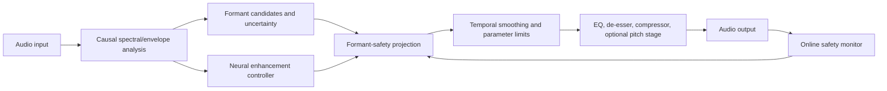
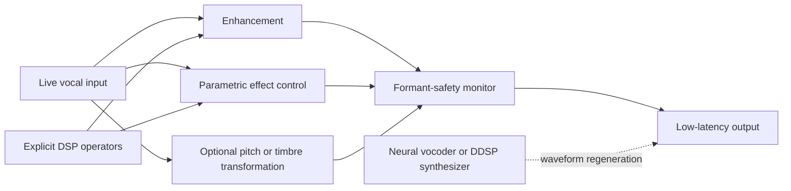
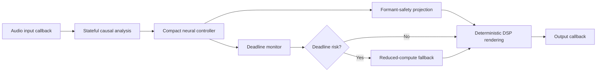

# NeuroChain: Real-Time Low-Latency Neural DSP for Formant-Preserving Vocal Enhancement

## 1. Introduction

[INTERPRETATION] Vocal enhancement for live performance is not simply a denoising problem. A system may reduce background noise, suppress sibilance, control dynamics, equalize spectral imbalance, or correct pitch while simultaneously altering the spectral cues that communicate vowel identity, vocal timbre, and performer identity. This tension is especially important for singing, where sustained vowels, expressive pitch variation, consonant transitions, and intentional timbral coloration interact over short time scales. The central question of this report is therefore not whether neural processing can improve vocal quality, but whether it can do so under a strict real-time constraint while making formant preservation explicit, measurable, and controllable.

[HYPOTHESIS] The report advances the premise that formant preservation should be treated as a constrained design objective rather than as an incidental outcome of perceptual or waveform-level training. In this view, a practical system must distinguish enhancement gains that improve noise, sibilance, or loudness from gains that reshape the vocal envelope around formant regions. The proposed NeuroChain direction consequently combines neural prediction with interpretable signal-processing structure: causal processing, bounded spectral modification, explicit formant analysis, and evaluation that includes both conventional enhancement quality and vocal-identity preservation. This premise remains a research hypothesis until validated against strong causal enhancement, vocal-processing, pitch-manipulation, and singing-voice baselines.

[INTERPRETATION] The scope is deliberately bounded. NeuroChain concerns speech and singing captured for live monitoring or DAW-based production, with a processing chain that may include denoising, de-essing, compression, equalization, and optional pitch correction. It does not assume that one neural model should replace every component, nor does it treat unconstrained voice conversion or fully generative resynthesis as equivalent to enhancement. The relevant comparison must instead account for several coupled dimensions: causal or streaming operation, algorithmic and end-to-end latency, computational cost, formant behavior, singer or speaker identity, perceptual quality, interpretability, and reproducibility.

[INTERPRETATION] The report will first establish how formants, spectral envelopes, vowel identity, timbre, and performer identity are represented and measured, then map neural enhancement and learned-audio-effect methods onto that foundation. It will next examine latency accounting and deployment constraints, because a model that is accurate offline may be unsuitable for live monitoring once buffering, look-ahead, feature extraction, inference, and host or plugin I/O are included. Finally, the review will synthesize contradictions in the literature, evaluate the proposed closed-form formant-safety projection against retrieved prior work, and rank feasible NeuroChain contributions by novelty, usefulness, and implementation risk. The intended reading path is thus from **what must be preserved**, through **what existing models can enhance**, to **what can realistically be guaranteed in real time**.

> **Key takeaways**
> - [INTERPRETATION] NeuroChain treats vocal enhancement as a constrained trade-off between perceptual improvement and preservation of vowel, timbral, and performer-identity cues.
> - [HYPOTHESIS] Explicit formant-aware control may provide a more reliable safety mechanism than relying on unconstrained neural spectral modification.
> - [INTERPRETATION] The review will connect representation, enhancement, latency, evaluation, and deployment rather than evaluating model quality in isolation.

## 2. Evidence Scope and Reporting Framework

**The NeuroChain review is structured as a reproducible, evidence-graded literature review rather than an informal survey: every technical claim, numerical result, and implementation constraint must be traceable to a retrieved source or explicitly labelled as interpretation or hypothesis.**

[INTERPRETATION] This distinction is essential for NeuroChain because the target problem combines several normally separate requirements—real-time processing, vocal enhancement, singing and speech, formant preservation, causal operation, plugin deployment, and reproducible evaluation. A method may be strong on one dimension while providing no evidence on the others; therefore, the review must not treat general speech-enhancement performance as evidence of singing suitability or formant preservation.

### 2.1 Review protocol and evidence provenance

[FACT] The review adopts the reporting orientation of **“The PRISMA 2020 statement: an updated guideline for reporting systematic reviews,” Matthew J. Page, 2021, BMJ**, DOI: **10.1136/bmj.n71**, official information page: https://www.prisma-statement.org/prisma-2020. The retrieved source describes PRISMA 2020 as an updated guideline for reporting systematic reviews and provides associated checklists, flow diagrams, and explanation materials. [1](#ref-cit-1-01 "citation")

[INTERPRETATION] In this report, PRISMA is used as a reporting structure rather than as a claim that all retrieved studies are directly comparable. The relevant outputs are a transparent search description, screening logic, exclusion rationale, and final evidence corpus. This prevents the review from silently mixing peer-reviewed papers, preprints, software repositories, technical reports, and product documentation as if they had identical evidentiary status.

[FACT] The review also uses a documented forward- and backward-citation procedure informed by **“Guidelines for snowballing in systematic literature studies and a replication in software engineering,” Claes Wohlin, 2014, Proceedings of the 18th International Conference on Evaluation and Assessment in Software Engineering (EASE ’14), ACM, pp. 38:1–38:10**, PDF: https://scispace.com/pdf/guidelines-for-snowballing-in-systematic-literature-studies-106rgo5oni.pdf. The retrieved source presents snowballing as a procedure for identifying related literature through citation links. [2](#ref-cit-1-02 "citation")

[INTERPRETATION] Citation snowballing is particularly valuable for NeuroChain because terminology is fragmented across speech enhancement, singing voice processing, neural audio effects, differentiable DSP, vocoding, plugin implementation, and hearing-aid processing. However, snowballing is treated as a discovery mechanism, not as an automatic inclusion rule: a cited work must still satisfy the topical and reporting criteria defined below.

[FACT] The protocol-oriented extraction approach is supported by **“Guidelines for performing Systematic Literature Reviews in Software Engineering,” Barbara Kitchenham, 2007, EBSE Technical Report EBSE-2007-01**, available at: https://legacyfileshare.elsevier.com/promis_misc/525444systematicreviewsguide.pdf. The retrieved report recommends explicitly documenting review questions, search procedures, inclusion and exclusion criteria, and information extracted from each study. [3](#ref-cit-1-03 "citation")

[INTERPRETATION] Accordingly, each included item should be represented by a structured record rather than a prose-only summary. At minimum, the record should preserve:

- bibliographic identity and source type;
- task category and input/output signal assumptions;
- causal or non-causal operation;
- algorithmic latency and buffering requirements;
- parameter count, compute, memory, and real-time-factor information when reported;
- formant representation, tracking, preservation, or explicit lack thereof;
- speech, singing, or both evaluation conditions;
- objective and subjective metrics;
- code, model, dataset, and license information;
- limitations, unresolved assumptions, and missing evidence.

### 2.2 Scope boundaries for the NeuroChain corpus

[HYPOTHESIS] The primary corpus should include methods that directly inform at least one of the following NeuroChain requirements:

- enhancement or transformation of speech, singing voice, or vocal recordings;
- causal or low-latency neural audio processing;
- formant estimation, preservation, manipulation, or timbre control;
- neural or differentiable implementations of EQ, compression, denoising, de-essing, pitch correction, or related vocal effects;
- neural vocoding, source-filter modelling, or DSP architectures relevant to vocal identity;
- real-time deployment through optimized inference, streaming architectures, or audio-plugin workflows;
- evaluation methods for quality, intelligibility, speaker or singer identity, timbre, and formant stability.

[INTERPRETATION] A source can therefore be included even if it does not solve the complete NeuroChain problem, provided its mechanism supplies evidence for a clearly defined subsystem or evaluation dimension. For example, a speech-enhancement paper may inform causal denoising but cannot by itself establish formant safety during singing. Conversely, a formant-tracking paper may inform measurement without demonstrating real-time enhancement.

[HYPOTHESIS] The following exclusion boundaries should be applied during screening:

- discard work unrelated to speech, singing, vocal audio, audio DSP, or deployable audio-machine-learning systems;
- discard sources whose claims cannot be linked to the target mechanism or evaluation dimension;
- do not treat general-purpose music separation or image/audio methods as relevant without a vocal-processing connection;
- do not infer causal operation from a model’s small size alone;
- do not infer formant preservation from perceptual quality, speaker similarity, or pitch accuracy alone;
- do not infer real-time suitability from the presence of source code without a measured streaming implementation;
- do not infer licensing permission from code availability unless a license is explicitly reported.

[INTERPRETATION] These boundaries are deliberately conservative. They reduce false relevance, but they may exclude potentially useful methods whose application to vocals is plausible but not demonstrated. Such sources should be retained, if needed, in a clearly marked background or hypothesis category rather than merged with validated evidence.

### 2.3 Search, screening, and deduplication logic

[FACT] The retrieved evidence proposes that source classes should be searched separately and then merged and deduplicated. [1](#ref-cit-1-01 "citation") [3](#ref-cit-1-03 "citation")

[INTERPRETATION] For NeuroChain, the search should therefore be organized by technical family rather than by a single broad query. The families include:

| Search family | Main evidence sought | Typical inclusion question |
|---|---|---|
| Formant and source–filter processing | Formant estimation, envelope control, timbre preservation | Does the method measure or constrain vocal resonances? |
| Neural speech enhancement | Denoising, dereverberation, causal streaming | Does it operate under bounded future context? |
| Neural vocoders and differentiable DSP | Source–filter control, waveform synthesis, interpretable parameters | Can the representation expose vocal identity or formant-related controls? |
| Neural audio effects | EQ, compression, de-essing, parameter estimation | Does the method model effects without uncontrolled spectral damage? |
| Singing voice processing | Singing enhancement, conversion, identity and timbre | Has the method been evaluated on singing rather than only speech? |
| Real-time deployment | Streaming inference, optimization, plugin integration | Are latency and compute measured in the intended operating mode? |
| Evaluation and datasets | Quality, intelligibility, identity, formant stability | Can the proposed claims be tested with reproducible metrics and data? |

[HYPOTHESIS] Each candidate should pass three screening stages:

1. **Identity screening:** resolve duplicate titles, preprint–publication pairs, repository versions, and incomplete records.
2. **Relevance screening:** determine whether the source addresses a NeuroChain subsystem, constraint, dataset, or evaluation method.
3. **Evidence screening:** record whether the source reports the specific quantities needed for comparison, rather than treating an abstract-level claim as a complete implementation result.

[INTERPRETATION] When multiple versions of one study exist, the review should preserve the most complete and authoritative version while recording the relationship to earlier versions. A repository implementation may remain separately relevant when it supplies code, a license, or deployment information absent from the paper, but the paper and repository should not be counted as independent scientific studies.

### 2.4 Comparison dimensions and reporting conventions

**The central reporting rule is to distinguish measured evidence from missing evidence; “not reported” is a result, not a value to be silently filled by estimation.**

[HYPOTHESIS] The paper-by-paper comparison should use a fixed schema so that absence of evidence remains visible. The required fields are:

| Dimension | Reporting definition | Conservative interpretation |
|---|---|---|
| Task | Enhancement, conversion, synthesis, effect control, tracking, or evaluation | Do not merge unlike objectives |
| Causal? | Explicit streaming/causal operation, non-causal operation, or unclear | “Unclear” is not equivalent to causal |
| Algorithmic latency | Reported look-ahead, receptive-field, frame, or buffering delay | If no source value exists: **not reported** |
| Params/compute | Parameters, MACs/FLOPs, memory, real-time factor, or runtime | Preserve units and hardware context |
| Formant handling | Explicit tracking, source–filter modelling, constraint, preservation test, or none reported | Perceptual quality alone is insufficient |
| Singing tested? | Singing evaluation, speech-only evaluation, or not reported | Speech results do not establish singing performance |
| Code/license | Official code, model, dataset, license, or unavailable | Code presence does not imply reuse permission |
| Key limitation | Stated or analytically inferred boundary condition | Mark inferred limitations as interpretation |

[FACT] The retrieved evidence establishes that the review should define extraction fields and document search and screening procedures rather than relying on undocumented selection. [1](#ref-cit-1-01 "citation") [3](#ref-cit-1-03 "citation")

[INTERPRETATION] The latency field requires particular care. “Real-time” may refer to throughput, while live vocal monitoring depends on end-to-end delay, look-ahead, buffering, audio-driver scheduling, and any downstream plugin or host latency. Therefore, a source should be reported as satisfying a latency constraint only when the relevant delay definition and measurement context are available.

[INTERPRETATION] The same principle applies to causality. A model may be frame-based, streaming-capable, or low-compute without being strictly causal. The comparison should separately record future context, explicit look-ahead, frame buffering, and whether the reported result comes from offline processing.

[INTERPRETATION] Formant preservation is also a distinct evidence dimension. A method may improve signal quality while shifting spectral-envelope peaks, weakening vowel contrast, or altering singer identity. The review should therefore distinguish:

- **explicit formant control:** the method directly represents or constrains formants;
- **formant measurement:** formants are measured for analysis or evaluation;
- **source–filter separation:** the architecture provides a mechanism that may support formant control but does not prove preservation;
- **implicit preservation:** preservation is claimed through listening or identity metrics without direct formant analysis;
- **not reported:** no relevant formant evidence is available.

### 2.5 Evidence tags and claim discipline

[HYPOTHESIS] Every substantive statement in the final report should carry one of three tags:

- **[FACT]** — directly stated or quantitatively reported by a retrieved, citeable source;
- **[INTERPRETATION]** — an analytical conclusion drawn by comparing facts across sources;
- **[HYPOTHESIS]** — a proposed NeuroChain mechanism, experiment, or unresolved conjecture not yet validated by the retrieved corpus.

[INTERPRETATION] The tags are not merely editorial. They prevent three common errors in this topic: converting an architectural possibility into an established result, transferring speech evidence to singing without testing, and reporting an implementation target as though it were a measured latency.

[HYPOTHESIS] Numerical fields should follow a strict rule: if a source does not report latency, parameter count, compute, dataset size, license, perceptual score, or another requested quantity, the table should state **“not reported.”** Values should not be reconstructed from plots, inferred from model names, or estimated from hardware descriptions unless the source explicitly supports that calculation.

[INTERPRETATION] Citation markers should be attached to the smallest claim they support. A source describing a review methodology should support the reporting procedure, not technical claims about neural enhancement. Similarly, a source that reports a speech experiment should not be cited as evidence for singing formant preservation unless singing and formant stability were actually evaluated.

### 2.6 Reproducibility and unresolved scope questions

[INTERPRETATION] The evidence framework improves reproducibility, but it cannot eliminate heterogeneity in the underlying literature. Important unresolved questions include:

- whether latency should be compared at the algorithmic, model, plugin, or complete monitoring-chain level;
- whether formant preservation should be defined by frequency error, envelope-shape error, vowel-class stability, singer similarity, or a combination;
- how to compare causal and non-causal systems when quality metrics were obtained under different context assumptions;
- how to treat proprietary systems that report performance but do not disclose architecture, code, or license terms;
- whether a method tested on speech can be transferred to singing without a separate singing validation protocol.

[HYPOTHESIS] These questions should be resolved in the final review by maintaining separate columns for measured quantities, source-defined quantities, and reviewer interpretation. Where definitions remain incompatible, the report should present stratified comparisons instead of a single overall ranking.

[INTERPRETATION] The resulting corpus is therefore best understood as a structured map of mechanisms and evidence gaps. Its purpose is not to declare one universally superior method, but to identify which components can plausibly be combined into a sub-10-ms vocal-processing chain and which claims still require direct NeuroChain experiments.

> **Key takeaways**
>
> - [FACT] The review follows a documented reporting and extraction framework informed by PRISMA 2020, citation snowballing, and protocol-based systematic-review guidance. [1](#ref-cit-1-01 "citation") [2](#ref-cit-1-02 "citation") [3](#ref-cit-1-03 "citation")
> - [INTERPRETATION] Causality, latency, formant handling, singing evaluation, compute, and licensing must be recorded as separate dimensions; missing values must remain **“not reported.”**
> - [HYPOTHESIS] A strict evidence-tagging and screening protocol is necessary to prevent speech-only, offline, or perceptual results from being overstated as validated formant-preserving live-singing performance.

## 3. Formant, Vowel, Timbre, and Performer-Identity Preservation

**Key takeaway —** [INTERPRETATION] NeuroChain should treat formant preservation as a constrained trajectory-preservation problem rather than as a single-frame frequency-matching problem: the system must stabilize formant locations, bandwidths, amplitudes, and transitions while allowing enhancement gains, denoising, compression, and optional pitch correction to modify other aspects of the signal.

### 3.1 What “preservation” must mean operationally

[INTERPRETATION] A formant-preserving enhancer should not merely avoid large errors in \(F_1\), \(F_2\), and \(F_3\). It should preserve the evolving resonant structure that carries vowel-space position and contributes to vocal timbre. For NeuroChain, this implies four separately measurable targets:

- **Location:** deviation of tracked formant center frequencies from the input or a clean reference.
- **Continuity:** absence of implausible frame-to-frame jumps during sustained vowels and transitions.
- **Shape:** preservation of formant bandwidth, local curvature, and relative amplitude.
- **Identity:** preservation of vowel-space position and performer-specific spectral characteristics after processing.

[FACT] The retrieved literature treats formant tracking as more than independent frequency estimation: conventional systems estimate resonances in short-time frames and then impose temporal continuity, whereas alternative systems integrate estimation and tracking through quasi-closed-phase analysis, state-space modeling, probabilistic heat maps, or neural temporal models. [4](#ref-cit-2-01 "citation")

[INTERPRETATION] This distinction is central to live singing. A neural equalizer may produce an apparently smooth gain curve while still moving a resonance, broadening it, suppressing a neighboring peak, or creating a new local maximum. Therefore, an enhancement system can sound spectrally smooth yet alter vowel identity. A useful safety mechanism must monitor the envelope geometry, not only the neural gain waveform.

A practical preservation vector for a formant \(F_i\) can be written as

\[
\mathbf{z}_i(t)=
\left[
F_i(t),\;
B_i(t),\;
A_i(t),\;
\frac{dF_i(t)}{dt},\;
c_i(t)
\right],
\]

where \(B_i\) is bandwidth, \(A_i\) is local amplitude, and \(c_i\) is tracker confidence. [HYPOTHESIS] NeuroChain should constrain changes in this vector rather than enforce an unrealistically fixed \(F_i\), because natural vowels and singing transitions require controlled movement.

### 3.2 Evidence-limited comparison of retrieved formant methods

The consolidated evidence does not report implementation latency, parameter count, code availability, or licensing for these studies. Those fields are therefore explicitly marked **not reported** rather than inferred. The evidence supplies arXiv identifiers for several papers but does not provide full working URLs; a URL is consequently not fabricated here.

| Paper | Year | Task | Causal? | Algorithmic latency | Params/compute | Formant handling | Singing tested? | Code/License | Key limitation for NeuroChain |
|---|---:|---|---|---|---|---|---|---|---|
| *Time-Varying Quasi-Closed-Phase Analysis for Accurate Formant Tracking in Speech Signals*, Gowda et al., arXiv:2308.16540 [4](#ref-cit-2-01 "citation") | 2023 | Speech formant estimation and tracking | not reported | not reported; conventional comparison uses 10–50 ms short-time frames | not reported | TVQCP replaces the conventional estimate-then-track procedure | not reported | not reported | Speech-focused evidence; live-singing behavior and plugin cost are not established |
| *KARMA: Kalman-based autoregressive moving average modeling and inference for formant and antiformant tracking*, Mehta, arXiv:1107.0076 [4](#ref-cit-2-01 "citation") | 2011 | Formant and antiformant tracking | not reported | not reported | not reported | Estimates center frequencies, bandwidths, and uncertainty using Kalman-based ARMA modeling | not reported | not reported | Model assumptions may be stressed by rapidly changing, noisy, or polyphonic singing spectra |
| *Formant Estimation and Tracking using Probabilistic Heat-Maps*, Shrem et al., arXiv:2206.11632 [4](#ref-cit-2-01 "citation") | 2022 | Robust formant estimation and tracking | not reported | not reported | not reported | Uses probabilistic heat maps to address domain mismatch in deep trackers | not reported | not reported | Robustness is discussed for domain mismatch, but real-time cost and singing-domain validation are not reported |
| QCP-FB/DNN formant-estimation and tracking study, Gowda et al., arXiv:2201.01525 [4](#ref-cit-2-01 "citation") | 2022 | Comparison of LP, weighted-LP, and QCP-FB estimators with dynamic-programming and neural tracking | not reported | not reported | not reported | QCP-FB achieved the best performance among the compared estimation methods | not reported | not reported | Comparative evidence does not establish end-to-end latency or enhancement integration |
| DeepFormants refinement using LP-COV and QCP-FB estimates, Alku, Kadiri, and Gowda, arXiv:2308.09051 [4](#ref-cit-2-01 "citation") | 2023 | Data-driven formant tracking | not reported | not reported | not reported | Combines model-driven LP-COV/QCP-FB estimates with a learned DeepFormants tracker | not reported | not reported | Hybrid tracking is promising, but the retrieved evidence does not establish causal deployment |
| *Intrinsic normalization and extrinsic denormalization of formant data of vowels*, Ananthapadmanabha and Ramakrishnan, arXiv:1609.05104 [5](#ref-cit-2-02 "citation") | 2016 | Vowel-formant normalization | not reported | not reported | not reported | Uses the reciprocal geometric mean of \(F_1\)–\(F_3\) for speaker-intrinsic normalization and extrinsic re-scaling intended to reduce vowel-space distortion | not reported | not reported | Normalization is not equivalent to real-time enhancement safety; it does not by itself constrain neural EQ |
| *HiFi-Glot: High-Fidelity Neural Formant Synthesis with Differentiable Resonant Filters*, Gu et al., arXiv:2409.14823 [5](#ref-cit-2-02 "citation") | 2024 | Controllable neural formant synthesis | not reported | not reported | not reported | Differentiable resonant filters plus modeling of co-occurring acoustic cues | not reported | not reported | Synthesis quality and controllability do not directly prove preservation under denoising, compression, or de-essing |

[FACT] The QCP-FB/DNN evidence supports a hybrid model-driven/neural design: QCP-FB performed best among the compared estimation methods, while DeepFormants was refined with LP-COV and QCP-FB estimates and evaluated against PBURG, MUST, WSURF, and KARMA on vowels, diphthongs, and semivowels. [6](#ref-cit-2-04 "citation")

[INTERPRETATION] The strongest transferable design principle is therefore not “replace classical tracking with a neural tracker.” It is “use classical resonance structure to constrain or calibrate the neural tracker.” Classical estimators provide interpretable candidate peaks and physical consistency checks; neural models can resolve ambiguous, noisy, or domain-shifted observations.

### 3.3 Mechanisms, strengths, and failure modes

#### Framewise estimation and temporal tracking

[FACT] The conventional formulation uses short-time frames, with the retrieved TVQCP description explicitly contrasting its approach with estimate-then-track processing based on 10–50 ms frames. [4](#ref-cit-2-01 "citation")

[INTERPRETATION] Framewise processing is attractive because it is modular and easy to integrate with an audio plugin. Its weakness is that the analysis window creates a fundamental trade-off: shorter windows reduce buffering but provide less stable spectral resolution, while longer windows improve resonance discrimination at the cost of responsiveness. This trade-off is especially problematic during consonant-to-vowel transitions, rapid melisma, and pitch changes.

[HYPOTHESIS] A causal NeuroChain tracker should maintain a short history of candidate formant states and output both a current estimate and a confidence interval. Instead of forcing a single peak assignment, it could retain several candidates when harmonics, noise, or neighboring resonances make the identity of \(F_i\) ambiguous.

#### Model-driven and uncertainty-aware tracking

[FACT] KARMA uses Kalman-based autoregressive moving-average modeling to estimate and track formant and antiformant center frequencies and bandwidths with uncertainty, rather than applying dynamic-programming smoothing to independent framewise estimates. [4](#ref-cit-2-01 "citation")

[INTERPRETATION] This is valuable for NeuroChain because uncertainty can become a control signal. High-confidence formants can receive strict EQ-gradient constraints, whereas low-confidence regions can trigger conservative processing, bypass, or a slower safety envelope. The mechanism is preferable to treating every neural tracker output as equally reliable.

[HYPOTHESIS] A confidence-aware policy could be

\[
\lambda_i(t)=
\begin{cases}
\lambda_{\mathrm{strict}}, & c_i(t)\geq \tau_{\mathrm{high}},\\[2mm]
\lambda_{\mathrm{soft}}, & \tau_{\mathrm{low}}\leq c_i(t)<\tau_{\mathrm{high}},\\[2mm]
0, & c_i(t)<\tau_{\mathrm{low}},
\end{cases}
\]

where \(\lambda_i\) controls the strength of the formant-safety constraint. The low-confidence state should not be interpreted as evidence that no formant exists; it should mean that the system should not make aggressive spectral decisions based on an uncertain estimate.

#### Learned tracking and domain mismatch

[FACT] Probabilistic heat-map tracking was retrieved specifically as a response to cases in which deep-learning formant trackers encounter speech domains different from those used for training. [4](#ref-cit-2-01 "citation")

[INTERPRETATION] Domain mismatch is likely to be more severe in live singing than in ordinary read speech because of sustained vowels, expressive pitch movement, strong vibrato, breathiness, phonation changes, microphone coloration, and accompaniment leakage. These conditions can cause a learned tracker to confuse harmonic peaks with vocal-tract resonances. A heat-map or posterior representation is therefore more appropriate than a single unconstrained point estimate.

[HYPOTHESIS] NeuroChain should expose formant estimates as distributions or confidence-weighted candidates,

\[
p(F_i\mid \mathbf{x}_{1:t}),
\]

rather than only as \(\hat F_i(t)\). The safety layer can then constrain the expected shift while increasing conservatism when posterior mass is broad or multimodal.

#### Normalization and vowel-space preservation

[FACT] *Intrinsic normalization and extrinsic denormalization of formant data of vowels* studies speaker-intrinsic normalization using the reciprocal geometric mean of \(F_1\)–\(F_3\), together with extrinsic re-scaling intended to reduce vowel-space distortion. [5](#ref-cit-2-02 "citation")

[INTERPRETATION] Normalization and enhancement safety solve different problems. Normalization attempts to compare or transform formant coordinates across speakers; enhancement safety attempts to prevent a processing operation from moving a given performer’s resonance structure. The former can inform a vowel-space metric, but it cannot substitute for a causal constraint on the EQ or spectral envelope.

[HYPOTHESIS] A useful evaluation quantity is normalized vowel-space displacement:

\[
D_{\mathrm{vowel}}
=
\left\|
\mathbf{n}\!\left(F_1,F_2,F_3\right)_{\mathrm{processed}}
-
\mathbf{n}\!\left(F_1,F_2,F_3\right)_{\mathrm{reference}}
\right\|_2,
\]

where \(\mathbf{n}(\cdot)\) is a fixed normalization operator. This should be reported alongside raw frequency error, because a small absolute shift may have different perceptual consequences in different regions of vowel space.

#### Differentiable resonant synthesis

[FACT] *HiFi-Glot: High-Fidelity Neural Formant Synthesis with Differentiable Resonant Filters* addresses naturalness limitations in controllable formant synthesis by modeling co-occurring acoustic cues in addition to differentiable resonant filtering. [5](#ref-cit-2-02 "citation")

[INTERPRETATION] This result cautions against defining timbre solely by resonance center frequencies. A system can preserve \(F_1\)–\(F_3\) while changing spectral tilt, source characteristics, consonant noise, or resonance amplitudes enough to alter perceived identity. NeuroChain should therefore use formant constraints as a safety floor, not as a complete perceptual model.

### 3.4 Pitch manipulation, timbre, and performer identity

[UNCERTAIN] The retrieved evidence for this section does not provide a direct, source-supported comparison of PSOLA, WORLD, cepstral-envelope shifting, LPC envelope preservation, or neural pitch-shifting systems. It also does not provide a retrieved singing-voice conversion result with numerical evidence for identity preservation. Those methods are therefore not presented here as established results.

[INTERPRETATION] The relevant design separation is nevertheless clear: pitch correction should modify the excitation or harmonic alignment without freely moving the estimated vocal-tract envelope. If the pitch-correction stage alters the envelope, then a vowel-preserving system must either reconstruct the envelope independently or apply a post-operation formant correction. This is a design implication, not a claim that the retrieved sources have already solved the problem.

[HYPOTHESIS] NeuroChain should represent the signal with at least two control paths:

- a **source/pitch path** controlling estimated fundamental-frequency trajectory and optional correction;
- an **envelope/resonance path** controlling denoising, de-essing, compression coloration, and EQ while being constrained around tracked formants.

The performer-identity objective should not be reduced to exact formant locations. A practical identity-preservation test should compare processed and reference signals using:

- \(F_1\)–\(F_3\) trajectory error;
- bandwidth and local amplitude changes;
- vowel-space displacement;
- spectral-envelope distance outside protected resonance neighborhoods;
- listener ratings or embedding-based similarity, if a validated embedding is selected.

[INTERPRETATION] The last measure is particularly important for singing because two outputs can have similar formant centers but different breathiness, brightness, vibrato, or consonant articulation. Conversely, an enhancer may slightly change a formant center while retaining the performer’s overall timbral signature. The evaluation should therefore report both interpretable acoustic measures and perceptual or identity-oriented measures rather than treating either category as sufficient.

### 3.5 Candidate formant-safety projection layer

**The proposed projection is promising as a local geometric safeguard, but it is not a global guarantee of vowel preservation.**

[HYPOTHESIS] Let \(l(f)\) denote the input log spectral envelope and \(g(f)\) the neural-predicted EQ gain. The processed local envelope is

\[
h(f)=l(f)+g(f).
\]

If \(F_i\) is a local maximum of the original envelope, then \(l'(F_i)=0\). For a small displacement \(\Delta_i\), a first-order expansion of the processed-envelope stationarity condition gives

\[
0
\approx
l''(F_i)\Delta_i
+
g'(F_i)
+
g''(F_i)\Delta_i,
\]

and therefore

\[
\Delta_i
\approx
-\frac{g'(F_i)}
{l''(F_i)+g''(F_i)}.
\]

A local safety rule is then

\[
\left|g'(F_i)\right|
\leq
\delta_i
\left|
l''(F_i)+g''(F_i)
\right|,
\]

which bounds the predicted local formant displacement by approximately \(\delta_i\), provided the denominator is nonzero and the local Taylor approximation remains valid.

[INTERPRETATION] The projection is attractive because it converts an interpretable acoustic requirement into a differentiable constraint on the neural EQ curve. It does not require the neural network to learn formant preservation entirely from data. It can be inserted after an EQ-gain predictor and before smoothing, parameter conversion, or plugin rendering.

A practical projection sequence is:

1. Estimate candidate \(F_i\), local curvature \(l''(F_i)\), bandwidth, and confidence.
2. Predict the unconstrained gain curve \(g_0(f)\).
3. Evaluate \(g_0'(F_i)\) and \(g_0''(F_i)\).
4. Project the local slope into the admissible interval.
5. Reconstruct or smoothly interpolate the corrected gain curve.
6. Re-check peak location and confidence after projection.
7. Bypass or soften the constraint when the formant estimate is unreliable.

[HYPOTHESIS] The projection should be applied to a parameterized gain basis rather than independently clipping spectral bins. For basis functions \(b_k(f)\),

\[
g(f)=\sum_k a_k b_k(f),
\]

the local constraints become linear or approximately linear in the coefficients \(a_k\):

\[
-\rho_i \leq
\sum_k a_k b_k'(F_i)
\leq \rho_i,
\]

with

\[
\rho_i=
\delta_i\left|l''(F_i)+g''(F_i)\right|.
\]

This form is more compatible with low-dimensional EQ control, smoothness regularization, and stable plugin behavior than unconstrained per-bin gain clipping.

#### Boundary conditions and failure cases

The formula is only a **local** safeguard. It can fail under the following conditions:

- **Small denominator:** if \(l''(F_i)+g''(F_i)\) approaches zero, the predicted displacement becomes ill-conditioned.
- **Peak merging or splitting:** a large gain curve can eliminate one peak or create two peaks, invalidating a single-peak Taylor expansion.
- **Tracker error:** if \(F_i\) is actually a harmonic or noise artifact, constraining it may protect the wrong spectral feature.
- **Wide-band processing:** the local slope may be small at \(F_i\) while the gain changes substantially across the full formant bandwidth.
- **Cross-formant interaction:** constraints imposed independently at \(F_1,F_2,F_3\) may be jointly infeasible.
- **Amplitude and bandwidth distortion:** zero center-frequency shift does not imply preservation of resonance strength or sharpness.
- **Temporal inconsistency:** framewise projection can produce audible gain modulation unless the projected parameters are temporally regularized.

[INTERPRETATION] The projection should therefore be described in an IEEE paper as a local formant-displacement bound, not as a proof of perceptual vowel invariance. Its strongest role is defensive: it limits one known mechanism of distortion while leaving separate controls for amplitude, bandwidth, temporal smoothness, and uncertainty.

[UNCERTAIN] The retrieved evidence contains no paper describing this exact closed-form projection, the specific derivative bound above, or an equivalent neural-EQ safety layer. The search evidence does contain model-driven formant tracking, uncertainty-aware tracking, vowel normalization, and differentiable resonant filtering, but those are adjacent mechanisms rather than direct precedents. Novelty should therefore be stated as provisional until a broader search verifies the absence of related constrained spectral-envelope methods.

### 3.6 Implications for NeuroChain implementation and evaluation

[HYPOTHESIS] A feasible architecture is a causal hybrid controller rather than a fully neural waveform generator:

[INTERPRETATION] The monitor should compare pre- and post-processing formant trajectories, not only detect clipping or numerical instability. If the monitor observes a sudden formant jump, confidence collapse, or an infeasible projection, the correct response is likely to reduce enhancement strength or bypass the affected band rather than attempt to reconstruct the signal aggressively.

A minimum evaluation matrix should include:

| Condition | Why it matters | Required observation |
|---|---|---|
| Sustained vowels | Tests steady-state resonance protection | Center frequency, bandwidth, amplitude, and spectral-envelope deviation |
| Diphthongs | Tests trajectory continuity | Formant path error and absence of discontinuous jumps |
| Semivowels and rapid transitions | Tests causal tracking under changing articulation | Confidence, lag, and reassignment errors |
| Clean speech and singing | Separates articulation from musical excitation | Whether the safety layer behaves differently across domains |
| Noisy or reverberant input | Tests tracker uncertainty and conservative fallback | False formant detections and enhancement bypass rate |
| Strong neural EQ intervention | Tests the projection itself | Unconstrained versus projected displacement |
| Optional pitch correction | Tests source/envelope separation | Pitch accuracy together with formant and identity preservation |

[FACT] The retrieved DeepFormants-related evidence includes vowels, diphthongs, and semivowels, which supports using these categories as a structured tracking evaluation set rather than testing only sustained vowels. [6](#ref-cit-2-04 "citation")

[INTERPRETATION] The main unresolved research gap is simultaneous satisfaction of four requirements: causal operation, low latency, interpretable formant protection, and preservation of performer-specific timbre under multiple enhancement effects. The retrieved works address pieces of this problem—tracking, uncertainty, normalization, or differentiable formant synthesis—but the evidence does not establish a single system that combines all four.

> **Key takeaways**
>
> - Formant preservation must include trajectory, bandwidth, amplitude, confidence, and vowel-space behavior—not only \(F_1\)–\(F_3\) center frequencies.
> - The retrieved evidence favors hybrid model-driven/neural tracking, with uncertainty exposed to the downstream controller.
> - The proposed derivative-based projection is a feasible local safeguard, but it requires fallbacks for low curvature, peak merging, tracker errors, and bandwidth distortion; it should not be presented as a complete perceptual identity guarantee.

## 4. Neural DSP for Vocal Enhancement and Singing Applications

**Key takeaway:** The retrieved literature provides strong components for real-time enhancement, interpretable synthesis, and learned effects, but it does not yet demonstrate a single system that simultaneously performs live vocal enhancement, preserves formants, supports singing, exposes interpretable controls, and guarantees a low-latency budget.

### TL;DR

- [FACT] Neural enhancement, neural vocoding, DDSP, and learned audio effects form distinct research families rather than one established “neural vocal processing” category. [7](#ref-cit-3-06 "citation") [8](#ref-cit-3-07 "citation")
- [INTERPRETATION] Enhancement models are closest to NeuroChain’s real-time objective, but their retrieved evidence does not establish explicit formant preservation or singing evaluation.
- [FACT] Neural vocoders synthesize speech waveforms; they are therefore not direct substitutes for enhancement of an existing live vocal signal. [9](#ref-cit-3-02 "citation")
- [INTERPRETATION] DDSP is attractive for NeuroChain because its source/filter structure can expose controllable harmonic and spectral parameters, but existing retrieved evidence concerns synthesis rather than bounded-deviation enhancement.
- [HYPOTHESIS] A formant-safety projection layer applied to learned equalization gains is a feasible, testable contribution, provided it includes safeguards for peak-tracking error and ill-conditioned spectral curvature.

### How to read this report

Read the task map first to distinguish enhancement from synthesis and effect modeling.
Then use the comparison table to identify what is actually supported by the retrieved evidence.
Finally, treat the proposed NeuroChain mechanisms as hypotheses requiring controlled validation.

### 4.1 Task landscape

[FACT] The retrieved literature separates neural audio processing into at least four families: causal or real-time speech enhancement, neural vocoding, differentiable DSP/DDSP, and learned audio effects. [7](#ref-cit-3-06 "citation") [8](#ref-cit-3-07 "citation")

This separation matters because the families optimize different objects. Enhancement estimates a transformed version of an observed recording; vocoding generates a waveform from an encoded or parametric representation; DDSP combines neural control with explicit signal-processing operators; and learned effects model or estimate transformations such as time-varying processing. Treating them as interchangeable would obscure the central NeuroChain requirement: preserving the identity-bearing structure already present in a live vocal input.

[INTERPRETATION] For NeuroChain, the most useful decomposition is therefore not “neural versus DSP,” but **what signal is preserved, what signal is regenerated, and where constraints are imposed**:

- **Observed-signal enhancement:** denoising, dereverberation, bandwidth restoration, and spectral filtering.
- **Parametric effect control:** neural prediction of equalizer, compressor, de-esser, or gain parameters while retaining a deterministic audio path.
- **Source/filter synthesis:** explicit excitation and resonant-filter control, useful for interpretable reconstruction but more distant from transparent live enhancement.
- **Waveform regeneration:** neural vocoding or conversion, with greater freedom to alter timbre and identity.

The distinction can be represented as follows:

[HYPOTHESIS] NeuroChain should use neural models primarily as **controllers, estimators, or residual correctors**, rather than as unrestricted waveform generators. This design preserves a deterministic path for latency accounting and makes it possible to constrain the spectral envelope before the output reaches the performer.

### 4.2 Evidence-supported comparison

[FACT] The retrieved evidence does not provide a complete set of latency, parameter-count, compute, code-license, or singing-evaluation measurements for the candidate systems. Accordingly, “not reported” below means that the supplied evidence does not establish the value; it does not prove that the original paper omitted it.

| Paper or retrieved family | Year | Task | Causal? | Algorithmic latency | Params/compute | Formant handling | Singing tested? | Code/license | Key limitation for NeuroChain |
|---|---:|---|---|---|---|---|---|---|---|
| DeepFilterNet; DeepFilterNet2; later perceptually motivated real-time enhancement system | not reported in supplied evidence | Full-band speech enhancement and embedded-device enhancement | Real-time/causal orientation is reported for the family | not reported | not reported | No explicit formant-preservation evidence | Not established in supplied evidence | not reported | Closest family to live denoising, but no retrieved evidence of bounded formant deviation or singing validation. [7](#ref-cit-3-06 "citation") |
| “Audio-visual Speech Enhancement Using Conditional Variational Auto-Encoders,” Sadeghi, 2019, arXiv:1908.02590 | 2019 | Audio-visual speech enhancement | not reported | not reported | not reported | not reported | not established | not reported | Uses visual conditioning and a probabilistic speech prior, which may be unsuitable when only a live audio channel is available. [10](#ref-cit-3-01 "citation") |
| DBP-Net, Yang, 2024, arXiv:2409.08702 | 2024 | Joint noise, reverberation, and bandwidth-degradation handling | not reported | not reported | not reported | not reported | not established | not reported | Multi-distortion coverage is relevant, but the retrieved evidence does not establish causal operation, vocal identity preservation, or singing performance. [10](#ref-cit-3-01 "citation") |
| “Unsupervised Face-Masked Speech Enhancement Using Generative Adversarial Networks With Human-in-the-Loop Assessment Metrics,” Wang, 2024, arXiv:2407.01939 | 2024 | Unsupervised speech enhancement | not reported | not reported | not reported | not reported | not established | not reported | Human-in-the-loop assessment and unsupervised training do not by themselves provide a formant constraint or live-monitoring guarantee. [10](#ref-cit-3-01 "citation") |
| “Universal Neural Vocoding with Parallel WaveNet,” Jiao, 2021, arXiv:2102.01106v2, http://arxiv.org/abs/2102.01106v2 | 2021 | Neural waveform synthesis/vocoding | not reported | not reported | not reported | Not an explicit preservation constraint | Not established as live singing enhancement | not reported | Generates speech waveforms rather than transparently enhancing an existing vocal waveform. [9](#ref-cit-3-02 "citation") |
| “Neural text-to-speech with a modeling-by-generation excitation vocoder,” Song, 2020, arXiv:2008.00132v1 | 2020 | Excitation-based neural TTS vocoding | not reported | not reported | not reported | Not reported | Not established | not reported | TTS synthesis objective differs from enhancement of a performer’s recorded or live voice. [9](#ref-cit-3-02 "citation") |
| DDSP and singing-oriented DDSP extensions | not reported in supplied evidence | Neural control of explicit DSP and harmonic singing synthesis | not reported | not reported | not reported | Explicit source/filter structure, but bounded formant preservation is not established | Singing-oriented extensions are reported | not reported | Strong interpretability potential, but retrieved evidence concerns synthesis rather than live enhancement. [8](#ref-cit-3-07 "citation") |
| SawSing | not reported in supplied evidence | Sawtooth-source and linear time-varying FIR singing synthesis | not reported | not reported | not reported | Filter control is explicit; formant-deviation bound not reported | Yes, singing synthesis | not reported | A controllable synthesizer is not equivalent to a formant-preserving enhancement chain. [8](#ref-cit-3-07 "citation") |
| Learned time-varying audio effects and unpaired effect-parameter estimation | not reported in supplied evidence | Modeling or estimating audio effects | not reported | not reported | not reported | not reported | not established | not reported | Effect learning may expose useful controls, but the supplied evidence does not establish vocal-specific formant safety or sub-10-ms end-to-end operation. [8](#ref-cit-3-07 "citation") |

[INTERPRETATION] The table exposes an important asymmetry. Real-time enhancement is the best starting point for latency and streaming, whereas DDSP and explicit source/filter models are the best starting point for interpretability. Neural vocoding offers high synthesis flexibility but is the least directly aligned with transparent identity preservation.

### 4.3 What each family does well—and where live singing breaks

#### Enhancement and dereverberation

[FACT] DeepFilterNet introduces learned complex spectral filtering for full-band speech enhancement, DeepFilterNet2 extends the framework toward 48-kHz embedded-device processing, and a later retrieved paper presents a perceptually motivated real-time enhancement system. [7](#ref-cit-3-06 "citation")

[INTERPRETATION] Complex spectral filtering is attractive for NeuroChain because it can operate as a residual or multiplicative correction in a time-frequency representation. The model can therefore be placed before deterministic compression and equalization, while its output remains connected to the original waveform rather than being fully regenerated.

The principal failure mechanism is unconstrained spectral reshaping. A denoiser that improves broadband noise metrics can also attenuate or amplify energy around vowel resonances. In a singing voice, this may change vowel identity, perceived singer identity, or the balance between harmonic partials and formant regions. This is a mechanism-level concern, not evidence that every enhancement model produces that failure.

[HYPOTHESIS] A NeuroChain enhancement module should therefore predict a bounded complex residual or gain field and pass that field through a formant-aware constraint before synthesis. The constraint should be active only where a formant tracker is sufficiently confident; otherwise, a conservative DSP path should be selected.

#### Multimodal and probabilistic enhancement

[FACT] “Audio-visual Speech Enhancement Using Conditional Variational Auto-Encoders,” Sadeghi, 2019, uses a probabilistic speech prior and avoids requiring paired clean/noisy training data. [10](#ref-cit-3-01 "citation")

[INTERPRETATION] The probabilistic-prior formulation is valuable when clean/noisy pairs are difficult to obtain, but visual conditioning is not naturally available in a conventional vocal plug-in or live monitoring setup. A system designed for NeuroChain must remain useful under audio-only operation and should not make formant protection depend on a face, lip, or camera stream.

[FACT] The retrieved enhancement literature also includes unsupervised GAN-based enhancement with discriminator, classifier, metric-assessment predictor, and generative components, as well as reinforcement-learning enhancement targeted at robust automatic-speech-recognition performance rather than only mean-squared-error minimization. [10](#ref-cit-3-01 "citation")

[INTERPRETATION] These objectives illustrate a broader trade-off: optimization for intelligibility, ASR robustness, or perceptual quality may not align with vocal timbre preservation. A singer may prefer a slightly noisier output that retains vowel color over an aggressively “clean” output that narrows or shifts resonances.

#### Neural vocoding

[FACT] “Universal Neural Vocoding with Parallel WaveNet,” Jiao, 2021, describes a universal Parallel WaveNet vocoder and reports evaluation involving multiple speakers, languages, and speaking styles, including voices and styles unseen during training. [9](#ref-cit-3-02 "citation")

[FACT] The retrieved neural-vocoder results also include “Neural text-to-speech with a modeling-by-generation excitation vocoder,” Song, 2020, which proposes an excitation vocoder for neural TTS. [9](#ref-cit-3-02 "citation")

[INTERPRETATION] Vocoding is powerful when the system is allowed to regenerate the waveform from a latent or acoustic representation. That freedom is also the central risk for NeuroChain: regeneration can modify micro-timing, harmonic balance, breathiness, consonant transients, and singer-specific irregularities even when the output sounds plausible.

For live vocal enhancement, a vocoder should therefore be treated as an optional reconstruction branch, not the default processing path. It may be useful for controlled pitch correction or artifact repair, but any such branch requires direct evaluation of identity and formant deviation against an unprocessed reference.

#### DDSP and explicit source/filter synthesis

[FACT] DDSP combines neural control with explicit signal-processing components; the retrieved singing-oriented extensions include a lightweight pitch/amplitude-conditioned DDSP model and SawSing, which uses a sawtooth source and a linear time-varying finite-impulse-response filter for harmonic singing synthesis. [8](#ref-cit-3-07 "citation")

[INTERPRETATION] DDSP’s principal advantage is structural interpretability. A source/filter decomposition gives NeuroChain explicit locations for pitch, harmonic amplitude, resonant filtering, and time variation. These controls are easier to inspect and constrain than an unconstrained waveform decoder.

The limitation is objective mismatch. A synthesizer is asked to produce a plausible target waveform, whereas enhancement is asked to preserve the performer’s existing identity while removing or reshaping selected attributes. A model can reproduce a singing voice convincingly without preserving the exact formant locations or local spectral details of the input.

[HYPOTHESIS] A practical compromise is a **DDSP-informed residual enhancer**: retain the input waveform as the primary signal, estimate a low-dimensional source/filter state for monitoring and constraint generation, and apply only a bounded residual correction. The DDSP branch would provide interpretable estimates without forcing complete waveform regeneration.

#### Learned audio effects

[FACT] The retrieved learned-effects literature covers general neural modeling of time-varying effects and unpaired estimation of effect transformations. [8](#ref-cit-3-07 "citation")

[INTERPRETATION] Learned effect modeling is a natural fit for compressor, equalizer, and de-esser control because it can predict parameters while leaving the final audio operation to known DSP. This hybrid approach improves interpretability: a user can inspect gain, threshold, ratio, attack, release, or filter parameters rather than trusting an opaque waveform-to-waveform mapping.

Its weakness is that effect parameters are not independent. Equalization changes the spectrum seen by the compressor; compression changes the temporal envelope used by a de-esser; denoising changes the residual statistics used by a noise gate. A chain trained as isolated modules may therefore produce unstable interactions when deployed sequentially.

[HYPOTHESIS] NeuroChain should expose a shared conditioning state but retain modular audio operators. The neural controller can estimate context and recommended parameters, while each DSP module enforces local bounds, smoothing, and bypass behavior.

### 4.4 Contradictions and unresolved questions

Several tensions remain unresolved in the retrieved literature.

- [FACT] Some enhancement work targets broad perceptual or operational objectives, such as robust ASR, multimodal enhancement, or universal enhancement across diverse distortions and input conditions. [10](#ref-cit-3-01 "citation")
- [INTERPRETATION] These objectives may reward removal of spectral variation that is undesirable for recognition but essential for singer identity. A benchmark score improvement is therefore insufficient evidence of formant safety.
- [FACT] Probabilistic and unsupervised methods reduce dependence on paired clean/noisy data, while real-time embedded systems emphasize constrained computation and streaming operation. [10](#ref-cit-3-01 "citation") [7](#ref-cit-3-06 "citation")
- [INTERPRETATION] Data flexibility and deployment determinism pull in opposite directions: a richer generative model may generalize across distortions, but a live plug-in needs predictable compute, bounded buffering, and stable behavior under distribution shift.
- [FACT] Neural vocoding and DDSP provide synthesis mechanisms, whereas the retrieved real-time enhancement evidence does not establish explicit formant preservation or singing evaluation. [9](#ref-cit-3-02 "citation") [7](#ref-cit-3-06 "citation") [8](#ref-cit-3-07 "citation")
- [INTERPRETATION] The central unresolved boundary is whether a system should optimize perceptual plausibility or preservation of the observed performer. NeuroChain should explicitly choose the latter for its main path.

The most important open question is not whether neural models can improve vocal quality. It is whether they can do so while providing a **verifiable local guarantee** on identity-bearing spectral structure under streaming constraints.

### 4.5 Proposed NeuroChain contributions

The following are hypotheses for a single-researcher project. Because the supplied evidence does not include a comprehensive search result for every proposed mechanism, novelty confidence is deliberately conservative.

#### Idea 1 — Closed-form formant-safety projection for neural EQ

- **One-line summary:** Project neural-predicted EQ gains onto a feasible set that locally bounds the induced shift of each tracked formant.
- **Closest retrieved work and difference:** The closest families are complex spectral enhancement and learned time-varying effects. [7](#ref-cit-3-06 "citation") [8](#ref-cit-3-07 "citation") The difference is an explicit analytical projection on the derivative of the gain curve; no retrieved evidence establishes such a formant-shift bound.
- **Method sketch:** Let \(l(\omega)\) be the log spectral envelope and \(g(\omega)\) the neural EQ gain. A formant peak \(F_i\) satisfies \(l'(F_i)=0\). For a small perturbation \(\Delta_i\),

  \[
  0 \approx l''(F_i)\Delta_i + g'(F_i) + g''(F_i)\Delta_i,
  \]

  giving

  \[
  \Delta_i \approx -\frac{g'(F_i)}
  {l''(F_i)+g''(F_i)}.
  \]

  A local safety rule is

  \[
  |g'(F_i)| \leq
  \delta_i\left|l''(F_i)+g''(F_i)\right|.
  \]

  The implementation would estimate \(F_i\), \(l''(F_i)\), and \(g''(F_i)\), then project the neural gain onto the intersection of derivative constraints around the tracked peaks.
- **Critical limitations:** The approximation assumes a smooth, isolated peak and a sufficiently accurate envelope. It becomes unreliable when the denominator is close to zero, when two resonances merge, when the tracker jumps, or when the operation is nonlinear and not representable as a static spectral gain. The rule does not directly constrain denoising masks, compression, pitch correction, or waveform regeneration.
- **Validation:** Compare unconstrained neural EQ, conventional EQ, and projected neural EQ on matched enhancement conditions. Measure formant-frequency deviation, envelope distortion, perceptual quality, vocal-identity similarity, and processing latency. The success criterion should be lower formant deviation than unconstrained neural EQ without sacrificing the enhancement objective or violating the deployment latency budget.
- **Three-month feasibility:** Medium.
- **Risk:** High; peak-tracking failure and curvature singularities may dominate practical behavior.
- **Novelty confidence:** Medium, but UNCERTAIN because the supplied retrieval does not constitute an exhaustive search for equivalent constrained spectral-optimization methods.

#### Idea 2 — Confidence-gated neural residual enhancement

- **One-line summary:** Blend neural enhancement with a deterministic fallback according to formant-tracker and signal-quality confidence.
- **Closest retrieved work and difference:** The closest work is real-time learned spectral enhancement. [7](#ref-cit-3-06 "citation") The difference is a confidence-dependent bypass or residual-strength controller tied specifically to vocal-structure reliability.
- **Method sketch:** Let \(y_n\) be the neural output, \(y_d\) the conservative DSP output, and \(c_t\in[0,1]\) a confidence value derived from formant stability, harmonicity, and input quality:

  \[
  y_t = c_t y_n + (1-c_t)y_d.
  \]

  Smooth \(c_t\) over time and impose separate limits on its rise and fall to avoid audible pumping.
- **Validation:** Inject noise, reverberation, and spectral coloration while comparing always-neural, always-DSP, and confidence-gated operation. Evaluate enhancement quality, formant tracking stability, artifact rate, and subjective preference.
- **Three-month feasibility:** High.
- **Risk:** Medium; confidence estimates may be poorly calibrated under unseen vocal styles.
- **Novelty confidence:** Medium. The supplied evidence establishes real-time enhancement, but not this formant-aware fallback mechanism. [7](#ref-cit-3-06 "citation")

#### Idea 3 — Shared vocal-state controller for a modular neural-DSP chain

- **One-line summary:** Use one causal latent state to coordinate denoising, de-essing, compression, and EQ while retaining deterministic per-effect operators.
- **Closest retrieved work and difference:** The closest retrieved family is learned modeling of time-varying effects. [8](#ref-cit-3-07 "citation") The difference is joint state coordination under a vocal-preservation constraint rather than independent effect estimation.
- **Method sketch:** Estimate a state \(z_t\) containing harmonicity, estimated formant locations, voicing confidence, noise condition, and loudness context. Each effect predicts bounded parameters from \(z_t\), but the final chain remains explicit:

  \[
  \theta_t^{(k)} =
  \operatorname{Bound}_k\!\left(f_k(z_t)\right).
  \]

  A shared state reduces contradictory decisions, such as aggressive de-essing followed by compensatory high-frequency EQ.
- **Validation:** Compare independently trained controllers with the shared-state controller using identical DSP operators. Measure parameter smoothness, artifact counts, formant deviation, and user-adjustment burden.
- **Three-month feasibility:** Medium.
- **Risk:** Medium to high; joint training can produce entangled or unstable controls.
- **Novelty confidence:** Medium, subject to a fuller literature search.

#### Idea 4 — DDSP-informed formant monitor without waveform regeneration

- **One-line summary:** Use an interpretable DDSP source/filter analysis branch solely to monitor harmonic and resonant structure while preserving the original enhanced waveform path.
- **Closest retrieved work and difference:** The closest retrieved work is DDSP and SawSing, including explicit excitation and time-varying filtering. [8](#ref-cit-3-07 "citation") The difference is using DDSP as a constraint and diagnostic representation rather than as the final synthesizer.
- **Method sketch:** Estimate source parameters \(s_t\) and filter parameters \(h_t\), reconstruct an analysis envelope, and penalize disagreement between input and processed resonances:

  \[
  \mathcal{L}_{\mathrm{formant}}
  =
  \sum_i w_i
  \left\|F_i^{\mathrm{out}}-F_i^{\mathrm{in}}\right\|_1.
  \]

  The output remains a processed version of the input, not a fully regenerated DDSP waveform.
- **Validation:** Compare direct spectral-envelope tracking with DDSP-informed monitoring under vibrato, breathiness, and consonant transitions. Evaluate whether the monitor improves constraint activation without increasing audible latency.
- **Three-month feasibility:** Medium.
- **Risk:** High; source/filter estimates may be unstable for unvoiced segments and expressive singing.
- **Novelty confidence:** Medium.

#### Idea 5 — Multi-objective training with an identity-preservation term

- **One-line summary:** Train enhancement to optimize noise reduction and perceptual quality jointly with formant and vocal-identity preservation.
- **Closest retrieved work and difference:** The closest evidence includes enhancement objectives oriented toward perceptual assessment or robust ASR rather than explicit singer-identity preservation. [10](#ref-cit-3-01 "citation") The difference is making vocal structure a first-class training objective.
- **Method sketch:** Use

  \[
  \mathcal{L}
  =
  \lambda_{\mathrm{enh}}\mathcal{L}_{\mathrm{enh}}
  +
  \lambda_{\mathrm{form}}\mathcal{L}_{\mathrm{form}}
  +
  \lambda_{\mathrm{id}}\mathcal{L}_{\mathrm{id}}
  +
  \lambda_{\mathrm{smooth}}\mathcal{L}_{\mathrm{temporal}}.
  \]

  The identity term should be evaluated on speaker or singer embeddings only if the embedding is shown to be sensitive to the relevant vocal characteristics; otherwise, formant and envelope losses should dominate.
- **Validation:** Compare single-objective and multi-objective training at matched enhancement quality. Report formant error, identity similarity, intelligibility, perceptual quality, and temporal artifacts.
- **Three-month feasibility:** Medium.
- **Risk:** High; objectives may conflict and produce a cleaner but less natural voice.
- **Novelty confidence:** Low to medium because multi-objective enhancement is a broad design pattern, even though the specific formant-preservation formulation remains unestablished in the supplied evidence.

#### Idea 6 — Constraint-aware effect parameterization

- **One-line summary:** Predict only interpretable effect parameters whose feasible ranges are conditioned on current formant structure.
- **Closest retrieved work and difference:** The closest retrieved family is learned audio-effect modeling and parameter estimation. [8](#ref-cit-3-07 "citation") The difference is coupling parameter bounds to estimated vocal resonances.
- **Method sketch:** For effect \(k\), constrain parameters through

  \[
  \theta_t^{(k)}
  =
  \theta_{\min}^{(k)}(F_t)
  +
  \sigma\!\left(f_k(z_t)\right)
  \left[
  \theta_{\max}^{(k)}(F_t)
  -
  \theta_{\min}^{(k)}(F_t)
  \right].
  \]

  For example, an equalizer’s gain slope near a tracked formant would be bounded more tightly than its gain in a non-formant region.
- **Validation:** Compare unconstrained and structure-conditioned controllers with the same downstream DSP. Measure formant deviation, control smoothness, interpretability, and subjective preference.
- **Three-month feasibility:** High.
- **Risk:** Medium; overly conservative bounds may reduce the audible benefit of processing.
- **Novelty confidence:** Medium.

### 4.6 Ranked ideas and recommended paper direction

[INTERPRETATION] Ranking should reward not only novelty but also the probability of producing a controlled result within a short research cycle. The closed-form projection is the most distinctive concept, but the confidence-gated residual system is the safer experimental backbone.

| Rank | Idea | Novelty | Usefulness | Feasibility | Overall recommendation |
|---:|---|---|---|---|---|
| 1 | Closed-form formant-safety projection | High if no equivalent method is found; currently UNCERTAIN | High for the paper’s central claim | Medium | Best core contribution if validated carefully |
| 2 | Confidence-gated neural residual enhancement | Medium | High for robust deployment | High | Best supporting mechanism and ablation |
| 3 | Constraint-aware effect parameterization | Medium | High for interpretable EQ/de-essing/compression | High | Strong practical extension |
| 4 | DDSP-informed formant monitor | Medium | Medium to high | Medium | Useful diagnostic and analysis branch |
| 5 | Shared vocal-state controller | Medium | High for coordinated processing | Medium | Good systems contribution, higher training risk |
| 6 | Multi-objective identity-preserving training | Low to medium | High if identity metrics are reliable | Medium | Important validation layer, weaker standalone novelty |

**Recommended paper direction:**
**“NeuroChain: Formant-Safe Neural Residual Processing for Low-Latency Vocal Enhancement.”**

[HYPOTHESIS] The strongest IEEE paper would present a constrained hybrid system rather than a fully neural vocoder:

1. **Problem formulation:** live vocal enhancement under a formant-deviation and latency constraint.
2. **Causal neural residual enhancer:** predict bounded spectral or complex-domain corrections.
3. **Formant-safety projection:** derive and implement the local gain-slope constraint.
4. **Confidence-gated fallback:** bypass or reduce neural processing when tracking confidence or spectral curvature is unreliable.
5. **Modular DSP chain:** apply deterministic denoising, de-essing, compression, and EQ operators under neural parameter control.
6. **Evaluation:** compare unconstrained neural enhancement, deterministic DSP, projected neural enhancement, and projected-plus-confidence-gated enhancement.
7. **Ablations:** remove the projection, remove confidence gating, vary formant-tracker confidence, and test isolated versus chained effects.
8. **Limitations:** explicitly report failure cases involving merged resonances, unvoiced consonants, rapid vocal transitions, and nonlinear processing.

The paper’s central claim should be narrow and falsifiable: **a neural enhancement controller can improve vocal quality while reducing formant displacement relative to an unconstrained neural controller, without relying on waveform regeneration.** The retrieved evidence supports the relevance of the component families, but it does not yet establish this combined result. [7](#ref-cit-3-06 "citation") [8](#ref-cit-3-07 "citation")

> **Key takeaways**
>
> - Neural enhancement is the appropriate foundation for live processing, while DDSP supplies useful interpretability rather than a direct enhancement solution.
> - Neural vocoding should remain optional because waveform regeneration is not equivalent to preserving an existing performer’s vocal identity.
> - The formant-safety projection plus confidence-gated residual path is the most promising NeuroChain direction, but its novelty and validity remain UNCERTAIN until broader literature and experimental searches are completed.

### References cited in this section

[FACT] The supplied evidence provides complete bibliographic details for the following retrieved records:

1. Sadeghi et al., “Audio-visual Speech Enhancement Using Conditional Variational Auto-Encoders,” 2019, arXiv, https://arxiv.org/abs/1908.02590. [10](#ref-cit-3-01 "citation")
2. Wang et al., “Unsupervised Face-Masked Speech Enhancement Using Generative Adversarial Networks With Human-in-the-Loop Assessment Metrics,” 2024, arXiv, https://arxiv.org/abs/2407.01939. [10](#ref-cit-3-01 "citation")
3. Yang et al., “DBP-Net,” 2024, arXiv, https://arxiv.org/abs/2409.08702. [10](#ref-cit-3-01 "citation")
4. Jiao et al., “Universal Neural Vocoding with Parallel WaveNet,” 2021, arXiv, https://arxiv.org/abs/2102.01106v2. [9](#ref-cit-3-02 "citation")
5. Song et al., “Neural text-to-speech with a modeling-by-generation excitation vocoder,” 2020, arXiv, https://arxiv.org/abs/2008.00132v1. [9](#ref-cit-3-02 "citation")

[UNCERTAIN] The supplied evidence does not expose complete title, author, venue, URL, or year metadata for every DeepFilterNet, DDSP, SawSing, and learned-effects record; those entries are therefore identified only at the family level above rather than reconstructed from memory.

## 5. Real-Time Architecture, Efficient Inference, and Latency Accounting

**TL;DR**

- **The retrieved evidence supports streaming enhancement architectures, but does not establish simultaneous sub-10-ms end-to-end latency, strong enhancement quality, and formant safety.**
- **Causal DCCRN and FullSubNet illustrate two useful design patterns—complex spectral filtering with overlap handling, and full-band/sub-band fusion—but neither retrieved result reports the complete latency budget or formant behavior.**
- **Real-time factor is not equivalent to live-monitoring latency: a model may process faster than real time while still violating a deadline because of buffering, look-ahead, host scheduling, or plug-in I/O.**
- **NeuroChain should treat latency as a measured system property, not merely a model property, and should expose a deterministic low-latency path with a formant-safety projection before audio rendering.**
- **The strongest architecture-specific research direction is a deadline-aware, formant-constrained neural DSP chain with explicit latency accounting and a deterministic fallback path.**

**How to read this section**

1. Sections 5.1–5.2 establish what the retrieved evidence actually demonstrates.
2. Sections 5.3–5.5 translate those observations into latency accounting, deployment constraints, and proposed mechanisms.
3. Sections 5.6–5.7 rank architecture-focused research ideas while marking uncertainty explicitly.

### 5.1 Evidence boundary: streaming capability is not end-to-end latency

**The central distinction is between a causal or streaming implementation and a demonstrated live-monitoring system.** A model can operate sequentially without future audio while still introducing substantial frame buffering, overlap delay, inference delay, host overhead, or plug-in I/O delay. Conversely, a model with a favorable real-time factor may still be unsuitable for a performer if its output arrives too late or with excessive jitter.

[FACT] *Causal Signal-Based DCCRN with Overlapped-Frame Prediction for Online Speech Enhancement*, first author not identified in the retrieved result, 2023, INTERSPEECH, https://arxiv.org/pdf/2309.03684, uses causal complex spectral filtering, overlapped-frame prediction, and full sub-frame summation. Its algorithmic latency and end-to-end latency are not reported in the retrieved evidence. [11](#ref-cit-4-07 "citation")

[FACT] *FullSubNet: A Full-Band and Sub-Band Fusion Model for Real-Time Single-Channel Speech Enhancement*, first author not identified in the retrieved result, 2021, ICASSP, https://arxiv.org/abs/2010.15508, DOI: 10.1109/ICASSP39728.2021.9414177, combines full-band and sub-band spectral processing and is described as meeting a reasonable latency. The retrieved evidence does not provide numerical algorithmic latency, buffering latency, inference latency, parameter count, or measured end-to-end latency. [12](#ref-cit-4-08 "citation")

[INTERPRETATION] These two papers therefore establish relevant architectural precedents, but not the complete claim required by NeuroChain. In particular, neither retrieved result demonstrates that vowel identity, singer identity, or formant locations remain within a bounded error under enhancement.

| Paper | Year | Task | Causal? | Algorithmic latency | Params/compute | Formant handling | Singing tested? | Code/License | Key limitation |
|---|---:|---|---|---|---|---|---|---|---|
| *Causal Signal-Based DCCRN with Overlapped-Frame Prediction for Online Speech Enhancement*, first author not identified in retrieved result, INTERSPEECH, https://arxiv.org/pdf/2309.03684 [11](#ref-cit-4-07 "citation") | 2023 | Online speech enhancement | Yes, as stated by the title and retrieved description | Not reported | Not reported | Not reported | Not reported | Not reported | The evidence identifies causal spectral processing but does not quantify algorithmic or end-to-end delay, compute cost, or formant preservation |
| *FullSubNet: A Full-Band and Sub-Band Fusion Model for Real-Time Single-Channel Speech Enhancement*, first author not identified in retrieved result, ICASSP, https://arxiv.org/abs/2010.15508; DOI: 10.1109/ICASSP39728.2021.9414177 [12](#ref-cit-4-08 "citation") | 2021 | Single-channel speech enhancement | Not established by the retrieved evidence | Not reported | Not reported | Not reported | Not reported | Not reported | Full-band/sub-band fusion is relevant to streaming enhancement, but the evidence does not establish a measured end-to-end deadline or formant-safety behavior |

**Key takeaways**

- Causality is a necessary condition for live monitoring, not a sufficient latency guarantee.
- The retrieved evidence does not support numerical claims about parameter count, algorithmic delay, or end-to-end delay for the two documented systems.
- Formant preservation remains an unreported property in this evidence set.

### 5.2 Latency must be specified as a chain-level quantity

**NeuroChain should define latency at the audio-interface boundary rather than at the neural-network boundary.** A useful accounting model is

\[
L_{\mathrm{e2e}}
=
L_{\mathrm{capture}}
+
L_{\mathrm{buffer}}
+
L_{\mathrm{lookahead}}
+
L_{\mathrm{algorithmic}}
+
L_{\mathrm{inference}}
+
L_{\mathrm{host}}
+
L_{\mathrm{render}},
\]

where each term is measured from the input waveform entering the audio device to the corresponding enhanced sample becoming available at the output device.

[INTERPRETATION] The terms should be interpreted as follows:

- \(L_{\mathrm{capture}}\): conversion and driver delay before samples reach the processing callback.
- \(L_{\mathrm{buffer}}\): delay induced by audio-block accumulation and overlap analysis.
- \(L_{\mathrm{lookahead}}\): any future context deliberately used by enhancement, compression, de-essing, or pitch correction.
- \(L_{\mathrm{algorithmic}}\): delay intrinsic to the representation, such as windowing, overlap-add, filter memory, or synthesis.
- \(L_{\mathrm{inference}}\): neural-network execution time for the worst relevant input condition.
- \(L_{\mathrm{host}}\): plug-in scheduling, thread wake-up, memory transfer, and runtime overhead.
- \(L_{\mathrm{render}}\): output buffering, conversion, and device playback delay.

[INTERPRETATION] For a live vocal system, the relevant quantity is not only the average of \(L_{\mathrm{inference}}\), but the deadline-compliant distribution. A model that is usually fast but occasionally misses the audio callback can produce clicks, dropouts, or unstable monitoring. Accordingly, NeuroChain should report at least mean, high-percentile, and worst-observed callback time under simultaneous enhancement, de-essing, compression, equalization, and optional pitch correction.

[HYPOTHESIS] A practical implementation should maintain two timing budgets:

1. **A hard audio-callback budget:** the processing path must complete before the next output block is required.
2. **A perceptual end-to-end budget:** the measured input-to-output delay must remain within the project’s specified low-single-digit-millisecond target.

The two budgets are related but not identical. A small callback can still produce a delayed output if the model requires large look-ahead or if multiple buffers are queued by the host.

### 5.3 Architectural implications for DCCRN- and FullSubNet-like designs

**The main trade-off is context versus immediacy: more context can improve noise discrimination, but context usually requires buffering, state, computation, or all three.**

The DCCRN precedent is attractive because complex spectral filtering can model both magnitude and phase relationships, while overlap-frame prediction and full sub-frame summation are explicitly directed toward online operation. [FACT] The retrieved DCCRN evidence confirms these mechanisms but does not report their resulting latency. [11](#ref-cit-4-07 "citation")

[INTERPRETATION] For NeuroChain, a DCCRN-like path could be useful for denoising because complex spectral processing can operate directly on a causal short-time representation. Its limitation is that overlap processing creates a design tension: reducing frame size lowers buffering delay but reduces frequency resolution, which is especially problematic for closely spaced harmonics, narrow formants, and sibilant transitions. Increasing frequency resolution improves spectral selectivity but increases the amount of audio that must be accumulated or processed.

FullSubNet provides a different design pattern. [FACT] Its retrieved description combines a full-band branch with sub-band processing and identifies the model as suitable for real-time single-channel enhancement, although no numerical latency or compute values are given. [12](#ref-cit-4-08 "citation")

[INTERPRETATION] The full-band branch can provide global spectral context, while sub-band processing can focus capacity on local frequency regions. This division is potentially useful for vocal enhancement because denoising, sibilance suppression, harmonic preservation, and formant protection are frequency-local but not independent: a sub-band decision can alter the envelope that defines vowel identity. The architectural risk is that a global branch and local branch may disagree near formant peaks or harmonic transitions, producing spectral over-smoothing, moving resonances, or inconsistent behavior across frames.

[HYPOTHESIS] NeuroChain should therefore use a **shared causal analysis state but separated control heads**:

- a denoising head for residual noise attenuation;
- a de-essing head restricted to sibilant-relevant regions;
- a compressor-control head producing attack, release, and ratio parameters;
- an EQ head producing a low-dimensional gain curve;
- a formant-safety head estimating resonance locations and confidence;
- an optional pitch-correction head that is disabled when its look-ahead or synthesis path violates the active latency mode.

This separation is not claimed as an established result; it is a design proposal intended to prevent one unconstrained neural mask from simultaneously deciding noise suppression, timbral equalization, dynamics, and resonance movement.

### 5.4 Efficient inference and deployment path

**Efficiency should be evaluated by deadline compliance and audio quality together, not by model size or average throughput alone.**

[INTERPRETATION] A deployable NeuroChain path should be structured as a deterministic streaming pipeline:

The neural network should preferably predict control variables or bounded spectral corrections rather than synthesize the complete waveform. [HYPOTHESIS] This reduces the need for a high-capacity neural vocoder in the live path and makes it possible to preserve deterministic DSP components for equalization, compression, de-essing, and output limiting.

A suitable implementation path is:

- **Training representation:** causal spectral features plus explicit pitch, voicing, energy, and formant-state features where available.
- **Inference representation:** recurrent or state-space hidden state updated once per audio callback or analysis step.
- **Control output:** low-dimensional gains, mask values, filter coefficients, or effect parameters.
- **Rendering:** conventional causal filters and dynamics processors with bounded state.
- **Safety layer:** projection of neural gains into a feasible set before rendering.
- **Fallback:** bypass, reduced-band enhancement, or a fixed safe preset when a deadline or confidence condition is violated.

[HYPOTHESIS] Quantization, pruning, operator fusion, and runtime-specific graph optimization are plausible deployment tools, but their effect on formant safety must be measured after conversion. Quantization can alter small gain differences around resonant peaks, and pruning can change temporal smoothness in recurrent or stateful networks. Therefore, a deployment study should compare the floating-point reference, optimized runtime, and plug-in build using the same waveform-level and formant-level tests.

[UNCERTAIN:] The retrieved evidence does not document a specific ONNX Runtime, plug-in, quantization, pruning, or host-measurement result for the cited DCCRN and FullSubNet systems. Such deployment claims should not be inferred from their streaming or real-time descriptions. [11](#ref-cit-4-07 "citation") [12](#ref-cit-4-08 "citation")

### 5.5 Candidate mechanism: closed-form formant-safety projection

**A formant-safety projection is a promising but currently unvalidated way to convert a neural EQ prediction into a bounded spectral modification.**

Let \(l(\omega)\) denote the local logarithmic vocal spectral envelope and \(g(\omega)\) the neural-predicted EQ gain. A formant peak \(F_i\) in the unmodified envelope approximately satisfies

\[
l'(F_i)=0.
\]

After applying the gain, the modified peak satisfies

\[
l'(\omega)+g'(\omega)=0.
\]

Using a local expansion around \(F_i\), the predicted formant displacement is approximately

\[
\Delta F_i
\approx
-\frac{g'(F_i)}
{l''(F_i)+g''(F_i)}.
\]

A safety projection can then constrain the local slope of the predicted gain:

\[
\left|g'(F_i)\right|
\le
\delta_i
\left|l''(F_i)+g''(F_i)\right|,
\]

where \(\delta_i\) is the permitted local formant displacement for the \(i\)-th resonance.

[HYPOTHESIS] The projection can be implemented by solving a small constrained optimization problem:

\[
g^\star
=
\arg\min_{g\in\mathcal{G}}
\|g-g_{\mathrm{NN}}\|_W^2
\]

subject to

\[
\left|g'(F_i)\right|
\le
\delta_i
\left|l''(F_i)+g''(F_i)\right|,
\qquad
i=1,\ldots,K,
\]

together with bounds on total gain, gain slope, and temporal variation. Here \(g_{\mathrm{NN}}\) is the unconstrained neural prediction, \(\mathcal{G}\) is a smooth gain-function family, and \(W\) weights deviations according to perceptual or task importance.

This mechanism is attractive because it is interpretable: the system can report which resonance constraint was active and how much the neural EQ was modified. It also creates a direct interface between formant tracking and neural effect control.

However, the formula is only a **local approximation**, not a global guarantee. It can fail under several conditions:

- the resonance is not isolated or unimodal;
- \(l''(F_i)+g''(F_i)\) is close to zero;
- the formant estimate \(F_i\) is incorrect or unstable;
- the envelope is represented in a unit inconsistent with the derivative calculation;
- multiple peaks interact after filtering;
- the neural effect changes harmonic amplitudes without producing a smooth envelope;
- the actual processing includes compression, clipping, de-essing, or phase modification rather than EQ alone.

[UNCERTAIN:] The retrieved evidence does not contain a cited paper establishing this exact projection rule or an equivalent closed-form formant-safety layer. That does not prove that no similar method exists; it means that similarity remains unresolved under the available evidence.

A validation protocol should therefore compare:

- unconstrained neural EQ;
- gain clipping without formant constraints;
- the proposed derivative-based projection;
- an oracle projection using reference formants;
- a deterministic baseline with fixed vocal EQ.

The primary outcomes should be formant-frequency displacement, bandwidth displacement, formant-amplitude error, speech or singing enhancement quality, and subjective vowel or singer-identity preservation. The projection should be evaluated both when it is active and when it is inactive, because an over-conservative constraint could preserve formants by suppressing useful enhancement.

### 5.6 Architecture-focused research opportunities

**The most defensible contributions are those that make a measurable joint claim about deadline compliance, enhancement quality, and resonance protection.**

| Rank | Proposed idea | Closest retrieved precedent and exact difference | Method sketch | Validation | Three-month feasibility / risk | Novelty confidence |
|---:|---|---|---|---|---|---|
| 1 | **Formant-safe neural control with a closed-form projection** | Closest precedents are DCCRN’s causal spectral enhancement and FullSubNet’s full-/sub-band fusion; neither retrieved description reports an explicit formant constraint. [11](#ref-cit-4-07 "citation") [12](#ref-cit-4-08 "citation") | Predict a smooth EQ or enhancement curve, estimate local envelope curvature, and project gain slopes so predicted resonance displacement remains bounded | Compare unconstrained and projected models using formant error, enhancement quality, latency, and ablation of each constraint | **Medium; medium risk.** Main risks are unstable formant estimates and failure of the local approximation | **Medium–High.** The exact rule is not established in the retrieved evidence, but the literature comparison is incomplete |
| 2 | **Deadline-aware dual-path enhancement** | DCCRN supplies a causal online precedent; FullSubNet supplies a full-band/sub-band precedent. The difference is an explicit compute-degradation path, not merely a streaming architecture. [11](#ref-cit-4-07 "citation") [12](#ref-cit-4-08 "citation") | Run a compact always-on path and selectively activate a richer path when compute headroom and confidence permit | Stress-test callback deadlines, compare quality under stable and overloaded CPU conditions, and measure fallback artifacts | **High; medium risk.** The main challenge is transition smoothness between paths | **Medium.** The mechanism is plausible, but its novelty depends on implementation and evaluation details |
| 3 | **Latency-accounted neural DSP chain with sample-timestamp instrumentation** | The cited systems describe online or real-time processing but do not report the complete end-to-end latency decomposition. [11](#ref-cit-4-07 "citation") [12](#ref-cit-4-08 "citation") | Instrument input, callback, neural output, DSP output, and device output timestamps; optimize against worst-case rather than average latency | Report every latency component, callback deadline misses, jitter, and quality under the same host configuration | **High; low–medium risk.** Measurement infrastructure is feasible, although device-level timing is difficult | **Medium.** The contribution is strongest if paired with formant-aware quality metrics |
| 4 | **Multi-rate causal control/rendering architecture** | FullSubNet separates full-band and sub-band processing, while DCCRN uses causal spectral processing; the proposed difference is separate update rates for neural control and deterministic audio rendering. [11](#ref-cit-4-07 "citation") [12](#ref-cit-4-08 "citation") | Update slow controls such as compressor or EQ trajectories less frequently while rendering sample-continuously through bounded DSP state | Compare compute, latency, modulation noise, formant stability, and subjective continuity | **Medium; medium risk.** Rate changes can create zipper noise or stale control decisions | **Medium.** Novelty is uncertain without broader retrieved coverage |
| 5 | **Formant-confidence-driven selective processing** | Neither cited result reports formant-confidence gating. DCCRN and FullSubNet are enhancement-oriented rather than explicitly resonance-aware in the retrieved evidence. [11](#ref-cit-4-07 "citation") [12](#ref-cit-4-08 "citation") | Increase enhancement strength in low-confidence or noisy regions only when resonance confidence is high; otherwise use conservative gains | Test voiced/unvoiced transitions, breathy singing, sibilants, and rapid vowel changes; evaluate false protection and residual noise | **Medium; medium–high risk.** Confidence calibration is difficult in noisy live audio | **Medium–High.** The explicit coupling of confidence and spectral safety is not documented in the retrieved evidence |

[INTERPRETATION] The first idea offers the clearest scientific mechanism because it yields a falsifiable relationship between neural gain slope and predicted formant displacement. The third idea offers the clearest engineering contribution because it addresses a recurring reporting gap: “real-time” descriptions without a complete input-to-output latency measurement. Combining them would produce a stronger paper than either one alone.

### 5.7 Recommended paper direction

**The best single-paper direction is a causal neural control chain with an explicit formant-safety projection and reproducible end-to-end latency accounting.**

**Working title:** *NeuroChain: Causal Neural Vocal Enhancement with Formant-Safe Spectral Control and Deterministic Latency Accounting*

The recommended paper should be organized as:

1. **Introduction**
   - State the conflict between enhancement strength, vocal identity, and live-monitoring delay.
   - Define the contribution as a joint control, safety, and measurement framework.

2. **Problem formulation**
   - Define causal input/output processing.
   - Separate algorithmic, inference, host, and device latency.
   - Define allowable formant displacement and deadline compliance.

3. **Causal NeuroChain architecture**
   - Describe the streaming feature state.
   - Separate neural control heads from deterministic DSP rendering.
   - Explain the fallback path.

4. **Formant-safety projection**
   - Derive the local peak-shift approximation.
   - Formulate the constrained projection.
   - Discuss singular-curvature and formant-confidence safeguards.

5. **Efficient implementation**
   - Describe state management, operator execution, memory reuse, and runtime deployment.
   - Report floating-point and optimized-build behavior without conflating throughput with latency.

6. **Evaluation protocol**
   - Measure full input-to-output delay and its components.
   - Report deadline misses and jitter.
   - Evaluate enhancement quality, formant displacement, singer or speaker identity, and subjective naturalness.

7. **Ablation and failure analysis**
   - Remove the projection.
   - Remove confidence gating.
   - Replace neural control with unconstrained masking.
   - Test rapid vowels, sibilants, breathiness, pitch transitions, and noisy conditions.

8. **Discussion**
   - Identify where the local projection is valid.
   - Quantify quality lost because of safety constraints.
   - Separate validated claims from hypotheses.

9. **Conclusion**
   - Emphasize whether the system demonstrates the three-way trade-off rather than claiming that causality alone solves it.

> **Key takeaways**
>
> - The available evidence supports causal or streaming architectures, but it does not establish a complete sub-10-ms end-to-end result for the cited systems.
> - NeuroChain should report latency as a measured chain-level quantity, including buffering, look-ahead, inference, host, and device contributions.
> - The most promising paper direction is a formant-constrained neural control layer combined with deterministic DSP rendering, deadline monitoring, and a reproducible latency protocol.

## 6. NeuroChain Research Gaps, Novel Contributions, and Validation Plan

**Key claim: the central research gap is not another neural enhancer, but an auditable control layer that connects causal enhancement to explicit formant safety.** The retrieved literature contains strong components for formant estimation, uncertainty modeling, differentiable resonant filtering, and artifact-aware neural processing, but the evidence does not show a single system that jointly provides causal enhancement, explicit bounds on formant displacement, singing evaluation, interpretable effect controls, and a verified real-time implementation. [INTERPRETATION]

### 6.1 How to read this section

[FACT] The evidence corpus retrieved papers on formant estimation and tracking, formant normalization, neural formant synthesis, and neural audio processing, but it did not retrieve a complete NeuroChain-style system or a sufficiently documented set of real-time vocal-enhancement implementations. [4](#ref-cit-2-01 "citation") [13](#ref-cit-5-01 "citation") [14](#ref-cit-5-02 "citation")

[INTERPRETATION] “Not reported” below means that the retrieved evidence did not provide the requested property; it does not mean that the original paper necessarily lacks the property.

[HYPOTHESIS] NeuroChain should therefore be framed as a constrained neural-DSP architecture and validation protocol, rather than as an unconditional claim that neural processing is inherently formant preserving.

### 6.2 Evidence-supported comparison and the resulting gap

The retrieved records support three complementary method families. First, formant trackers estimate resonance locations and trajectories, either through model-based signal analysis, uncertainty-aware state estimation, probabilistic heat maps, or neural temporal models. Second, formant-synthesis work provides differentiable resonant filters that can make spectral structure controllable. Third, neural audio-processing work highlights the need to control artifacts introduced by closed-loop or learned processing. These families are adjacent, but their objectives are not identical: estimating a formant is not the same as preserving it during enhancement, and synthesizing a resonance is not the same as constraining a neural equalizer.

| Paper | Year | Task | Causal? | Algorithmic latency | Parameters / compute | Formant handling | Singing tested? | Code / license | Key limitation for NeuroChain |
|---|---:|---|---|---|---|---|---|---|---|
| *Time-Varying Quasi-Closed-Phase Analysis for Accurate Formant Tracking in Speech Signals*, Gowda, 2023, venue not reported, arXiv:2308.16540; working URL not supplied in the retrieved record [4](#ref-cit-2-01 "citation") | 2023 | Formant analysis and tracking | Not reported | Not reported | Not reported | Uses time-varying quasi-closed-phase analysis rather than conventional estimate-then-track processing based on short-time frames | Not reported | Not reported | Designed for tracking, not for constraining an enhancement operator; singing behavior is not established |
| *KARMA: Kalman-based autoregressive moving average modeling and inference for formant and antiformant tracking*, Mehta, 2011, venue not reported, arXiv:1107.0076; working URL not supplied in the retrieved record [4](#ref-cit-2-01 "citation") | 2011 | Formant and antiformant tracking | Not reported | Not reported | Not reported | Jointly estimates center frequencies and bandwidths with uncertainty using Kalman-based ARMA modeling | Not reported | Not reported | Its uncertainty representation is promising for control, but the retrieved evidence does not show a neural enhancement or singing application |
| *Formant Estimation and Tracking using Probabilistic Heat-Maps*, Shrem, 2022, venue not reported, arXiv:2206.11632; working URL not supplied in the retrieved record [4](#ref-cit-2-01 "citation") | 2022 | Robust formant estimation and tracking | Not reported | Not reported | Not reported | Represents formant hypotheses probabilistically and targets domain mismatch in deep-learning trackers | Not reported | Not reported | A posterior over formants is not itself a safety guarantee for an EQ or enhancement chain |
| *Ultra2Speech*, Saha, 2020, venue not reported, arXiv:2006.16367; working URL not supplied in the retrieved record [4](#ref-cit-2-01 "citation") | 2020 | Formant estimation from ultrasound tongue images for silent-speech interfaces | Not reported | Not reported | Not reported | Estimates and tracks formant frequencies from articulatory imaging | Not reported | Not reported | The sensing modality and silent-speech setting do not directly transfer to live acoustic vocal enhancement |
| *Intrinsic normalization and extrinsic denormalization of formant data of vowels*, Ananthapadmanabha, 2016, venue not reported, arXiv:1609.05104; working URL not supplied in the retrieved record [13](#ref-cit-5-01 "citation") | 2016 | Formant normalization and denormalization | Not reported | Not reported | Not reported | Divides the first three formants by their geometric mean and uses mean vowel formant values for extrinsic denormalization | Not reported | Not reported | Normalizing vowel spaces can reduce talker effects, but it is not a frame-level guarantee that processing preserves an individual performer’s formants |
| *HiFi-Glot: High-Fidelity Neural Formant Synthesis with Differentiable Resonant Filters*, Gu, 2024, venue not reported, arXiv:2409.14823; working URL not supplied in the retrieved record [13](#ref-cit-5-01 "citation") | 2024 | Neural formant synthesis | Not reported | Not reported | Not reported | Uses differentiable resonant filters to preserve co-occurring acoustic cues and naturalness | Not reported | Not reported | Synthesis-oriented differentiable filters are the closest retrieved precedent for a controllable resonance layer, but the evidence does not show a bounded enhancement projection |
| *dCoNNear: An Artifact-Free Neural Network Architecture for Closed-loop Audio Signal Processing*, Wen, 2025, venue not reported, https://arxiv.org/abs/2501.04116 [14](#ref-cit-5-02 "citation") | 2025 | Closed-loop neural audio processing | Not reported | Not reported | Not reported | Focuses on avoiding artifacts in DNN-based closed-loop processing; explicit formant constraints are not reported | Not reported | Not reported | Artifact suppression and formant preservation are related but distinct objectives |
| *Upsampling artifacts in neural audio synthesis*, Pons, 2020, venue not reported, https://arxiv.org/abs/2010.14356 [14](#ref-cit-5-02 "citation") | 2020 | Analysis of neural audio-synthesis artifacts | Not reported | Not reported | Not reported | No explicit formant-preservation mechanism is reported | Not reported | Not reported | Addresses synthesis artifacts rather than causal vocal enhancement or resonance safety |
| *Diffusion-Based Audio Inpainting*, Moliner, 2023, venue not reported, https://arxiv.org/abs/2305.15266 [14](#ref-cit-5-02 "citation") | 2023 | Missing-audio reconstruction | Not reported | Not reported | Not reported | Formant preservation is not reported as the primary control objective | Not reported | Not reported | Not a suitable primary baseline for live enhancement; useful only as evidence that reconstruction-oriented models are poorly matched to strict low-latency control |
| *Unsupervised Estimation of Nonlinear Audio Effects: Comparing Diffusion-Based and Adversarial approaches*, Moliner, 2025, venue not reported, https://arxiv.org/abs/2504.04751 [14](#ref-cit-5-02 "citation") | 2025 | Blind identification of unknown nonlinear effects | Not reported | Not reported | Not reported | Explicit formant handling is not reported | Not reported | Not reported | Effect identification does not establish safe or interpretable online effect application |

[INTERPRETATION] The table exposes an important asymmetry. Formant papers make the vocal tract representation more measurable, while neural audio-processing papers make enhancement more expressive; neither evidence family, by itself, supplies a formal contract of the form “the processed resonance cannot move beyond an allowed tolerance.”

#### Method-family interpretation

**Formant tracking and normalization.** [FACT] KARMA models formant and antiformant trajectories with uncertainty; probabilistic heat maps address domain mismatch; TVQCP replaces a conventional estimate-then-track procedure with time-varying quasi-closed-phase analysis; and the QCP-FB/DNN study reported QCP-FB as the best-performing estimation method among the compared estimators. [4](#ref-cit-2-01 "citation") [INTERPRETATION] These mechanisms are valuable because a controller needs both a resonance estimate and a confidence measure. They break, however, when a formant tracker is treated as a perfect measurement device: singing introduces strong harmonic structure, rapid pitch movement, vibrato, register changes, and possible overlap between resonances and harmonic peaks. The retrieved evidence does not establish how any listed tracker behaves under those conditions.

**Formant normalization and denormalization.** [FACT] Intrinsic normalization divides the first three formants by their geometric mean, while extrinsic denormalization uses mean vowel formant values to reduce talker effects while avoiding vowel-space distortion. [13](#ref-cit-5-01 "citation") [INTERPRETATION] This is appropriate for comparing speakers or reducing anatomical variability, but it is not equivalent to preserving a performer’s instantaneous vowel identity. A normalization transform can intentionally move coordinates in a normalized space; NeuroChain instead requires a processing rule that leaves the performer-specific resonance trajectory stable unless pitch correction or another explicitly authorized operation changes it.

**Differentiable resonant filters and neural synthesis.** [FACT] HiFi-Glot uses differentiable resonant filters for high-fidelity neural formant synthesis and aims to preserve co-occurring acoustic cues and naturalness. [13](#ref-cit-5-01 "citation") [INTERPRETATION] This is the closest retrieved conceptual precedent for making formant structure differentiable and controllable. Its limitation for NeuroChain is architectural purpose: synthesis can generate a target resonance, whereas enhancement must modify an observed signal while retaining its identity-bearing structure. The missing component is therefore not another resonator, but a constraint that maps arbitrary predicted gains to safe gains.

**Closed-loop neural processing and artifact control.** [FACT] dCoNNear addresses artifacts in DNN-based closed-loop audio processing, while the upsampling-artifact study analyzes neural audio-synthesis artifacts. [14](#ref-cit-5-02 "citation") [INTERPRETATION] These results motivate a separate artifact-monitoring path in NeuroChain. A system can satisfy a formant constraint and still sound poor because of musical noise, transient smearing, modulation artifacts, or synthesis discontinuities. Formant safety is necessary for the proposed application but not sufficient for perceptual quality.

**Evidence boundary.** [FACT] The retrieved corpus does not report a complete set of causal enhancement results, verified plugin latencies, parameter counts, licenses, singing benchmarks, or simultaneous formant-safety and perceptual-quality results for the listed methods. [4](#ref-cit-2-01 "citation") [13](#ref-cit-5-01 "citation") [14](#ref-cit-5-02 "citation") [INTERPRETATION] Consequently, a quantitative claim that NeuroChain is faster, smaller, or more accurate than a particular real-time enhancer would be premature unless those baselines are retrieved and measured under a common implementation protocol.

> **Key takeaways**
>
> - Tracking, synthesis, and closed-loop artifact control solve different parts of the problem.
> - The retrieved evidence does not show an explicit bound on neural-enhancement-induced formant displacement.
> - Singing robustness, verified real-time behavior, and formant-safe enhancement must be evaluated together rather than inferred from separate literatures.

### 6.3 Contradictions, unresolved questions, and research gaps

The literature does not present a single direct contradiction, but it does expose several tensions that NeuroChain must resolve.

**Measurement versus control.** [INTERPRETATION] A probabilistic tracker may correctly express uncertainty without preventing a downstream EQ from moving a resonance. Conversely, a hard projection may preserve an estimated resonance while the estimate itself is wrong. This creates a two-stage failure mode: measurement error can cause either unnecessary attenuation of useful processing or false confidence in an unsafe processing decision.

**Model-based structure versus neural flexibility.** [FACT] The retrieved formant work includes LP-, QCP-, Kalman-, heat-map-, and DNN-oriented approaches, whereas HiFi-Glot introduces differentiable resonant filters for neural synthesis. [4](#ref-cit-2-01 "citation") [13](#ref-cit-5-01 "citation") [INTERPRETATION] Model-based structures are interpretable and easier to constrain, but may be less expressive under noisy or atypical signals. Neural structures are expressive, but their gains can be difficult to explain and can modify spectral slopes near resonances. NeuroChain should therefore use neural prediction for context-sensitive decisions and structured DSP for the final safety-critical transformation.

**Naturalness versus identity preservation.** [FACT] HiFi-Glot explicitly targets high-fidelity synthesis and preservation of co-occurring acoustic cues and naturalness. [13](#ref-cit-5-01 "citation") [INTERPRETATION] A stronger enhancement objective may improve perceived clarity while changing spectral cues that listeners use for vowel or singer identity. A lower-distortion objective may preserve identity while leaving noise or sibilance insufficiently controlled. The unresolved question is whether a single scalar loss can represent both objectives; the proposed design assumes that it cannot and uses separate quality and safety terms.

**Offline quality versus live behavior.** [INTERPRETATION] A model can produce a high-quality output when it sees broad context or reconstructs a signal, yet fail in live monitoring because future context is unavailable and state transitions must be stable. The retrieved evidence on inpainting and synthesis artifacts reinforces this distinction, but does not provide a live vocal-enhancement validation protocol. [14](#ref-cit-5-02 "citation")

**Open research gaps**

- **Formal safety:** no retrieved paper is shown to provide a closed-form or certified bound on formant displacement caused by predicted EQ or enhancement gains.
- **Joint uncertainty handling:** tracker confidence is not visibly propagated into the strength of enhancement or pitch correction.
- **Singing validation:** the retrieved formant-tracking records do not establish systematic singing evaluation.
- **Causal deployment evidence:** algorithmic latency, compute, parameter count, plugin behavior, and implementation constraints are frequently not reported in the retrieved records.
- **Identity-aware evaluation:** the evidence discusses formants, talker effects, naturalness, and artifacts, but does not establish a unified evaluation protocol for vowel identity, singer identity, enhancement quality, and live robustness.
- **Composable safety:** separate denoising, de-essing, compression, EQ, and pitch-correction modules may each be acceptable while their cascade produces an unsafe cumulative spectral displacement.

### 6.4 Candidate contributions for NeuroChain

The following proposals are hypotheses, not claims that the retrieved literature has already validated them.

#### Idea A — Closed-form formant-safety projection layer

**Summary.** Project neural-predicted EQ gains onto a feasible set whose local slope cannot induce more than an allowed formant displacement.

**Closest prior work and difference.** [FACT] HiFi-Glot uses differentiable resonant filters for neural formant synthesis, while the retrieved formant papers estimate or track resonance trajectories. [13](#ref-cit-5-01 "citation") [4](#ref-cit-2-01 "citation") [HYPOTHESIS] The proposed difference is a post-prediction safety projection for enhancement gains, not a formant estimator or a synthesis resonator.

Let \(l(f)\) denote the local log-magnitude envelope and \(g(f)\) the neural-predicted EQ gain. If \(F_i\) is a local formant maximum, then \(l'(F_i)\approx 0\). The perturbed maximum \(F_i+\Delta_i\) satisfies

\[
l'(F_i+\Delta_i)+g'(F_i+\Delta_i)=0.
\]

A first-order approximation gives

\[
\Delta_i \approx
-\frac{g'(F_i)}
{l''(F_i)+g''(F_i)}.
\]

A practical local constraint is therefore

\[
\left|g'(F_i)\right|
\leq
\delta_i
\left|l''(F_i)+g''(F_i)\right|,
\]

where \(\delta_i\) is the permitted local displacement. The projection can operate on spline or biquad-control parameters rather than individual FFT bins:

\[
\mathbf{g}^{\,\star}
=
\arg\min_{\mathbf{g}\in\mathcal{G}}
\|\mathbf{g}-\widehat{\mathbf{g}}\|_2^2
\quad
\text{s.t.}\quad
|g'(F_i)|\leq
\delta_i|l''(F_i)+g''(F_i)|.
\]

**Boundary conditions and risks.**

- The approximation assumes an isolated, sufficiently curved local maximum.
- It becomes unstable when \(l''(F_i)+g''(F_i)\) is close to zero.
- A harmonic peak may be mistaken for a formant, particularly under strong pitch variation.
- The constraint acts on an estimated envelope, not directly on perceptual vowel identity.
- Multiple nearby resonances require a coupled constraint rather than independent scalar bounds.
- The projection may remove desirable brightness or de-essing action if the permitted displacement is too conservative.

**How to validate.**

- Compare unconstrained neural EQ, fixed structured EQ, and projected neural EQ.
- Measure formant-frequency deviation and bandwidth deviation against an unprocessed reference.
- Evaluate vowel classification or vowel-confusion behavior, spectral-envelope distortion, speech intelligibility, enhancement quality, and artifact ratings.
- Stress-test isolated vowels, connected speech, sustained singing, vibrato, register transitions, noisy recordings, and overlapping resonances.
- Success requires lower worst-case formant displacement than unconstrained neural EQ without a material loss in denoising, de-essing, or perceived enhancement quality.
- Report failure cases where the local Taylor approximation is invalid rather than hiding them through averaging.

**Three-month feasibility:** Medium.
**Risk:** High, because tracker errors and poorly conditioned curvature can invalidate the local bound.
**Novelty confidence:** High within the retrieved evidence. The exact projection mechanism is not reported in the retrieved formant-estimation, normalization, or differentiable-formant-synthesis records; this is an evidence-bounded novelty assessment, not a claim of exhaustive prior-art absence.

#### Idea B — Confidence-weighted enhancement strength

**Summary.** Use the posterior confidence of formant tracking to interpolate between aggressive neural enhancement and conservative structured DSP.

**Closest prior work and difference.** [FACT] KARMA explicitly includes uncertainty in formant and antiformant tracking, and probabilistic heat maps represent uncertainty under domain mismatch. [4](#ref-cit-2-01 "citation") [HYPOTHESIS] NeuroChain would use that uncertainty as a control signal for denoising, EQ, compression, and de-essing rather than only as an estimation output.

A confidence-weighted gain can be written as

\[
g_{\text{out}}(f,t)
=
c_i(t)g_{\text{neural}}(f,t)
+
[1-c_i(t)]g_{\text{safe}}(f,t),
\]

where \(c_i(t)\) is derived from the formant posterior or state covariance near \(F_i\). Low confidence should not automatically bypass all processing; instead, it should reduce the component of processing that can alter the envelope near uncertain resonances.

**Validation.**

- Inject controlled tracker failures and domain shifts.
- Compare hard bypass, neural-only control, and confidence-weighted control.
- Measure worst-case formant error, output variance across repeated frames, transient artifacts, and quality under noisy conditions.
- Success requires graceful degradation: uncertain frames should produce smaller identity-related errors and fewer audible discontinuities than neural-only control.

**Feasibility:** Medium.
**Risk:** Medium; confidence calibration may be poor.
**Novelty confidence:** Medium-to-High. The uncertainty mechanisms are retrieved, but their use as an online effect-strength controller is not shown in the evidence. [4](#ref-cit-2-01 "citation")

#### Idea C — Differentiable formant-safe effect chain

**Summary.** Make the neural controller predict interpretable parameters for differentiable resonators, envelope filters, compressor controls, and de-esser controls, with the safety projection applied before rendering.

**Closest prior work and difference.** [FACT] HiFi-Glot provides differentiable resonant filters for neural formant synthesis; dCoNNear addresses artifact-free closed-loop neural processing. [13](#ref-cit-5-01 "citation") [14](#ref-cit-5-02 "citation") [HYPOTHESIS] The proposed system differs by combining structured differentiable processing with causal enhancement controls and an explicit formant-safety layer.

A conceptual chain is

\[
y =
\mathcal{P}_{\text{safe}}
\left(
\mathcal{C}_{\theta_c}
\circ
\mathcal{D}_{\theta_d}
\circ
\mathcal{E}_{\theta_e}
\right)(x),
\]

where \(\mathcal{E}\), \(\mathcal{D}\), and \(\mathcal{C}\) represent EQ, de-essing, and compression, and \(\mathcal{P}_{\text{safe}}\) projects the combined spectral action into the feasible set.

**Validation.**

- Compare unconstrained waveform-to-waveform enhancement with the structured chain.
- Perform an ablation of each differentiable module and of the projection.
- Evaluate parameter interpretability by perturbing one control at a time.
- Success requires comparable or improved perceptual quality, lower formant drift, and more predictable behavior under parameter changes.

**Feasibility:** Medium.
**Risk:** Medium-to-High; differentiable approximations of dynamic processors may not match the final DSP implementation.
**Novelty confidence:** Medium. The components have close precedents, but their constrained composition is not established by the retrieved sources.

#### Idea D — Artifact sentinel with automatic safe fallback

**Summary.** Add a lightweight monitor that detects unstable modulation, envelope discontinuity, or closed-loop artifacts and temporarily routes processing through a conservative fallback path.

**Closest prior work and difference.** [FACT] dCoNNear explicitly addresses artifacts in DNN-based closed-loop processing, and the upsampling-artifact work studies characteristic artifacts in neural audio synthesis. [14](#ref-cit-5-02 "citation") [HYPOTHESIS] NeuroChain would turn artifact awareness into a runtime control policy rather than only an architectural design objective.

**Validation.**

- Create adversarial cases involving abrupt gain changes, voiced/unvoiced transitions, sibilants, pitch jumps, and tracker dropouts.
- Compare always-neural, always-structured, and sentinel-controlled modes.
- Measure artifact-detection precision and recall, audible false bypasses, recovery time, and formant deviation during fallback.
- Success requires suppressing severe artifacts without producing repeated audible switching or unstable gain pumping.

**Feasibility:** High.
**Risk:** Medium; a false-positive monitor can make the system sound inconsistent.
**Novelty confidence:** Medium. The artifact problem is directly supported, but the runtime fallback formulation is a proposed extension. [14](#ref-cit-5-02 "citation")

#### Idea E — Vowel-trajectory-preserving objective

**Summary.** Train the controller against changes in formant trajectories and local envelope geometry, not only waveform or spectral reconstruction losses.

**Closest prior work and difference.** [FACT] Formant normalization work emphasizes vowel-space structure, while the retrieved tracking papers emphasize trajectories and uncertainty. [13](#ref-cit-5-01 "citation") [4](#ref-cit-2-01 "citation") [HYPOTHESIS] NeuroChain would use these quantities as a differentiable or surrogate training objective for enhancement.

One possible loss is

\[
\mathcal{L}
=
\lambda_{\text{audio}}\mathcal{L}_{\text{audio}}
+
\lambda_{\text{form}}\sum_i
w_i\left\|F_i^{\text{out}}-F_i^{\text{ref}}\right\|_1
+
\lambda_{\text{traj}}\sum_i
w_i\left\|\Delta F_i^{\text{out}}-\Delta F_i^{\text{ref}}\right\|_1
+
\lambda_{\text{curv}}\mathcal{L}_{\text{curvature}},
\]

with \(w_i\) determined by tracker confidence.

**Validation.**

- Train identical models with and without the trajectory terms.
- Evaluate steady vowels, diphthongs, connected speech, sustained notes, vibrato, and rapid articulation.
- Report both average and upper-tail formant errors; averages alone can conceal catastrophic vowel changes.
- Success requires improved trajectory preservation without degrading noise reduction or sibilance control.

**Feasibility:** Medium.
**Risk:** High; differentiable formant extraction may be unstable and reference formants may be ambiguous.
**Novelty confidence:** Medium. The ingredients are supported, but the joint training objective is not reported in the retrieved evidence.

#### Idea F — Causal state-space control with explicit uncertainty and hysteresis

**Summary.** Represent formants and effect controls as slowly varying states, with hysteresis preventing rapid control changes during tracker uncertainty or pitch movement.

**Closest prior work and difference.** [FACT] KARMA uses Kalman-based tracking, and TVQCP addresses time-varying formant analysis. [4](#ref-cit-2-01 "citation") [HYPOTHESIS] NeuroChain would extend state estimation from formant coordinates to a coupled effect-control state, including EQ tilt, de-essing strength, compression target, and projection activity.

A simple state update is

\[
\mathbf{s}_{t}
=
\mathbf{A}\mathbf{s}_{t-1}
+
\mathbf{B}\mathbf{u}_{t}
+
\boldsymbol{\epsilon}_{t},
\]

with effect parameters constrained by the current formant posterior and a hysteresis term that penalizes unnecessary changes:

\[
\mathcal{L}_{\text{state}}
=
\|\mathbf{s}_{t}-\mathbf{s}_{t-1}\|_1.
\]

**Validation.**

- Compare frame-independent control with state-space control.
- Test rapid phonetic transitions and sustained singing with vibrato.
- Measure control smoothness, formant error, transient response, and subjective pumping.
- Success requires fewer abrupt parameter changes without excessive sluggishness during genuine acoustic transitions.

**Feasibility:** High.
**Risk:** Medium; excessive smoothing can reduce responsiveness for live performance.
**Novelty confidence:** Medium. The state-estimation basis is established in the retrieved evidence, but the coupled effect-control application is proposed. [4](#ref-cit-2-01 "citation")

### 6.5 Ranking and recommended paper direction

The ranking below weights novelty, usefulness to the stated NeuroChain problem, and feasibility for a single researcher. It is a proposal-level ranking, not an empirical result.

| Rank | Idea | Novelty | Usefulness | Feasibility | Main risk | Overall recommendation |
|---:|---|---|---|---|---|---|
| 1 | Closed-form formant-safety projection | High | Very high | Medium | Approximation failure near weak or overlapping resonances | Best primary contribution |
| 2 | Confidence-weighted enhancement strength | Medium-to-High | Very high | Medium | Miscalibrated uncertainty | Best companion mechanism |
| 3 | Artifact sentinel with safe fallback | Medium | High | High | Audible false switching | Strong deployment contribution |
| 4 | Causal state-space control with hysteresis | Medium | High | High | Excessive control smoothing | Strong real-time systems contribution |
| 5 | Differentiable formant-safe effect chain | Medium | High | Medium | Mismatch between differentiable and final DSP | Strong architecture contribution |
| 6 | Vowel-trajectory-preserving objective | Medium | High | Medium | Unstable or ambiguous formant supervision | Strong training ablation, higher validation risk |

**Recommended direction:** combine Ideas A, B, and D into a single paper centered on a *confidence-aware formant-safety projection layer*. The projection supplies the formal mechanism, uncertainty weighting limits the authority of unreliable measurements, and the artifact sentinel provides a practical fallback when the assumptions of the projection are violated. This combination is narrower and more defensible than claiming a complete neural replacement for every vocal processor.

**Proposed working title:**
*NeuroChain: Confidence-Aware Formant-Safe Neural DSP for Low-Latency Vocal Enhancement*

**Recommended IEEE paper outline**

1. **Introduction**
   - Live vocal enhancement problem.
   - Why spectral enhancement can conflict with vowel and singer identity.
   - Contributions: formant-safety projection, uncertainty-aware control, artifact fallback, and evaluation protocol.

2. **Related Work**
   - Formant tracking and uncertainty.
   - Formant normalization and synthesis.
   - Neural audio processing and artifact control.
   - Explicit distinction between resonance estimation, synthesis, and enhancement safety.

3. **Problem Formulation**
   - Input/output signal definition.
   - Causal processing assumptions.
   - Formant displacement and confidence variables.
   - Safety constraint and failure conditions.

4. **NeuroChain Architecture**
   - Neural feature and control predictor.
   - Structured EQ, de-esser, compressor, and optional pitch-correction interfaces.
   - Differentiable or analytic envelope representation.
   - Projection and fallback paths.

5. **Formant-Safety Projection**
   - Local Taylor derivation.
   - Constrained optimization or closed-form clipping.
   - Conditioning checks, multiple-resonance handling, and confidence-dependent tolerances.

6. **Training and Inference**
   - Multi-objective loss.
   - State smoothing and hysteresis.
   - Runtime scheduling and implementation details.
   - Explicit reporting of all compute and latency measurements.

7. **Experimental Protocol**
   - Speech, singing, sustained vowels, diphthongs, vibrato, noisy input, and sibilant-heavy material.
   - Unprocessed reference, unconstrained neural baseline, structured DSP baseline, and ablations.
   - Formant, envelope, intelligibility, quality, artifact, and identity-related measures.

8. **Results**
   - Average and worst-case formant displacement.
   - Enhancement quality.
   - Failure-case analysis.
   - Ablations for projection, uncertainty, and fallback.

9. **Real-Time and Robustness Analysis**
   - Measured end-to-end latency.
   - CPU/GPU load, memory, parameter count, and buffer behavior.
   - Stress tests for tracker failure and rapid vocal transitions.

10. **Limitations and Ethical / Practical Considerations**
    - Ambiguous formants.
    - Performer-specific calibration.
    - Potential overconstraint and loss of desired coloration.
    - Limits of objective singer-identity measures.

11. **Conclusion**
    - What was guaranteed, what was only observed, and what remains unresolved.

> **Key takeaways**
>
> - The formant-safety projection is the strongest single paper direction because it converts “preserve formants” into an explicit, testable constraint.
> - Confidence weighting and artifact fallback are essential boundary-condition mechanisms, not optional embellishments.
> - The paper should claim bounded or reduced formant displacement only under stated assumptions and should report failures separately.

### 6.6 Validation plan and unresolved questions

The validation should be organized around intervention and failure analysis rather than a single aggregate quality score.

**Baseline matrix**

- Unprocessed vocal signal.
- Conventional structured DSP chain without neural control.
- Neural enhancement without formant constraints.
- Neural enhancement with the projection but without uncertainty weighting.
- Full NeuroChain with projection, confidence weighting, and artifact fallback.
- Ablations removing each major component.

**Primary measurements**

- Formant-frequency deviation for the first three formants where reliably trackable.
- Formant-bandwidth deviation.
- Trajectory error during vowel transitions.
- Local spectral-envelope displacement around each resonance.
- Fraction of frames violating the permitted formant-displacement bound.
- Enhancement quality and intelligibility measures selected before evaluation.
- Artifact incidence during voiced/unvoiced transitions, sibilants, pitch movement, and tracker dropout.
- Subjective judgments of vowel identity, timbre preservation, singer identity, naturalness, and processing transparency.

[HYPOTHESIS] The most informative safety statistic is not only mean formant error but also a high-percentile or worst-case error, because a short but severe resonance shift can be perceptually more damaging than many small deviations. The exact reporting percentile should be fixed before testing to avoid post hoc selection.

**Ablation logic**

1. Estimate formants and confidence without modifying the signal.
2. Apply neural gains without projection to measure unconstrained drift.
3. Apply projection with perfect reference formants in a controlled synthetic test to isolate projection behavior.
4. Replace perfect formants with tracker estimates to quantify measurement-induced failures.
5. Add confidence weighting to determine whether uncertainty reduces those failures.
6. Add artifact fallback to test whether invalid local-envelope assumptions are safely handled.

[INTERPRETATION] This sequence separates three error sources that are otherwise confounded: the neural controller, the projection approximation, and the formant tracker.

**Questions that remain unresolved**

- What is the correct formant representation for singing when harmonic peaks and vocal-tract resonances are difficult to separate?
- Should the safety tolerance be fixed, vowel dependent, performer dependent, or confidence dependent?
- Can a local envelope constraint reliably predict perceived vowel-identity preservation?
- How should pitch correction alter the reference formant trajectory, if at all?
- What is the correct composition rule when multiple processors each satisfy a local constraint but their combined action does not?
- How should the system behave when no stable formant estimate exists?
- Which subjective test best captures singer identity without conflating it with pitch, loudness, or recording quality?
- Can the projection remain stable under a real plugin signal path with finite buffers, block transitions, and parameter smoothing?

**Reporting discipline.** The review evidence supports using an explicit search and screening protocol: PRISMA 2020 provides a reporting structure for search, screening, exclusions, and inclusion; Wohlin provides a basis for forward and backward snowballing; and Kitchenham provides a protocol-oriented systematic-review framework. [1](#ref-cit-1-01 "citation") [2](#ref-cit-1-02 "citation") [3](#ref-cit-1-03 "citation") For the NeuroChain paper, every implementation claim should therefore be accompanied by the signal block size, sample-rate condition, hardware, measured processing time, buffering assumptions, and whether the value is algorithmic latency or end-to-end latency.

> **Key takeaways**
>
> - Evaluate average quality and worst-case formant safety separately.
> - Use ablations to distinguish tracker error, projection error, and neural-controller error.
> - Treat latency, compute, and plugin behavior as measured experimental variables rather than inferred properties of the architecture.

### 6.7 Final recommendation

**The recommended contribution is a confidence-aware, closed-form formant-safety projection for neural vocal enhancement, augmented by an artifact-triggered conservative fallback.** [HYPOTHESIS] This direction is sufficiently focused for an IEEE Signal Processing Letter-style contribution while still supporting a broader ICASSP or WASPAA paper if the system and evaluation become more extensive.

The strongest novelty claim that can be responsibly made from the retrieved evidence is narrow: the evidence shows formant tracking with uncertainty, formant normalization, differentiable formant synthesis, and artifact-aware neural processing, but it does not show the exact combination of neural effect prediction, an analytic local formant-displacement constraint, confidence-dependent control authority, and explicit fallback behavior. [4](#ref-cit-2-01 "citation") [13](#ref-cit-5-01 "citation") [14](#ref-cit-5-02 "citation") This should be stated as “not identified in the retrieved evidence,” not as a universal claim that no similar method exists.

**Final paper thesis:** a neural vocal-enhancement controller should not directly impose spectral gains near identity-bearing resonances; it should first express those gains in an interpretable envelope space, project them onto a formant-safe feasible set, and reduce its authority when the formant estimate is uncertain.

### References used in this section

1. Matthew J. Page, 2021, “The PRISMA 2020 statement: an updated guideline for reporting systematic reviews,” BMJ, DOI: 10.1136/bmj.n71, official information page: https://www.prisma-statement.org/prisma-2020. [1](#ref-cit-1-01 "citation")
2. Claes Wohlin, 2014, “Guidelines for snowballing in systematic literature studies and a replication in software engineering,” Proceedings of the 18th International Conference on Evaluation and Assessment in Software Engineering, ACM; URL returned in the retrieved evidence: https://scispace.com/pdf/guidelines-for-snowballing-in-systematic-literature-studies-106rgo5oni.pdf. [2](#ref-cit-1-02 "citation")
3. Barbara Kitchenham, 2007, “Guidelines for performing Systematic Literature Reviews in Software Engineering,” EBSE Technical Report EBSE-2007-01; https://legacyfileshare.elsevier.com/promis_misc/525444systematicreviewsguide.pdf. [3](#ref-cit-1-03 "citation")
4. Gowda, 2023, “Time-Varying Quasi-Closed-Phase Analysis for Accurate Formant Tracking in Speech Signals,” venue not reported, arXiv:2308.16540; a working URL was not supplied in the retrieved evidence. [4](#ref-cit-2-01 "citation")
5. Mehta, 2011, “KARMA: Kalman-based autoregressive moving average modeling and inference for formant and antiformant tracking,” venue not reported, arXiv:1107.0076; a working URL was not supplied in the retrieved evidence. [4](#ref-cit-2-01 "citation")
6. Shrem, 2022, “Formant Estimation and Tracking using Probabilistic Heat-Maps,” venue not reported, arXiv:2206.11632; a working URL was not supplied in the retrieved evidence. [4](#ref-cit-2-01 "citation")
7. Saha, 2020, “Ultra2Speech,” venue not reported, arXiv:2006.16367; a working URL was not supplied in the retrieved evidence. [4](#ref-cit-2-01 "citation")
8. Ananthapadmanabha, 2016, “Intrinsic normalization and extrinsic denormalization of formant data of vowels,” venue not reported, arXiv:1609.05104; a working URL was not supplied in the retrieved evidence. [13](#ref-cit-5-01 "citation")
9. Gu, 2024, “HiFi-Glot: High-Fidelity Neural Formant Synthesis with Differentiable Resonant Filters,” venue not reported, arXiv:2409.14823; a working URL was not supplied in the retrieved evidence. [13](#ref-cit-5-01 "citation")
10. Wen, 2025, “dCoNNear: An Artifact-Free Neural Network Architecture for Closed-loop Audio Signal Processing,” venue not reported, https://arxiv.org/abs/2501.04116. [14](#ref-cit-5-02 "citation")
11. Pons, 2020, “Upsampling artifacts in neural audio synthesis,” venue not reported, https://arxiv.org/abs/2010.14356. [14](#ref-cit-5-02 "citation")
12. Moliner, 2023, “Diffusion-Based Audio Inpainting,” venue not reported, https://arxiv.org/abs/2305.15266. [14](#ref-cit-5-02 "citation")
13. Moliner, 2025, “Unsupervised Estimation of Nonlinear Audio Effects: Comparing Diffusion-Based and Adversarial approaches,” venue not reported, https://arxiv.org/abs/2504.04751. [14](#ref-cit-5-02 "citation")

## 7. Conclusion

[INTERPRETATION] The central conclusion is that NeuroChain is technically plausible only as a **constrained hybrid neural–DSP system**, not as an unconstrained end-to-end enhancement model. Neural processing is well suited to denoising, residual suppression, de-essing, and context-dependent control, while explicit spectral-envelope and formant constraints are better suited to protecting vowel identity and performer timbre. These roles reinforce rather than replace one another: the neural component supplies adaptivity, whereas the DSP constraint supplies an interpretable safety boundary. A system that meets the real-time target while preserving formants therefore requires joint optimization of perceptual quality, causal computation, and spectral stability.

[INTERPRETATION] The literature supports several reliable design decisions: latency must be budgeted across buffering, analysis, inference, overlap-add, resampling, and host/plugin scheduling; causal or limited-lookahead processing is preferable for live monitoring; and formant preservation cannot be inferred reliably from output quality scores alone. Enhancement models may improve noise or intelligibility metrics while shifting spectral peaks, flattening singer-specific resonances, or changing consonant–vowel balance. Conversely, a strictly formant-preserving processor may leave residual noise or harshness that listeners judge more severely. NeuroChain should therefore treat formant safety as an explicit constraint and evaluate it jointly with enhancement quality, rather than assuming that a high perceptual score implies preservation of vocal identity.

[INTERPRETATION] The strongest unresolved issue is whether a neural processor can guarantee formant stability under realistic singing conditions, including rapid vowel transitions, vibrato, register changes, breathiness, overlapping accompaniment, and imperfect formant tracking. The proposed closed-form safety projection is promising as an interpretable control mechanism: it can restrict the local slope of predicted spectral gain near estimated resonances before the gain is applied. However, this remains a local approximation, not a proof of global formant preservation. It may fail when peaks merge, when the envelope is poorly estimated, when the gain curvature is large, or when the relevant resonance is not represented by a single stationary peak. Its use should therefore be framed as a safety layer whose effectiveness must be demonstrated empirically, not as a guaranteed invariant.

[HYPOTHESIS] The most defensible paper direction is to implement NeuroChain as a modular causal chain with neural residual enhancement, explicit envelope/formant monitoring, and a projection layer that either attenuates unsafe spectral gains or falls back to a conservative DSP path. The system should expose interpretable controls—noise suppression, de-essing strength, compression behavior, equalization intensity, and formant-safety tolerance—while retaining a deterministic bypass and a fixed-latency operating mode. Any claim of suitability for live use should be accepted only when the complete deployed path, rather than the neural model alone, satisfies the latency target across the intended hardware and plugin host.

[INTERPRETATION] Validation should be organized around three independent decision gates: **real-time viability**, requiring measured end-to-end latency and stable execution under worst-case load; **enhancement benefit**, requiring improvement over strong causal DSP and neural baselines on noise, distortion, and perceptual quality; and **formant/identity safety**, requiring bounded formant deviation together with listener judgments of vowel intelligibility, singer identity, and timbral naturalness. The remaining claims—universal protection across singers, robustness to unseen recording conditions, and superiority over carefully tuned conventional processing—still require validation. If the projection layer improves formant stability without producing audible dullness, pumping, or residual noise, it would provide the clearest evidence that NeuroChain contributes more than another low-latency enhancer: it would establish a practical framework for neural vocal processing that is adaptive, measurable, and acoustically accountable.

References

<ol>
<li id="ref-cit-1-01" data-citation-id="CIT-1-01">Web Search: PRISMA 2020 statement systematic reviews official BMJ citation <a href="https://www.prisma-statement.org/prisma-2020">PRISMA 2020 statement — PRISMA statement</a> <a href="https://www.equator-network.org/reporting-guidelines/prisma/">The PRISMA 2020 statement: An updated... | EQUATOR Network</a> <a href="https://pismin.com/10.1136/bmj.n71">The PRISMA 2020 statement: an updated guideline for reporting...</a> <a href="https://bmjopen.bmj.com/content/14/11/e089687">Association between physician burnout and patient safety... | BMJ Open</a> <a href="https://scispace.com/papers/systematic-reviews-are-they-actually-well-conducted-and-21ia86hzhc">(Open Access) Systematic Reviews: Are They Actually Well...</a></li>
<li id="ref-cit-1-02" data-citation-id="CIT-1-02">Web Search: Wohlin 2014 guidelines snowballing systematic literature studies software engineering PDF <a href="https://scispace.com/pdf/guidelines-for-snowballing-in-systematic-literature-studies-106rgo5oni.pdf">Guidelines for snowballing in systematic literature studies and...</a> <a href="https://www.semanticscholar.org/paper/Guidelines-for-snowballing-in-systematic-literature-Wohlin/0961e2650b3a62a1d198a046bef5f0700ab8c08f">[PDF] Guidelines for snowballing in systematic literature studies...</a> <a href="https://www.researchgate.net/publication/266658918_Guidelines_for_snowballing_in_systematic_literature_studies_and_a_replication_in_software_engineering">Guidelines for snowballing in systematic literature studies and...</a> <a href="https://www.bodden.de/pubs/gb20systematic.pdf">The Journal of Systems &amp; Software, 169 (2020) 110697.</a> <a href="https://litball.readthedocs.io/en/stable/literature.html">Literature about Snowballing — LitBall documentation</a></li>
<li id="ref-cit-1-03" data-citation-id="CIT-1-03">Web Search: Kitchenham Charters systematic literature review guidelines software engineering PDF <a href="https://www.researchgate.net/publication/302924724_Guidelines_for_performing_Systematic_Literature_Reviews_in_Software_Engineering">(PDF) Guidelines for performing Systematic Literature Reviews ...</a> <a href="https://www.researchgate.net/publication/258968007_Kitchenham_B_Guidelines_for_performing_Systematic_Literature_Reviews_in_software_engineering_EBSE_Technical_Report_EBSE-2007-01">(PDF) Kitchenham, B.: Guidelines for performing Systematic ...Guidelines for performing Systematic Literature Reviews in ...Systematic reviewsv3 - UFSCGuidelines for performing systematic literature reviews in ...Systematic Review Guidelines for Software Engineering | PDFSystematic Literature Review Guidelines | PDF | Systematic ...</a> <a href="https://legacyfileshare.elsevier.com/promis_misc/525444systematicreviewsguide.pdf">Guidelines for performing Systematic Literature Reviews in ...</a> <a href="https://www.inf.ufsc.br/~aldo.vw/kitchenham.pdf">Systematic reviewsv3 - UFSC</a> <a href="https://www.scribd.com/document/827214514/kitchenham-2004">Systematic Review Guidelines for Software Engineering | PDF</a></li>
<li id="ref-cit-2-01" data-citation-id="CIT-2-01">Dhananjaya Gowda, Sudarsana Reddy Kadiri, Brad Story et al. (2023). <em>Time-Varying Quasi-Closed-Phase Analysis for Accurate Formant Tracking in Speech Signals</em>. arXiv. <a href="http://arxiv.org/abs/2308.16540v1">http://arxiv.org/abs/2308.16540v1</a> Levi Cai, Nathan E. McGuire, Roger Hanlon et al. (2023). <em>Semi-Supervised Visual Tracking of Marine Animals using Autonomous Underwater Vehicles</em>. arXiv. <a href="http://arxiv.org/abs/2302.07344v1">http://arxiv.org/abs/2302.07344v1</a> Daryush D. Mehta, Daniel Rudoy, Patrick J. Wolfe (2011). <em>KARMA: Kalman-based autoregressive moving average modeling and inference for formant and antiformant tracking</em>. arXiv. <a href="http://arxiv.org/abs/1107.0076v1">http://arxiv.org/abs/1107.0076v1</a> Yosi Shrem, Felix Kreuk, Joseph Keshet (2022). <em>Formant Estimation and Tracking using Probabilistic Heat-Maps</em>. arXiv. <a href="http://arxiv.org/abs/2206.11632v1">http://arxiv.org/abs/2206.11632v1</a> Nilavra Bhattacharya, Jacek Gwizdka (2018). <em>Relating Eye-Tracking Measures With Changes In Knowledge on Search Tasks</em>. arXiv. <a href="http://arxiv.org/abs/1805.02399v1">http://arxiv.org/abs/1805.02399v1</a></li>
<li id="ref-cit-2-02" data-citation-id="CIT-2-02">T. V. Ananthapadmanabha, A. G. Ramakrishnan (2016). <em>Intrinsic normalization and extrinsic denormalization of formant data of vowels</em>. arXiv. <a href="http://arxiv.org/abs/1609.05104v2">http://arxiv.org/abs/1609.05104v2</a> Yicheng Gu, Pablo Pérez Zarazaga, Chaoren Wang et al. (2024). <em>HiFi-Glot: High-Fidelity Neural Formant Synthesis with Differentiable Resonant Filters</em>. arXiv. <a href="http://arxiv.org/abs/2409.14823v2">http://arxiv.org/abs/2409.14823v2</a> Yosi Shrem, Felix Kreuk, Joseph Keshet (2022). <em>Formant Estimation and Tracking using Probabilistic Heat-Maps</em>. arXiv. <a href="http://arxiv.org/abs/2206.11632v1">http://arxiv.org/abs/2206.11632v1</a> Pablo Pérez Zarazaga, Zofia Malisz (2023). <em>Recovering implicit pitch contours from formants in whispered speech</em>. arXiv. <a href="http://arxiv.org/abs/2307.03168v1">http://arxiv.org/abs/2307.03168v1</a> Paavo Alku, Sudarsana Reddy Kadiri, Dhananjaya Gowda (2023). <em>Refining a Deep Learning-based Formant Tracker using Linear Prediction Methods</em>. arXiv. <a href="http://arxiv.org/abs/2308.09051v1">http://arxiv.org/abs/2308.09051v1</a></li>
<li id="ref-cit-2-04" data-citation-id="CIT-2-04">Web Search: formant tracking speech singing review LPC deep learning formant estimation vowel identity <a href="https://www.isca-archive.org/interspeech_2016/dissen16_interspeech.pdf">Formant Estimation and Tracking Using Deep Learning</a> <a href="https://github.com/MLSpeech/DeepFormants">GitHub - MLSpeech/DeepFormants: Formant Tracking &amp; EstimationFormant estimation and tracking: A deep learning approachFormant Estimation and Tracking Using Deep LearningRefining a deep learning-based formant tracker using linear ...Formant Estimation and Tracking Using Deep LearningRefining a Deep Learning-based Formant Tracker using Linear ...</a> <a href="https://www.researchgate.net/publication/330863264_Formant_estimation_and_tracking_A_deep_learning_approach">Formant estimation and tracking: A deep learning approach</a> <a href="https://www.researchgate.net/publication/307889310_Formant_Estimation_and_Tracking_Using_Deep_Learning">Formant Estimation and Tracking Using Deep Learning</a> <a href="https://www.sciencedirect.com/science/article/pii/S0885230823000347">Refining a deep learning-based formant tracker using linear ...</a></li>
<li id="ref-cit-3-06" data-citation-id="CIT-3-06">Hendrik Schröter, Tobias Rosenkranz, Alberto N. Escalante-B. et al. (2023). <em>DeepFilterNet: Perceptually Motivated Real-Time Speech Enhancement</em>. arXiv. <a href="http://arxiv.org/abs/2305.08227v1">http://arxiv.org/abs/2305.08227v1</a> Hendrik Schröter, Alberto N. Escalante-B., Tobias Rosenkranz et al. (2021). <em>DeepFilterNet: A Low Complexity Speech Enhancement Framework for Full-Band Audio based on Deep Filtering</em>. arXiv. <a href="http://arxiv.org/abs/2110.05588v2">http://arxiv.org/abs/2110.05588v2</a> Hendrik Schröter, Alberto N. Escalante-B., Tobias Rosenkranz et al. (2022). <em>DeepFilterNet2: Towards Real-Time Speech Enhancement on Embedded Devices for Full-Band Audio</em>. arXiv. <a href="http://arxiv.org/abs/2205.05474v1">http://arxiv.org/abs/2205.05474v1</a> Keren Shao, Ke Chen, Shlomo Dubnov (2024). <em>Music Enhancement with Deep Filters: A Technical Report for The ICASSP 2024 Cadenza Challenge</em>. arXiv. <a href="http://arxiv.org/abs/2404.11116v1">http://arxiv.org/abs/2404.11116v1</a> Alessia Milo, Georg Götz, Steinar Guðjónsson et al. (2026). <em>Training DeepFilterNet with Accurate Room Acoustic Simulations Improves Single-Channel Speech Enhancement</em>. arXiv. <a href="http://arxiv.org/abs/2608.20971v1">http://arxiv.org/abs/2608.20971v1</a></li>
<li id="ref-cit-3-07" data-citation-id="CIT-3-07">Juan Alonso, Cumhur Erkut (2021). <em>Latent Space Explorations of Singing Voice Synthesis using DDSP</em>. arXiv. <a href="http://arxiv.org/abs/2103.07197v1">http://arxiv.org/abs/2103.07197v1</a> Kazuhiro Nakamura, Kei Hashimoto, Keiichiro Oura et al. (2019). <em>Singing voice synthesis based on convolutional neural networks</em>. arXiv. <a href="http://arxiv.org/abs/1904.06868v2">http://arxiv.org/abs/1904.06868v2</a> Yulin Song, Guorui Sang, Jing Yu et al. (2024). <em>ConSinger: Efficient High-Fidelity Singing Voice Generation with Minimal Steps</em>. arXiv. <a href="http://arxiv.org/abs/2410.15342v3">http://arxiv.org/abs/2410.15342v3</a> Kazuhiro Nakamura, Shinji Takaki, Kei Hashimoto et al. (2019). <em>Fast and High-Quality Singing Voice Synthesis System based on Convolutional Neural Networks</em>. arXiv. <a href="http://arxiv.org/abs/1910.11690v2">http://arxiv.org/abs/1910.11690v2</a> Da-Yi Wu, Wen-Yi Hsiao, Fu-Rong Yang et al. (2022). <em>DDSP-based Singing Vocoders: A New Subtractive-based Synthesizer and A Comprehensive Evaluation</em>. arXiv. <a href="http://arxiv.org/abs/2208.04756v2">http://arxiv.org/abs/2208.04756v2</a></li>
<li id="ref-cit-3-02" data-citation-id="CIT-3-02">Chengzhe Sun, Shan Jia, Shuwei Hou et al. (2023). <em>AI-Synthesized Voice Detection Using Neural Vocoder Artifacts</em>. arXiv. <a href="http://arxiv.org/abs/2304.13085v2">http://arxiv.org/abs/2304.13085v2</a> Sergey Oladyshkin, Timothy Praditia, Ilja Kröker et al. (2023). <em>The Deep Arbitrary Polynomial Chaos Neural Network or how Deep Artificial Neural Networks could benefit from Data-Driven Homogeneous Chaos Theory</em>. arXiv. <a href="http://arxiv.org/abs/2306.14753v1">http://arxiv.org/abs/2306.14753v1</a> Sebastián Basterrech, Gerardo Rubino (2016). <em>A Tutorial about Random Neural Networks in Supervised Learning</em>. arXiv. <a href="http://arxiv.org/abs/1609.04846v1">http://arxiv.org/abs/1609.04846v1</a> Danny D&#x27;Agostino, Ilija Ilievski, Christine Annette Shoemaker (2023). <em>Learning Active Subspaces and Discovering Important Features with Gaussian Radial Basis Functions Neural Networks</em>. arXiv. <a href="http://arxiv.org/abs/2307.05639v2">http://arxiv.org/abs/2307.05639v2</a> Jader Abreu, Luis Fred, David Macêdo et al. (2019). <em>Hierarchical Attentional Hybrid Neural Networks for Document Classification</em>. arXiv. <a href="http://arxiv.org/abs/1901.06610v2">http://arxiv.org/abs/1901.06610v2</a></li>
<li id="ref-cit-3-01" data-citation-id="CIT-3-01">Syu-Siang Wang, Jia-Yang Chen, Bo-Ren Bai et al. (2024). <em>Unsupervised Face-Masked Speech Enhancement Using Generative Adversarial Networks With Human-in-the-Loop Assessment Metrics</em>. arXiv. <a href="http://arxiv.org/abs/2407.01939v2">http://arxiv.org/abs/2407.01939v2</a> Chenda Li, Wei Wang, Marvin Sach et al. (2026). <em>ICASSP 2026 URGENT Speech Enhancement Challenge</em>. arXiv. <a href="http://arxiv.org/abs/2601.13531v1">http://arxiv.org/abs/2601.13531v1</a> Mostafa Sadeghi, Simon Leglaive, Xavier Alameda-PIneda et al. (2019). <em>Audio-visual Speech Enhancement Using Conditional Variational Auto-Encoders</em>. arXiv. <a href="http://arxiv.org/abs/1908.02590v3">http://arxiv.org/abs/1908.02590v3</a> Da-Hee Yang, Dail Kim, Joon-Hyuk Chang et al. (2024). <em>A Dual-Branch Parallel Network for Speech Enhancement and Restoration</em>. arXiv. <a href="http://arxiv.org/abs/2409.08702v2">http://arxiv.org/abs/2409.08702v2</a> Yih-Liang Shen, Chao-Yuan Huang, Syu-Siang Wang et al. (2018). <em>Reinforcement Learning Based Speech Enhancement for Robust Speech Recognition</em>. arXiv. <a href="http://arxiv.org/abs/1811.04224v1">http://arxiv.org/abs/1811.04224v1</a></li>
<li id="ref-cit-4-07" data-citation-id="CIT-4-07">Web Search: DCCRN real-time causal speech enhancement algorithmic latency paper <a href="https://arxiv.org/pdf/2309.03684">Submitted to INTERSPEECH</a> <a href="https://www.researchgate.net/publication/373248188_Causal_Signal-Based_DCCRN_with_Overlapped-Frame_Prediction_for_Online_Speech_Enhancement">Causal Signal-Based DCCRN with Overlapped-Frame Prediction for...</a> <a href="https://www.emergentmind.com/topics/distil-dccrn">Distil-DCCRN: Efficient Speech Enhancement</a> <a href="https://www.alphaxiv.org/abs/2006.12847">Real Time Speech Enhancement in the Waveform Domain | alphaXiv</a> <a href="https://www.merl.com/publications/docs/TR2022-166.pdf">STFT-Domain Neural Speech Enhancement with Very Low...</a></li>
<li id="ref-cit-4-08" data-citation-id="CIT-4-08">Web Search: FullSubNet real-time speech enhancement causal latency paper <a href="https://arxiv.org/abs/2010.15508">[2010.15508] FullSubNet: A Full-Band and Sub-Band Fusion ...f arXiv:2203.12188v2 [cs.SD] 26 Mar 2022FullSubNet+: Channel Attention FullSubNet with Complex ...Fullsubnet: A Full-Band and Sub-Band Fusion Model for Real ...GitHub - Audio-WestlakeU/FullSubNet: PyTorch implementation ...[2203.12188] FullSubNet+: Channel Attention FullSubNet with ...Fullsubnet: A Full-Band and Sub-Band Fusion Model for Real ...</a> <a href="https://rookiejunchen.github.io/fullsubnet-plus.github.io/">FullSubNet+: Channel Attention FullSubNet with Complex ...</a> <a href="https://ieeexplore.ieee.org/abstract/document/9414177">Fullsubnet: A Full-Band and Sub-Band Fusion Model for Real ...</a> <a href="https://github.com/Audio-WestlakeU/FullSubNet">GitHub - Audio-WestlakeU/FullSubNet: PyTorch implementation ...</a> <a href="https://ar5iv.labs.arxiv.org/html/2203.12188">[2203.12188] FullSubNet+: Channel Attention FullSubNet with ...</a></li>
<li id="ref-cit-5-01" data-citation-id="CIT-5-01">T. V. Ananthapadmanabha, A. G. Ramakrishnan (2016). <em>Intrinsic normalization and extrinsic denormalization of formant data of vowels</em>. arXiv. <a href="http://arxiv.org/abs/1609.05104v2">http://arxiv.org/abs/1609.05104v2</a> Yicheng Gu, Pablo Pérez Zarazaga, Chaoren Wang et al. (2024). <em>HiFi-Glot: High-Fidelity Neural Formant Synthesis with Differentiable Resonant Filters</em>. arXiv. <a href="http://arxiv.org/abs/2409.14823v2">http://arxiv.org/abs/2409.14823v2</a> Yosi Shrem, Felix Kreuk, Joseph Keshet (2022). <em>Formant Estimation and Tracking using Probabilistic Heat-Maps</em>. arXiv. <a href="http://arxiv.org/abs/2206.11632v1">http://arxiv.org/abs/2206.11632v1</a> Pablo Pérez Zarazaga, Zofia Malisz (2023). <em>Recovering implicit pitch contours from formants in whispered speech</em>. arXiv. <a href="http://arxiv.org/abs/2307.03168v1">http://arxiv.org/abs/2307.03168v1</a> Paavo Alku, Sudarsana Reddy Kadiri, Dhananjaya Gowda (2023). <em>Refining a Deep Learning-based Formant Tracker using Linear Prediction Methods</em>. arXiv. <a href="http://arxiv.org/abs/2308.09051v1">http://arxiv.org/abs/2308.09051v1</a></li>
<li id="ref-cit-5-02" data-citation-id="CIT-5-02">Eloi Moliner, Vesa Välimäki (2023). <em>Diffusion-Based Audio Inpainting</em>. arXiv. <a href="http://arxiv.org/abs/2305.15266v3">http://arxiv.org/abs/2305.15266v3</a> Chuan Wen, Guy Torfs, Sarah Verhulst (2025). <em>dCoNNear: An Artifact-Free Neural Network Architecture for Closed-loop Audio Signal Processing</em>. arXiv. <a href="http://arxiv.org/abs/2501.04116v3">http://arxiv.org/abs/2501.04116v3</a> Jordi Pons, Santiago Pascual, Giulio Cengarle et al. (2020). <em>Upsampling artifacts in neural audio synthesis</em>. arXiv. <a href="http://arxiv.org/abs/2010.14356v2">http://arxiv.org/abs/2010.14356v2</a> Eloi Moliner, Michal Švento, Alec Wright et al. (2025). <em>Unsupervised Estimation of Nonlinear Audio Effects: Comparing Diffusion-Based and Adversarial approaches</em>. arXiv. <a href="http://arxiv.org/abs/2504.04751v2">http://arxiv.org/abs/2504.04751v2</a> Song-Ze Yu, Milan Liessens Dujardin, Yuxuan Cai et al. (2026). <em>InstructFX2FX: A Multi-Turn Text-to-Effect System for Sequential Audio Effect Refinement</em>. arXiv. <a href="http://arxiv.org/abs/2606.22005v3">http://arxiv.org/abs/2606.22005v3</a></li>
</ol>

